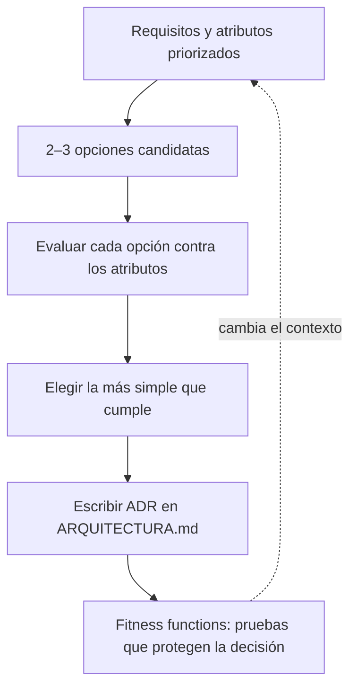

# Cómo elegir una arquitectura

Parte de: [[09-Arquitectura-Patrones/06 Documentar decisiones/_Índice Documentar decisiones|Documentar decisiones]]

> [!info] Cómo avanzar
> `progreso`: **pendiente** → **viendo** (estudiando) → **visto** (contestaste la autoevaluación sin abrir las respuestas) → **dominado** (hiciste el laboratorio o lo aplicaste de verdad).

## Contenido

### Qué es
**Elegir una arquitectura** es decidir la estructura de alto nivel de un sistema (monolito modular, capas, vertical slices, hexagonal, microservicios, orientada a eventos) a partir de las necesidades reales y no de la moda. No hay arquitectura "mejor": hay una que equilibra mejor los **atributos de calidad** que te importan con las **restricciones** que tienes. La elección se documenta en un ADR para que el porqué sobreviva.

### Cómo funciona
**Insumos para decidir:**
1. **Atributos de calidad prioritarios** ([[Atributos de calidad y trade-offs]]): ¿qué importa más, velocidad de entrega, escalabilidad, disponibilidad, seguridad, costo? Elige 2 o 3; no todos pueden ser prioridad.
2. **Equipo**: tamaño, experiencia, cuántos equipos trabajarán en paralelo. Microservicios con una sola persona es casi siempre un error (cada servicio es un despliegue, un pipeline, una base y una superficie de fallo más).
3. **Complejidad del dominio**: un CRUD de catálogos no necesita [[Domain-Driven Design - conceptos|DDD]] táctico; un motor de reglas fiscales sí se beneficia de modelar con cuidado.
4. **Restricciones**: presupuesto, plazos, plataforma (Azure, SQL Server existente), normativa, integraciones heredadas.
5. **Tasa de cambio esperada**: qué partes cambiarán seguido y cuáles casi nunca.

**Un proceso práctico:**



Una matriz sencilla ayuda a hacerlo explícito:

| Opción | Entrega rápida | Escala por módulo | Operación (1–2 devs) | Costo |
|---|---|---|---|---|
| Monolito modular + vertical slices | Alta | Media | Simple | Bajo |
| Microservicios | Media | Alta | Compleja | Alto |
| Capas clásicas | Alta | Baja | Simple | Bajo |

**"Empezar simple" no es "sin arquitectura".** Empezar con un [[Monolito modular]] es una decisión de arquitectura: un solo despliegue, pero con **fronteras claras** entre módulos (cada uno con sus slices, sus tablas o esquema, y comunicación por interfaces o eventos internos). Esas fronteras son las que después permiten extraer un módulo a un servicio si de verdad hace falta. Un "monolito sin arquitectura" no tiene fronteras y por eso no se puede evolucionar sin reescribir. Ver [[Arquitectura evolutiva]].

### Ejemplo
Decisión para Itzamna.Dionisio, registrada en su `ARQUITECTURA.md`:

```markdown
### ADR-001: Monolito modular con Vertical Slice Architecture
- Fecha: 2026-11-09 · Estado: Aceptado

#### Contexto
API para un SaaS con 4 módulos (Pedidos, Clientes, Facturación, Reportes).
1–2 desarrolladores. Azure App Service + Azure SQL. Prioridades: velocidad
de entrega, mantenibilidad y costo bajo. Carga estimada < 100 req/s.

#### Decisión
Un solo proyecto ASP.NET Core con controllers, organizado por módulo y por
feature (slice). Dapper con SQL en archivos y una interfaz por consulta.
Los módulos no se llaman por dentro: usan interfaces públicas o eventos internos.

#### Consecuencias
+ Un pipeline, un despliegue, depuración simple.
+ Cada feature se entiende leyendo una carpeta.
- Un módulo con carga alta escala junto con los demás.
- Hay que vigilar las fronteras (prueba de arquitectura con NetArchTest).

#### Alternativas
- Microservicios: operación inviable para el tamaño del equipo.
- Clean Architecture en capas: más ceremonia por feature sin beneficio claro aquí.
```

Una *fitness function* que protege la decisión, como prueba en el pipeline de Azure DevOps:

```csharp
[Fact]
public void Pedidos_no_depende_de_internos_de_Facturacion()
{
    var r = Types.InAssembly(typeof(Program).Assembly)
        .That().ResideInNamespace("Dionisio.Pedidos")
        .ShouldNot().HaveDependencyOn("Dionisio.Facturacion.Internos")
        .GetResult();
    Assert.True(r.IsSuccessful);
}
```

### Cuándo usarlo y cuándo no
- Haz este análisis al iniciar un proyecto y cuando cambie algo grande (equipo, escala, negocio).
- No lo repitas por cada feature: la arquitectura ya elegida guía esas decisiones.
- Si dudas entre dos opciones parecidas, elige la más fácil de revertir y documenta cuándo reconsiderarías.

### Errores comunes
- **Elegir por moda o por currículum** ("todos usan microservicios").
- **Ignorar al equipo**: una arquitectura que el equipo no puede operar fracasa aunque sea "correcta".
- **No escribir la decisión**, y que cada quien la interprete distinto.
- **Diseñar para una escala 1,000 veces mayor** que la estimada.
- **Confundir estilo con calidad**: una arquitectura hexagonal mal aplicada sigue siendo mala.

### Para profundizar
- [Azure Architecture Center: estilos de arquitectura](https://learn.microsoft.com/azure/architecture/guide/architecture-styles/)
- [Martin Fowler: MonolithFirst](https://martinfowler.com/bliki/MonolithFirst.html)
- [NetArchTest (GitHub)](https://github.com/BenMorris/NetArchTest)

## Autoevaluación

Contesta primero en voz alta o en papel; luego despliega la respuesta.

> [!question]- ¿Cuáles son los insumos para elegir una arquitectura?
> Atributos de calidad prioritarios, tamaño y experiencia del equipo, complejidad del dominio, restricciones (presupuesto, plazos, plataforma) y cuánto cambiará el sistema.

> [!question]- ¿Por qué "empezar simple" no es lo mismo que "sin arquitectura"?
> Empiezas con lo más simple que cumpla los atributos (p. ej. monolito modular), pero con fronteras claras que permitan evolucionar.

> [!question]- ¿Cómo dejas constancia de la elección?
> Con un ADR: contexto, opciones evaluadas, decisión y consecuencias aceptadas.

## Práctica

- [[Lab 5 - Escribir un ADR real en ARQUITECTURA.md]]

