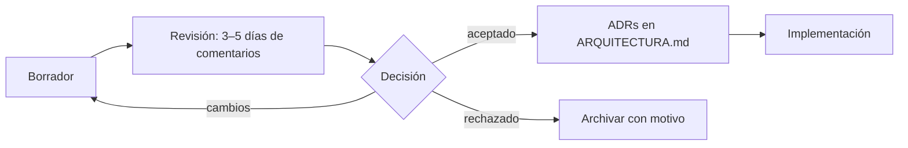

# Design docs y RFCs

Parte de: [[09-Arquitectura-Patrones/06 Documentar decisiones/_Índice Documentar decisiones|Documentar decisiones]]

> [!info] Cómo avanzar
> `progreso`: **pendiente** → **viendo** (estudiando) → **visto** (contestaste la autoevaluación sin abrir las respuestas) → **dominado** (hiciste el laboratorio o lo aplicaste de verdad).

## Contenido

### Qué es
Un **design doc** (documento de diseño) es un texto que se escribe **antes** de construir algo no trivial para pensar el problema por escrito y obtener retroalimentación cuando cambiar de opinión todavía es barato. Contiene el problema, los objetivos y **no objetivos**, la propuesta, las alternativas, los riesgos y un plan.

Un **RFC** (*Request for Comments*) es el proceso de circular una propuesta así entre otros equipos o personas para recibir comentarios antes de decidir. El nombre viene de los documentos de la IETF, pero en un equipo de software significa "esto es lo que propongo; díganme qué ven mal antes de que lo construya".

### Cómo funciona
**Diferencia con un ADR:**

| | Design doc / RFC | ADR |
|---|---|---|
| Momento | Antes de construir | Cuando se decide |
| Alcance | Una funcionalidad o cambio completo | Una sola decisión |
| Extensión | 2–10 páginas | Media página |
| Vida | Se archiva al terminar | Permanente en `ARQUITECTURA.md` |

Un design doc suele **producir varios ADRs**: el doc de "facturación electrónica" puede derivar en "ADR-009: timbrado asíncrono con Service Bus" y "ADR-010: PAC detrás de una interfaz Strategy".

**Estructura recomendada:**
1. **Contexto y problema**: qué duele hoy, con datos.
2. **Objetivos**: medibles cuando sea posible.
3. **No objetivos**: lo que explícitamente **no** se resolverá. Acotan el alcance, evitan que la revisión se desvíe a temas laterales y previenen expectativas falsas ("¿y esto también va a hacer X?").
4. **Propuesta**: diseño con diagramas ([[Diagramas C4]] de contexto y contenedores, [[Diagramas de secuencia]] del flujo principal), API, modelo de datos.
5. **Alternativas** y por qué no.
6. **Riesgos y preguntas abiertas**.
7. **Plan**: fases, migración, cómo se mide el éxito, cómo se revierte.

**Proceso RFC ligero:**



En Azure DevOps funciona bien abrir un PR con el documento en `docs/rfc/0003-facturacion.md`: los comentarios en línea quedan asociados al texto, y aprobar el PR es aceptar la propuesta.

### Ejemplo
Esqueleto de design doc para agregar notificaciones en Ocelotl.Hermes:

```markdown
### Notificaciones de estado de pedido

**Problema.** Los clientes llaman a soporte para saber dónde va su pedido
(≈ 30% de las llamadas, según tickets de octubre).

**Objetivos**
- Avisar por push y correo en cada cambio de estado, en < 1 min.
- Reducir llamadas de "¿dónde está mi pedido?" a la mitad en 3 meses.

**No objetivos**
- SMS (costo; se evaluará después).
- Chat con el repartidor.
- Preferencias por tipo de notificación (solo on/off global en esta fase).

**Propuesta.** Evento PedidoCambioEstado vía outbox → Service Bus →
worker de notificaciones → Notification Hubs / Communication Services.
(Diagrama de contenedores y de secuencia)

**Alternativas.** Llamar al proveedor desde el API (acopla y bloquea);
polling desde la app (batería y costo).

**Riesgos.** Tokens push vencidos; límites de envío del proveedor.

**Plan.** F1 correo; F2 push; métricas de entrega y de llamadas a soporte.
```

### Cuándo usarlo y cuándo no
- Escribe design doc cuando el trabajo dure más de una o dos semanas, toque varios componentes o equipos, o tenga riesgos que conviene que otros revisen.
- No lo escribas para cambios pequeños y bien entendidos: ahí basta la descripción del PR o un ADR.
- Usa RFC cuando la decisión afecta a otros (un contrato de eventos, un cambio en la autenticación de Xolotl.Hecate que consumen varios sistemas).
- Aunque trabajes solo, el design doc te obliga a pensar antes de programar y le sirve a tu "yo" de dentro de seis meses.

### Errores comunes
- **Escribirlo después de construir**: se vuelve documentación justificatoria, no herramienta de diseño.
- **Omitir los no objetivos**: la revisión se llena de "¿y si también…?".
- **Diez páginas de detalle** que nadie lee; lo importante cabe en tres.
- **No cerrar el ciclo**: el doc se aprueba pero las decisiones nunca llegan a ADRs ni al `ARQUITECTURA.md`.
- **Pedir comentarios sin fecha límite**: la revisión se eterniza.

### Para profundizar
- [Design Docs at Google (Malte Ubl)](https://www.industrialempathy.com/posts/design-docs-at-google/)
- [Proceso de RFCs de Rust (ejemplo público)](https://github.com/rust-lang/rfcs)
- [ADR GitHub organization](https://adr.github.io/)

## Autoevaluación

Contesta primero en voz alta o en papel; luego despliega la respuesta.

> [!question]- ¿Qué es un design doc y en qué se diferencia de un ADR?
> Un documento previo a construir algo no trivial: problema, objetivos y no objetivos, propuesta, alternativas, riesgos, plan. Un ADR registra una decisión puntual; un design doc puede producir varios ADRs.

> [!question]- ¿Qué son los "no objetivos" y por qué importan?
> Lo que explícitamente no se resolverá. Acotan el alcance y evitan discusiones y expectativas falsas.

> [!question]- ¿Qué es un RFC en un equipo?
> Una propuesta abierta a comentarios de otros equipos antes de decidir; busca detectar problemas temprano y alinear.

## Práctica

- [[Lab 5 - Escribir un ADR real en ARQUITECTURA.md]]

