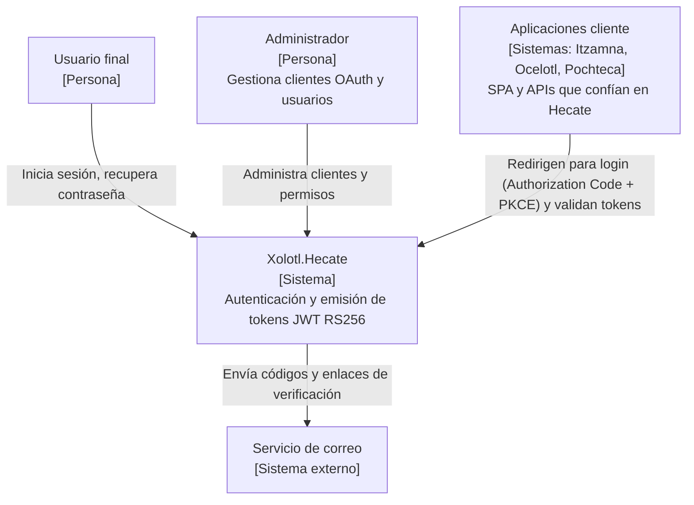

# C4 nivel 1 - Contexto

Parte de: [[Diagramas C4]]

> [!info] Cómo avanzar
> `progreso`: **pendiente** → **viendo** (estudiando) → **visto** (contestaste la autoevaluación sin abrir las respuestas) → **dominado** (hiciste el laboratorio o lo aplicaste de verdad).

## Contenido

### Qué es
El **diagrama de contexto** es el primer nivel de [[Diagramas C4]]: muestra **tu sistema como una sola caja** en el centro, las **personas** que lo usan y los **sistemas externos** con los que se comunica. No muestra tecnologías, servidores ni bases de datos; responde solo "¿qué es esto, quién lo usa y de quién depende?". Es el punto de partida de toda la documentación de arquitectura y el diagrama que más gente va a ver.

### Cómo funciona
**Qué incluye:**
- **Tu sistema**: una caja con nombre y una frase de lo que hace.
- **Personas o roles**: Cliente, Administrador de tienda, Contador. Roles, no individuos.
- **Sistemas externos**: los que no controla tu equipo, o que pertenecen a otro equipo: proveedor de identidad, pasarela de pagos, PAC de timbrado, servicio de correo, ERP del cliente.
- **Relaciones** con etiqueta que dice qué se hace: "Consulta sus facturas", "Envía CFDI para timbrar".

**Qué no incluye:** contenedores internos, protocolos detallados, clases, servidores, redes. Si alguien pregunta "¿y qué base usa?", la respuesta está en el [[C4 nivel 2 - Contenedores|nivel 2]].

**Para quién es:** para **cualquiera**, incluidas personas no técnicas: dueño del producto, negocio, soporte, auditoría, un desarrollador que llega nuevo, tú dentro de un año. Si un gerente no lo entiende en 30 segundos, tiene demasiado detalle.

**Cómo construirlo:**
1. Escribe el nombre del sistema y una frase de propósito.
2. Lista quién lo usa (roles) y para qué.
3. Lista con qué sistemas habla y en qué dirección.
4. Dibuja, etiqueta cada flecha con un verbo y revisa que no aparezca ninguna tecnología interna.

Hacer este ejercicio suele revelar dependencias que nadie tenía presentes ("ah, también mandamos un archivo nocturno al ERP"), que son justo las que rompen las migraciones.

### Ejemplo
Contexto de Xolotl.Hecate (servicio de identidad) para su `ARQUITECTURA.md`:

Observa que no aparece "ASP.NET Core", "SQL Server" ni "Key Vault": eso es del nivel 2. Las aplicaciones de tu ecosistema aparecen como sistemas externos porque, desde el punto de vista de Hecate, están fuera de su frontera.

En el `ARQUITECTURA.md` este diagrama va al inicio, después de un párrafo que explica el propósito del sistema; luego vienen el de contenedores y los ADRs.

### Cuándo usarlo y cuándo no
- **Siempre**: todo sistema con más de un usuario o una integración merece su diagrama de contexto. Es barato y casi no cambia.
- Úsalo en el arranque de un proyecto, en el design doc y en la inducción de alguien nuevo.
- Si el panorama incluye varios sistemas tuyos que interactúan, C4 propone un diagrama de **paisaje del sistema** (*system landscape*), que es un contexto con varias cajas propias.

### Errores comunes
- **Meter tecnología**: bases, colas y frameworks en el contexto.
- **Olvidar sistemas externos "pequeños"** (correo, SMS, un FTP) que luego bloquean una migración.
- **Flechas sin verbo** o con nombres de endpoint en lugar de intención.
- **Personas con nombre propio** en lugar de roles.
- **Diagramar el sistema como varias cajas**: en el nivel 1, tu sistema es una sola.

### Para profundizar
- [C4: diagrama de contexto del sistema](https://c4model.com/diagrams/system-context)
- [Sitio oficial del modelo C4](https://c4model.com/)
- [Mermaid: flowcharts](https://mermaid.js.org/syntax/flowchart.html)

## Autoevaluación

Contesta primero en voz alta o en papel; luego despliega la respuesta.

> [!question]- ¿Qué muestra el diagrama de contexto?
> Tu sistema como una sola caja, las personas que lo usan y los sistemas externos con los que se comunica. Sin detalles técnicos.

> [!question]- ¿Para quién es?
> Para cualquiera, incluidas personas no técnicas: explica qué hace el sistema y con quién habla.

## Práctica

- [[Lab 5 - Escribir un ADR real en ARQUITECTURA.md]]

