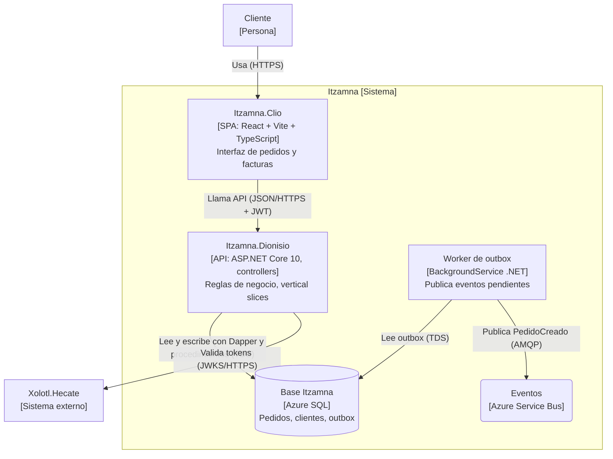

# C4 nivel 2 - Contenedores

Parte de: [[Diagramas C4]]

> [!info] Cómo avanzar
> `progreso`: **pendiente** → **viendo** (estudiando) → **visto** (contestaste la autoevaluación sin abrir las respuestas) → **dominado** (hiciste el laboratorio o lo aplicaste de verdad).

## Contenido

### Qué es
El **diagrama de contenedores** es el segundo nivel de [[Diagramas C4]]: hace zoom dentro de tu sistema y muestra sus **contenedores**, es decir, las unidades que se **ejecutan o almacenan datos y se despliegan por separado**: la SPA de React, el API de ASP.NET Core, un worker, una Azure Function, la base de Azure SQL, una cola de Service Bus, un contenedor de Blob Storage. "Contenedor" aquí no significa Docker: un API en App Service es un contenedor C4 aunque no use Docker, y una base de datos también lo es.

### Cómo funciona
**Qué muestra:**
- Cada contenedor con **nombre, tipo, tecnología** y **responsabilidad**: "API de pedidos – ASP.NET Core 10 – Expone REST, aplica reglas de negocio".
- Las **relaciones** entre contenedores y con el exterior, con intención **y protocolo**: "Lee y escribe – SQL/TDS", "Publica PedidoCreado – AMQP", "Llama – JSON/HTTPS".
- Las personas y sistemas externos del [[C4 nivel 1 - Contexto|nivel 1]], conectados al contenedor concreto con el que interactúan.

**Qué decisiones se ven en este nivel** (y por eso es el más valioso para arquitectura):
- **Tecnologías principales**: React + Vite, .NET, SQL Server o Postgres.
- **Cómo se comunican**: síncrono (HTTP) vs asíncrono (colas, eventos).
- **Dónde viven los datos** y quién es dueño de cada almacén (¿dos contenedores escriben en la misma base? eso es un acoplamiento que hay que justificar).
- **Fronteras de despliegue y escalado**: qué escala por separado.
- **Seguridad**: por dónde entra el tráfico, dónde se valida el token.

Casi todos los ADRs importantes cambian algo en este diagrama: agregar un outbox con un worker, separar reportes en otro contenedor, poner Redis como caché.

**Qué no muestra:** clases, componentes internos, número de instancias ni infraestructura de red (eso va en un diagrama de despliegue).

### Ejemplo
Contenedores de Itzamna (Dionisio + Clio) para el `ARQUITECTURA.md`:

Leyendo el diagrama ya se entienden varias decisiones: la SPA no toca la base, la autenticación está delegada a Hecate, y los eventos salen por outbox y no directamente desde el request. Cada una de esas decisiones debería tener su ADR enlazado debajo.

### Cuándo usarlo y cuándo no
- **Siempre** junto al de contexto: entre los dos explican la mayoría de los sistemas.
- Actualízalo en el mismo PR que agrega o quita un contenedor; si el diagrama vive en el `ARQUITECTURA.md` como Mermaid, el cambio se revisa junto con el código.
- Si tienes muchos contenedores, divide por subsistema en lugar de hacer un diagrama ilegible.

### Errores comunes
- **Omitir la tecnología** o el protocolo de las flechas: pierde casi todo su valor.
- **Dibujar cada instancia o réplica**: eso es despliegue, no contenedores.
- **Mostrar librerías como contenedores** (Dapper, FluentValidation): son código dentro del API.
- **Esconder que dos contenedores comparten base**: es justo lo que el diagrama debe hacer visible.
- **Diagrama desactualizado**: peor que no tenerlo, porque engaña.

### Para profundizar
- [C4: diagrama de contenedores](https://c4model.com/diagrams/container)
- [Mermaid: diagramas C4](https://mermaid.js.org/syntax/c4.html)
- [Azure Architecture Center: iconos y diagramas](https://learn.microsoft.com/azure/architecture/icons/)

## Autoevaluación

Contesta primero en voz alta o en papel; luego despliega la respuesta.

> [!question]- ¿Qué es un "contenedor" en C4?
> Una unidad ejecutable o de almacenamiento que se despliega por separado: SPA, API, worker, base de datos, cola. No es (necesariamente) un contenedor Docker.

> [!question]- ¿Qué decisiones se ven en este nivel?
> Tecnologías principales, cómo se comunican (HTTP, cola, SignalR) y dónde viven los datos.

## Práctica

- [[Lab 5 - Escribir un ADR real en ARQUITECTURA.md]]

