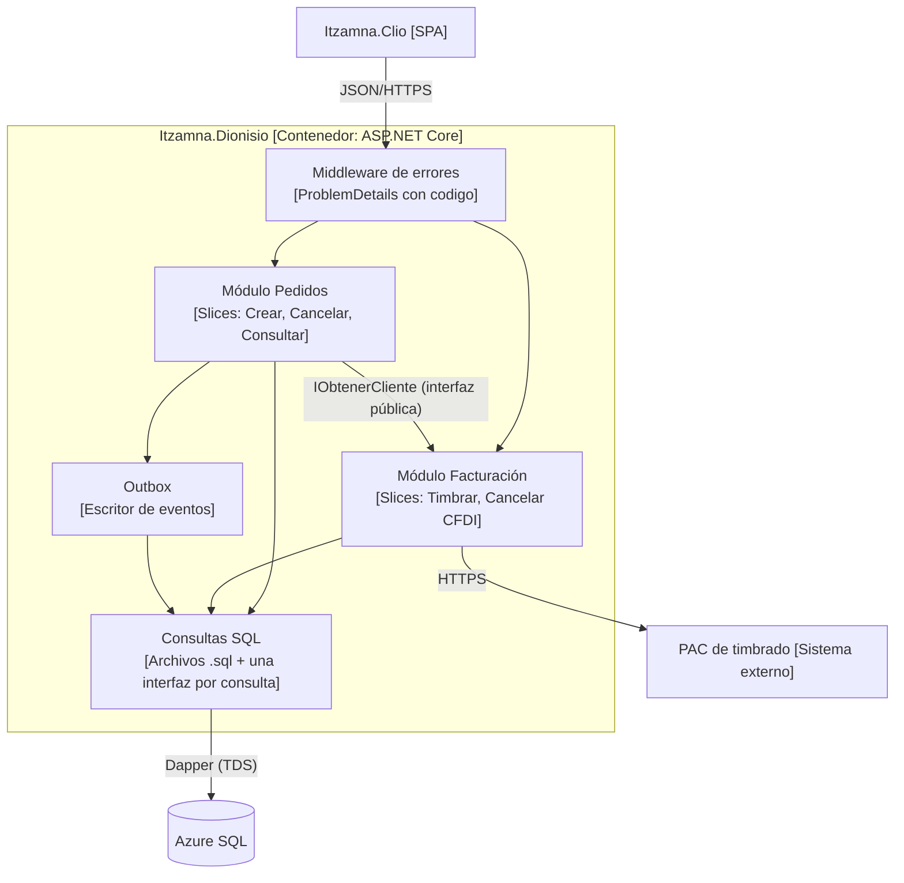

# C4 nivel 3 - Componentes

Parte de: [[Diagramas C4]]

> [!info] Cómo avanzar
> `progreso`: **pendiente** → **viendo** (estudiando) → **visto** (contestaste la autoevaluación sin abrir las respuestas) → **dominado** (hiciste el laboratorio o lo aplicaste de verdad).

## Contenido

### Qué es
El **diagrama de componentes** es el tercer nivel de [[Diagramas C4]]: hace zoom dentro de **un contenedor** (por ejemplo, el API) y muestra sus **componentes principales**, es decir, agrupaciones de código con una responsabilidad clara y una interfaz bien definida, y cómo se relacionan entre sí y con otros contenedores. Un componente no es una clase: es un conjunto de clases detrás de una interfaz (un módulo, un slice, un adaptador).

### Cómo funciona
**Qué muestra:**
- Los componentes de un solo contenedor, con nombre, tecnología o tipo (controller, handler, query, adaptador) y responsabilidad.
- Sus dependencias entre sí.
- Las relaciones con otros contenedores (base, cola) y sistemas externos.

**Qué es un componente según tu arquitectura:**
- En [[Vertical Slice Architecture]], un componente natural es un **módulo** (Pedidos, Facturación) o un **slice** importante (CrearPedido: controller + validador + handler + consulta SQL).
- En [[Arquitectura hexagonal]], los componentes son el núcleo, los **puertos** y los **adaptadores** (adaptador de Service Bus, adaptador de la pasarela de pagos).
- En capas, las capas y sus servicios principales.

**Cuándo vale la pena dibujarlo:**
- El contenedor es **complejo** y alguien nuevo necesita orientarse.
- Quieres explicar o hacer cumplir **fronteras** (qué módulo puede depender de cuál).
- Estás planeando **extraer** un módulo a un servicio aparte y necesitas ver sus dependencias reales.
- En una revisión de diseño de una funcionalidad que cruza varios componentes.

Si el contenedor es pequeño o la estructura se entiende con el árbol de carpetas, **no lo dibujes**: cambia con frecuencia y mantenerlo a mano cuesta. Una alternativa es generarlo o, mejor, proteger las fronteras con pruebas de arquitectura que fallan en el pipeline.

### Ejemplo
Componentes del API Itzamna.Dionisio (monolito modular con vertical slices):

El diagrama deja claro que Pedidos solo conoce una interfaz pública de Facturación, no sus internos. Esa regla se puede volver ejecutable con una prueba de NetArchTest en el pipeline de Azure DevOps, que es más confiable que el propio diagrama para mantenerla.

En el `ARQUITECTURA.md`, si incluyes este nivel, ponlo en una sección por contenedor ("API – componentes") y enlázalo desde el ADR que define las fronteras entre módulos.

### Cuándo usarlo y cuándo no
- Úsalo para contenedores grandes o críticos, para incorporar a alguien al equipo y para planear refactors o extracciones.
- No lo uses para cada contenedor por costumbre ni para contenedores triviales (un worker con una sola clase).
- Prefiere que el diagrama refleje **intención** (las fronteras deseadas) y que las pruebas de arquitectura verifiquen que el código las respeta.

### Errores comunes
- **Dibujar clases** en lugar de componentes: el diagrama se vuelve el nivel 4 y se desactualiza en una semana.
- **Mostrar varios contenedores** por dentro en el mismo diagrama.
- **Componentes sin responsabilidad clara** ("Utils", "Helpers", "Common").
- **No reflejar dependencias reales**: el diagrama dice una cosa y el código otra.
- **Mantenerlo a mano** cuando cambia cada sprint.

### Para profundizar
- [C4: diagrama de componentes](https://c4model.com/diagrams/component)
- [NetArchTest (GitHub)](https://github.com/BenMorris/NetArchTest)
- [Mermaid: flowcharts y subgrafos](https://mermaid.js.org/syntax/flowchart.html)

## Autoevaluación

Contesta primero en voz alta o en papel; luego despliega la respuesta.

> [!question]- ¿Qué muestra?
> Los componentes principales dentro de un contenedor (módulos, slices, adaptadores) y sus responsabilidades e interacciones.

> [!question]- ¿Cuándo vale la pena dibujarlo?
> Para un contenedor complejo o al incorporar gente nueva; si cambia muy seguido, mejor generarlo o no mantenerlo.

