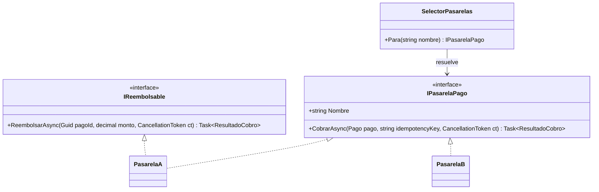

# C4 nivel 4 - Código

Parte de: [[Diagramas C4]]

> [!info] Cómo avanzar
> `progreso`: **pendiente** → **viendo** (estudiando) → **visto** (contestaste la autoevaluación sin abrir las respuestas) → **dominado** (hiciste el laboratorio o lo aplicaste de verdad).

## Contenido

### Qué es
El **nivel de código** es el cuarto y último zoom de [[Diagramas C4]]: muestra cómo está implementado **un componente** con elementos de código, típicamente un diagrama de clases UML o un diagrama entidad-relación: clases, interfaces, sus propiedades y relaciones (herencia, implementación, composición). Es el nivel con más detalle y, por lo mismo, el más efímero.

### Cómo funciona
**Por qué casi no se dibuja a mano:**
- **Cambia constantemente**: cada refactor, cada clase nueva o cada renombre lo vuelve obsoleto. Un diagrama de clases desactualizado engaña más de lo que ayuda.
- **El código ya es la fuente de verdad**: cualquiera puede navegarlo en el IDE con "Ir a definición" y "Buscar referencias".
- **Las herramientas lo generan**: Visual Studio (Class Designer y Code Maps en ediciones que lo incluyen), Rider (diagramas de tipos) o extensiones de VS Code pueden producir el diagrama bajo demanda desde el código actual (verifica qué ofrece tu edición y versión).

Por eso el propio modelo C4 lo considera **opcional** y recomienda dibujarlo solo para piezas importantes o complejas, idealmente generado.

**Cuándo sí aporta:**
- Explicar un **patrón** aplicado en una parte clave: el [[Patrón Strategy]] de pasarelas de pago, un pipeline de decoradores, la jerarquía de errores de un Result.
- Documentar un **modelo de dominio** (agregados, value objects) en un design doc.
- Material didáctico o de inducción, sabiendo que es una foto del momento.

**Qué usar en su lugar para explicar un flujo:** un [[Diagramas de secuencia|diagrama de secuencia]]. Casi siempre la pregunta real no es "¿qué clases existen?" sino "¿qué pasa cuando llega esta petición?", y eso se responde mejor mostrando el orden de los mensajes entre controller, validador, handler, consulta y base. También ayuda un buen README del slice o pruebas con nombres que describen el comportamiento.

### Ejemplo
Diagrama de clases en Mermaid para explicar el Strategy de pasarelas en el design doc de pagos:



Y el código que ese diagrama describe; el diagrama solo vale la pena porque explica una decisión (capacidades opcionales en interfaces separadas), no porque liste clases:

```csharp
public interface IPasarelaPago
{
    string Nombre { get; }
    Task<ResultadoCobro> CobrarAsync(Pago pago, string idempotencyKey, CancellationToken ct);
}

public interface IReembolsable
{
    Task<ResultadoCobro> ReembolsarAsync(Guid pagoId, decimal monto, CancellationToken ct);
}

public sealed class SelectorPasarelas(IEnumerable<IPasarelaPago> pasarelas)
{
    private readonly Dictionary<string, IPasarelaPago> _porNombre = pasarelas.ToDictionary(p => p.Nombre);
    public IPasarelaPago Para(string nombre) =>
        _porNombre.TryGetValue(nombre, out var p) ? p : throw new InvalidOperationException($"Pasarela {nombre} no registrada");
}
```

En el `ARQUITECTURA.md` normalmente **no** va este nivel; si acaso, un enlace al design doc o al ADR que justifica el patrón.

### Cuándo usarlo y cuándo no
- **Úsalo** de forma puntual para explicar un patrón o modelo central, generado o hecho para un documento con fecha.
- **No lo uses** como documentación permanente de todo el código ni para cada componente.
- Para flujos, prefiere diagramas de secuencia; para estructura, los niveles 1 y 2.

### Errores comunes
- **Mantener a mano diagramas de clases de todo el sistema**.
- **Diagramas con cada propiedad y método**: ruido que esconde la idea.
- **Usar el diagrama de clases para explicar un flujo** temporal.
- **No indicar la fecha o versión** de un diagrama que es una foto del momento.

### Para profundizar
- [C4: diagrama de código](https://c4model.com/diagrams/code)
- [Mermaid: diagramas de clases](https://mermaid.js.org/syntax/classDiagram.html)
- [Sitio oficial del modelo C4](https://c4model.com/)

## Autoevaluación

Contesta primero en voz alta o en papel; luego despliega la respuesta.

> [!question]- ¿Qué muestra y por qué casi no se dibuja a mano?
> Clases e interfaces (UML) de un componente. Cambia con cada commit; se genera desde el código si se necesita.

> [!question]- ¿Qué usarías en su lugar para explicar un flujo?
> Un [[Diagramas de secuencia|diagrama de secuencia]] del caso concreto.

