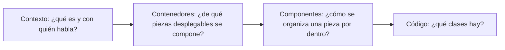
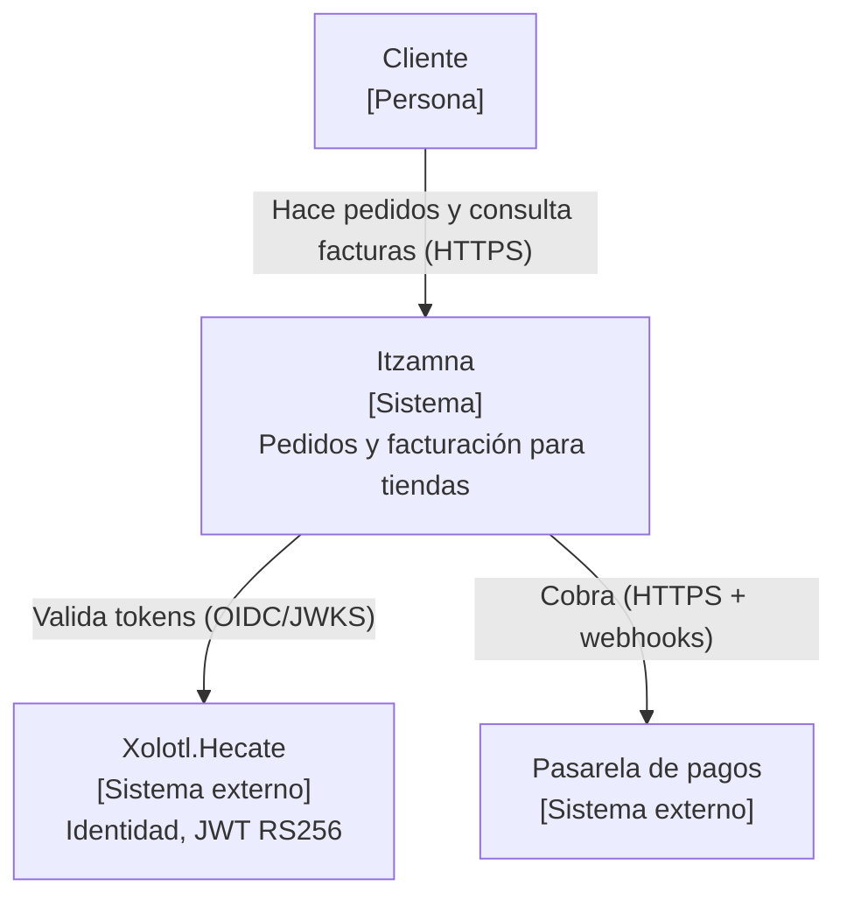

# Diagramas C4

Parte de: [[09-Arquitectura-Patrones/06 Documentar decisiones/_Índice Documentar decisiones|Documentar decisiones]]

> [!info] Cómo avanzar
> `progreso`: **pendiente** → **viendo** (estudiando) → **visto** (contestaste la autoevaluación sin abrir las respuestas) → **dominado** (hiciste el laboratorio o lo aplicaste de verdad).

## Contenido

### Qué es
El **modelo C4**, creado por Simon Brown, es una forma de diagramar la arquitectura de software en **cuatro niveles de zoom**, como un mapa que va de país a calle: Contexto, Contenedores, Componentes y Código. Su objetivo es que los diagramas sean consistentes y entendibles sin una leyenda de 40 símbolos: cajas con nombre, tipo, tecnología y una descripción, unidas por flechas con etiqueta. Es independiente de la notación; lo importante son las abstracciones.

### Cómo funciona
**Las abstracciones:**
- **Persona**: un usuario humano (cliente, administrador).
- **Sistema de software**: lo que entrega valor; el tuyo o uno externo (pasarela de pagos, SAT, proveedor de identidad).
- **Contenedor**: algo que se ejecuta o almacena datos y se despliega por separado (SPA, API, worker, base, cola). No es un contenedor Docker.
- **Componente**: una agrupación de código dentro de un contenedor con una responsabilidad clara.

**Los cuatro niveles:**

| Nivel | Muestra | Público | Nota |
|---|---|---|---|
| 1. Contexto | Tu sistema como una caja, personas y sistemas externos | Todos | [[C4 nivel 1 - Contexto]] |
| 2. Contenedores | Apps y almacenes dentro del sistema, con tecnología | Equipo técnico, operación | [[C4 nivel 2 - Contenedores]] |
| 3. Componentes | Piezas dentro de un contenedor | Desarrolladores | [[C4 nivel 3 - Componentes]] |
| 4. Código | Clases e interfaces | Desarrolladores | [[C4 nivel 4 - Código]] |



**En la práctica se usan sobre todo los niveles 1 y 2.** Son estables (cambian poco), útiles para muchas audiencias y suficientes para explicar la mayoría de las decisiones. El nivel 3 se dibuja solo para contenedores complejos, y el 4 casi nunca a mano (el IDE lo genera).

**Todo diagrama C4 debe tener:**
- Un **título** que diga tipo y alcance ("Contenedores – Itzamna.Dionisio").
- En cada caja: **nombre, tipo, tecnología** (desde nivel 2) y una **descripción** corta de su responsabilidad.
- **Flechas unidireccionales con etiqueta**: qué hace la relación y, desde nivel 2, el protocolo ("Lee y escribe pedidos – TDS/SQL", "Publica PedidoCreado – AMQP").
- Una **leyenda** si usas colores o formas con significado.

C4 muestra **estructura**. Para mostrar **comportamiento** (en qué orden pasa un flujo) se complementa con [[Diagramas de secuencia]], y C4 también define diagramas complementarios de despliegue y dinámicos.

### Ejemplo
En el `ARQUITECTURA.md` de cada repo conviene tener, como mínimo, el diagrama de contexto y el de contenedores en Mermaid, para que se rendericen en Obsidian y en Azure DevOps sin herramientas extra. Mermaid tiene una sintaxis C4 propia (`C4Context`, `C4Container`) marcada como experimental; un `flowchart` con etiquetas es más portable:



Para modelos grandes, **Structurizr** permite definir el modelo una vez en un DSL de texto y generar todas las vistas consistentes entre sí.

### Cuándo usarlo y cuándo no
- Siempre que expliques un sistema a alguien nuevo, en un design doc o en el `ARQUITECTURA.md`.
- Antes de una decisión importante: el diagrama de contenedores hace visibles dependencias y riesgos.
- No dibujes los cuatro niveles "por completitud": cada diagrama extra hay que mantenerlo.

### Errores comunes
- **Mezclar niveles** en un solo diagrama (personas, clases y tablas juntas).
- **Flechas sin etiqueta** o bidireccionales: no se sabe quién llama a quién ni para qué.
- **Cajas sin tecnología** en el nivel 2.
- **Diagramas en una herramienta externa** que nadie actualiza; mejor como texto en el repo.
- **Confundir "contenedor" con Docker**.

### Para profundizar
- [Sitio oficial del modelo C4](https://c4model.com/)
- [Mermaid: diagramas C4](https://mermaid.js.org/syntax/c4.html)
- [Structurizr](https://structurizr.com/)

## Subtemas

- [[C4 nivel 1 - Contexto]]
- [[C4 nivel 2 - Contenedores]]
- [[C4 nivel 3 - Componentes]]
- [[C4 nivel 4 - Código]]

## Autoevaluación

Contesta primero en voz alta o en papel; luego despliega la respuesta.

> [!question]- ¿Qué es el modelo C4?
> Una forma de diagramar arquitectura en cuatro niveles de zoom: contexto, contenedores, componentes y código. Ver los subtemas.

> [!question]- ¿Qué niveles se usan más en la práctica?
> Contexto y contenedores; componentes solo para partes complejas y el de código casi nunca (lo genera el IDE).

> [!question]- ¿Qué debe tener todo diagrama C4?
> Título, leyenda, tipo de cada elemento y tecnología, y flechas con etiqueta que digan qué fluye ("envía pedido JSON/HTTPS").

## Práctica

- [[Lab 5 - Escribir un ADR real en ARQUITECTURA.md]]

## Progreso de los subtemas

```base
filters:
  and:
    - file.inFolder("09-Arquitectura-Patrones/06 Documentar decisiones/Diagramas C4")
    - file.name != "Diagramas C4"
views:
  - type: table
    name: Progreso
    order:
      - file.name
      - progreso
      - nivel
```
