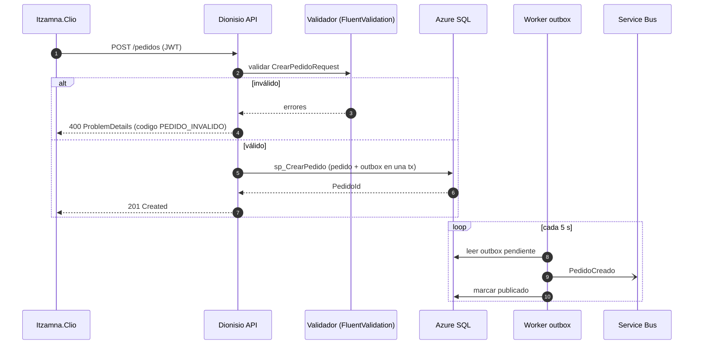

# Diagramas de secuencia

Parte de: [[09-Arquitectura-Patrones/06 Documentar decisiones/_Índice Documentar decisiones|Documentar decisiones]]

> [!info] Cómo avanzar
> `progreso`: **pendiente** → **viendo** (estudiando) → **visto** (contestaste la autoevaluación sin abrir las respuestas) → **dominado** (hiciste el laboratorio o lo aplicaste de verdad).

## Contenido

### Qué es
Un **diagrama de secuencia** muestra cómo interactúan varios participantes (cliente, API, base, cola, servicio externo) **a lo largo del tiempo** en un escenario concreto: quién llama a quién, en qué orden, qué responde cada uno y qué pasa en los caminos alternativos. Los participantes se dibujan arriba con una línea de vida vertical, y los mensajes como flechas horizontales que bajan conforme avanza el tiempo.

Mientras [[Diagramas C4]] muestra **estructura** (qué existe y cómo se conecta), el diagrama de secuencia muestra **comportamiento** (qué pasa, y en qué orden, cuando ocurre algo).

### Cómo funciona
En Mermaid (que se renderiza en Obsidian, GitHub y Azure DevOps) la sintaxis básica es:

| Elemento | Sintaxis |
|---|---|
| Participante con alias | `participant API as API Pedidos` |
| Llamada síncrona | `A->>B: mensaje` |
| Respuesta | `B-->>A: respuesta` |
| Mensaje asíncrono (sin esperar) | `A-)B: evento` |
| Mensaje fallido / perdido | `A-xB: mensaje` |
| Alternativa | `alt condición` … `else otra` … `end` |
| Opcional | `opt condición` … `end` |
| Repetición | `loop cada 5 s` … `end` |
| En paralelo | `par` … `and` … `end` |
| Nota | `Note over A,B: texto` |
| Activación | `activate API` / `deactivate API` (o `->>+` y `-->>-`) |
| Numeración | `autonumber` |

**Buenas prácticas:**
- **Un escenario por diagrama**: "crear pedido con pago aprobado", no "todo el módulo de pedidos".
- Los participantes deben coincidir con los contenedores o componentes de tus diagramas C4, con los mismos nombres.
- Etiqueta los mensajes con la operación real (`POST /pedidos`, `PedidoCreado`, `sp_CrearPedido`).
- Muestra los caminos de error importantes con `alt`; ahí suelen estar las decisiones de diseño.

### Ejemplo
Crear un pedido en Itzamna.Dionisio con validación, transacción con outbox y publicación asíncrona:



Del diagrama se leen decisiones que en el código están dispersas: la validación ocurre antes de tocar la base, el cliente no espera la publicación del evento y la publicación es periódica (por lo tanto, eventual y potencialmente duplicada, lo que obliga a [[Consumidores idempotentes]]).

El mismo formato sirve para flujos de seguridad, como el login con Authorization Code + PKCE contra Xolotl.Hecate a través de un BFF, que es uno de los ejercicios de esta nota.

En el `ARQUITECTURA.md`, pon un diagrama de secuencia por cada flujo crítico (autenticación, pago, el flujo que justifica un ADR) en la sección de ese flujo o justo debajo del ADR que lo motivó.

### Cuándo usarlo y cuándo no
- **Úsalo** para flujos con varios participantes, asincronía, reintentos o caminos de error: autenticación, pagos, webhooks, sagas, integración con terceros.
- **Úsalo** en design docs y en revisiones de incidentes ("esto es lo que pasó, en orden").
- **No lo uses** para mostrar qué componentes existen (eso es C4) ni para un CRUD trivial de una llamada.
- Si el diagrama tiene más de unos 15 mensajes, divídelo en escenarios.

### Errores comunes
- **Meter todos los casos en un solo diagrama** con `alt` anidados ilegibles.
- **Confundir síncrono y asíncrono**: dibujar una publicación a la cola como si el API esperara respuesta.
- **Participantes con nombres distintos** a los de los diagramas C4 y del código.
- **Omitir los errores**, que es donde está el diseño interesante.
- **Diagramar a nivel de cada método privado**: se vuelve código dibujado.

### Para profundizar
- [Mermaid: diagramas de secuencia](https://mermaid.js.org/syntax/sequenceDiagram.html)
- [Mermaid Live Editor](https://mermaid.live/)
- [C4: diagramas dinámicos](https://c4model.com/diagrams/dynamic)

## Ejercicios

Resuélvelos en papel o en la herramienta; la solución está plegada.

> [!question]- Dibuja en Mermaid la secuencia de un login con OAuth: navegador → API (BFF) → proveedor de identidad → callback → cookie.
> ```mermaid
> sequenceDiagram
>   participant N as Navegador
>   participant B as BFF
>   participant IdP as Proveedor de identidad
>   N->>B: GET /login
>   B-->>N: 302 a IdP (authorize + PKCE)
>   N->>IdP: usuario se autentica
>   IdP-->>N: 302 a /callback?code=...
>   N->>B: GET /callback?code=...
>   B->>IdP: POST /token (code + verifier)
>   IdP-->>B: tokens
>   B-->>N: Set-Cookie HttpOnly y 302 a /
> ```

## Autoevaluación

Contesta primero en voz alta o en papel; luego despliega la respuesta.

> [!question]- ¿Qué muestra un diagrama de secuencia?
> Los mensajes entre participantes en orden temporal para un escenario concreto (líneas de vida verticales, flechas horizontales).

> [!question]- ¿Cómo representas en Mermaid una alternativa y una llamada asíncrona?
> `alt condición ... else ... end` para alternativas; `-)` para mensaje asíncrono y `-->>` para respuesta.
> ```mermaid
> sequenceDiagram
>   API->>DB: guardar
>   alt ok
>     API-)Cola: PedidoCreado
>   else error
>     API-->>Cliente: 500
>   end
> ```

> [!question]- ¿Cuándo usar secuencia y cuándo C4?
> C4 muestra estructura (qué existe y cómo se conecta); secuencia muestra comportamiento de un flujo (en qué orden pasan las cosas).

## Práctica

- [[Lab 5 - Escribir un ADR real en ARQUITECTURA.md]]

