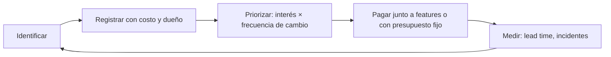

# Gestión de deuda técnica

Parte de: [[09-Arquitectura-Patrones/06 Documentar decisiones/_Índice Documentar decisiones|Documentar decisiones]]

> [!info] Cómo avanzar
> `progreso`: **pendiente** → **viendo** (estudiando) → **visto** (contestaste la autoevaluación sin abrir las respuestas) → **dominado** (hiciste el laboratorio o lo aplicaste de verdad).

## Contenido

### Qué es
La **deuda técnica** es el costo futuro de decisiones de diseño o código que hoy hacen más lento o riesgoso cambiar el sistema. El término lo acuñó Ward Cunningham con una metáfora financiera: tomar un atajo es pedir prestado; los **intereses** son el tiempo extra que cuesta cada cambio en esa zona, y el **capital** se paga con un refactor. Como la deuda real, no siempre es mala: a veces conviene endeudarse para llegar a tiempo, siempre que se sepa y se pague.

### Cómo funciona
**El cuadrante de deuda** (Martin Fowler) clasifica según dos ejes, **deliberada vs inadvertida** y **prudente vs imprudente**:

| | Imprudente | Prudente |
|---|---|---|
| **Deliberada** | "No hay tiempo para diseño" | "Salimos ya y lo arreglamos después; sabemos el costo" |
| **Inadvertida** | "¿Qué es separar responsabilidades?" | "Ahora sabemos cómo debió hacerse" |

- **Deliberada y prudente**: una decisión consciente, registrada, con plan de pago. Es la sana.
- **Deliberada e imprudente**: atajos sabiendo que son malos y sin intención de pagar.
- **Inadvertida e imprudente**: falta de conocimiento; se corrige con aprendizaje y revisión de código.
- **Inadvertida y prudente**: inevitable; al construir aprendes el dominio y descubres que el diseño ya no encaja. Es señal de que el equipo creció.

**Gestionarla, no solo lamentarla:**
1. **Registrar** solo lo que tiene costo real: dónde está, qué cuesta (horas extra por cambio, incidentes) y qué costaría pagarla. Un elemento de trabajo en Azure Boards con etiqueta `deuda-tecnica` y un dueño.
2. **Priorizar** por interés × frecuencia de cambio: la deuda en código que nadie toca casi no cobra intereses; la del módulo que cambias cada semana, sí.
3. **Pagar de forma continua**: la regla del boy scout (dejar el código un poco mejor), y pagar la deuda de una zona cuando una funcionalidad la toca.
4. **Hacerla visible** en decisiones: cuando un ADR acepta un atajo, sus "consecuencias negativas" son deuda deliberada; enlaza el elemento de trabajo.



**Cómo convencer a negocio:** no hables de "código feo"; habla de **impacto medible**: "cada cambio en facturación tarda 3 días en vez de 1", "tuvimos 4 incidentes este trimestre en ese módulo", "soporte gasta 10 horas al mes en correcciones manuales". Propón pagarla **junto** a funcionalidades que tocan esa zona ("para agregar el nuevo método de pago, primero separo la lógica de pasarelas; suma 2 días y los siguientes cambios bajan de 3 días a 1"), o reservar un porcentaje fijo de cada sprint.

### Ejemplo
Registro de deuda deliberada en un ADR de Itzamna.Dionisio, con su elemento de trabajo:

```markdown
### ADR-011: Generar reportes de forma síncrona en la primera versión
- Fecha: 2026-11-09 · Estado: Aceptado

#### Contexto
El cliente necesita el reporte de ventas este mes. Los reportes actuales
tienen < 20 k filas y tardan < 5 s.

#### Decisión
Generar el Excel dentro del request en esta versión.

#### Consecuencias
- Deuda deliberada (AB#482): con > 100 k filas el request excede el timeout
  y consume memoria del API. Pagarla antes de abrir reportes anuales:
  mover la generación a un worker con cola (ver Wee.Reporteria).
```

Una métrica simple para detectar dónde cobra intereses: los archivos que más cambian y más fallan.

```bash
# Archivos con más commits en los últimos 6 meses (candidatos a revisar deuda)
git log --since="6 months ago" --name-only --pretty=format: | sort | uniq -c | sort -rn | head -20
```

Cruza esa lista con los bugs por módulo en Azure Boards: alta frecuencia de cambio + muchos bugs = la deuda más cara.

### Cuándo usarlo y cuándo no
- Endéudate deliberadamente cuando la fecha importa más que la elegancia, **y** lo registras con plan de pago.
- Paga primero la deuda en zonas de cambio frecuente o de riesgo (seguridad, dinero).
- No pagues deuda en código estable que nadie toca solo por estética.
- Si la deuda es estructural y enorme, el camino es [[Modernizar código legado]] de forma incremental, no un refactor eterno.

### Errores comunes
- **Llamar "deuda" a todo lo que no te gusta**: pierde credibilidad ante negocio.
- **Un backlog de deuda que nadie prioriza** y crece para siempre.
- **Pedir "un sprint de refactor"** sin valor visible; casi nunca se aprueba.
- **No registrar la deuda deliberada**: en seis meses parece imprudente.
- **Medir con métricas de vanidad** (número de warnings) en lugar de impacto en entrega.

### Para profundizar
- [Martin Fowler: Technical Debt](https://martinfowler.com/bliki/TechnicalDebt.html)
- [Martin Fowler: Technical Debt Quadrant](https://martinfowler.com/bliki/TechnicalDebtQuadrant.html)
- [Azure DevOps: etiquetas en elementos de trabajo](https://learn.microsoft.com/azure/devops/boards/queries/add-tags-to-work-items)

## Autoevaluación

Contesta primero en voz alta o en papel; luego despliega la respuesta.

> [!question]- ¿Qué es la deuda técnica?
> El costo futuro de atajos o diseños que ya no encajan: cada cambio cuesta más ("intereses") hasta que se paga (refactor).

> [!question]- Explica el cuadrante de deuda (deliberada/inadvertida, prudente/imprudente).
> Deliberada y prudente: "salimos ya y refactorizamos después" (consciente, registrada). Imprudente: "no hay tiempo para diseño". Inadvertida y prudente: "ahora sabemos cómo debió ser".

> [!question]- ¿Cómo convences a negocio de pagar deuda?
> Con impacto medible: tiempo de entrega de cambios en esa zona, incidentes, horas de soporte. Propón pagarla junto a funcionalidades que tocan esa zona, no como proyecto aparte sin valor visible.

> [!question]- Error común.
> Llamar "deuda" a todo lo que no te gusta, o acumular un backlog de deuda que nadie prioriza. Registra solo lo que tiene costo real y ponle dueño.

