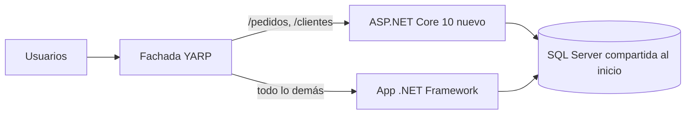

# Modernizar código legado

Parte de: [[09-Arquitectura-Patrones/06 Documentar decisiones/_Índice Documentar decisiones|Documentar decisiones]]

> [!info] Cómo avanzar
> `progreso`: **pendiente** → **viendo** (estudiando) → **visto** (contestaste la autoevaluación sin abrir las respuestas) → **dominado** (hiciste el laboratorio o lo aplicaste de verdad).

## Contenido

### Qué es
**Modernizar código legado** es llevar un sistema existente (por ejemplo, ASP.NET Web Forms o MVC 5 sobre .NET Framework, procedimientos gigantes, un monolito sin pruebas) a una base tecnológica y de diseño actual **sin detener el negocio**. Michael Feathers define el código legado de forma práctica: código sin pruebas. Sin pruebas, cualquier cambio es una apuesta; por eso la modernización empieza por poder cambiar con seguridad, no por reescribir.

### Cómo funciona
**1. Antes de cambiar: pruebas de caracterización.** Capturan lo que el sistema **hace hoy**, aunque sea "raro" o incorrecto. No verifican lo que debería hacer, sino que nada cambie sin que te enteres. Se escriben llamando al código con entradas reales y fijando la salida observada (aprobación de snapshots, comparación de resultados de procedimientos).

**2. Crear costuras (*seams*).** Puntos donde puedes sustituir comportamiento sin editar el código alrededor: extraer un método, introducir una interfaz, inyectar una dependencia en vez de crearla con `new`. Permiten probar y reemplazar por partes.

**3. Cambiar poco a poco con técnicas incrementales:**
- **[[Strangler fig]]**: una fachada (proxy) delante del sistema viejo; cada ruta o módulo se reimplementa en el nuevo y la fachada lo redirige. Lo viejo se "estrangula" hasta apagarse. En .NET, **YARP** sirve como fachada, y los *System.Web adapters* de Microsoft permiten compartir sesión y autenticación entre la app de .NET Framework y la de ASP.NET Core durante la migración.
- **Branch by abstraction**: una interfaz delante del código viejo; se implementa la versión nueva detrás de la misma interfaz y se cambia el uso gradualmente.
- **Feature flags**: activar lo nuevo por porcentaje, tenant o usuario, con vuelta atrás inmediata.
- **Ejecución en paralelo** (*shadowing*): correr viejo y nuevo con la misma entrada y comparar resultados antes de confiar en lo nuevo.
- **[[Anti-corruption layer]]**: traducir el modelo viejo para que no contamine el nuevo.



**4. Medir y apagar.** Métricas de errores y latencia por ruta, comparación con el viejo, y finalmente borrar el código legado (si no lo apagas, ahora mantienes dos sistemas).

### Ejemplo
Prueba de caracterización con xUnit sobre un cálculo legado antes de moverlo a un slice nuevo:

```csharp
public class CalculoDescuentoLegadoTests
{
    // Valores capturados ejecutando el sistema actual con datos reales anonimizados
    [Theory]
    [InlineData(999.99, "MAYOREO", 0, 949.99)]
    [InlineData(1000.00, "MAYOREO", 0, 900.00)]
    [InlineData(1000.00, "MENUDEO", 3, 970.00)] // comportamiento "raro" conservado a propósito
    public void Conserva_el_comportamiento_actual(decimal total, string tipo, int antiguedad, decimal esperado)
    {
        var resultado = CalculadoraLegada.AplicarDescuento(total, tipo, antiguedad);
        Assert.Equal(esperado, resultado);
    }
}
```

Fachada con YARP en el proyecto nuevo, enviando a .NET Framework lo que aún no se migra:

```csharp
builder.Services.AddReverseProxy().LoadFromConfig(builder.Configuration.GetSection("ReverseProxy"));
var app = builder.Build();
app.MapControllers();      // rutas ya migradas
app.MapReverseProxy();     // el resto va a la app legada (ruta comodín en configuración)
app.Run();
```

**Herramientas de Microsoft para la conversión:** el .NET Upgrade Assistant está **oficialmente obsoleto**; Microsoft recomienda ahora el agente de modernización de GitHub Copilot, incluido en Visual Studio 2026 y en Visual Studio 2022 17.14.16 o posterior, que analiza dependencias, propone un plan y aplica cambios en commits revisables. Revisa sus condiciones de licencia antes de depender de él (Pendiente de confirmar si requiere plan de pago de Copilot).

### Cuándo usarlo y cuándo no
**Caso típico:** te piden "reescribir todo en .NET moderno". Propón, en un design doc y luego ADRs:
1. Inventario de módulos con valor de negocio, riesgo y frecuencia de cambio.
2. Pruebas de caracterización en lo que vas a tocar primero.
3. Fachada (YARP) y migrar primero un módulo de **alto valor y riesgo acotado**.
4. Uno por uno, con métricas y flags; la base se separa al final, si hace falta.
5. Apagar lo viejo por partes.

Evita el **big bang**: meses sin entregar valor, un sistema viejo que sigue cambiando mientras lo reescribes y una fecha de corte de alto riesgo. La reescritura completa solo tiene sentido si el sistema es pequeño, está congelado funcionalmente, o la plataforma vieja ya no se puede operar.

### Errores comunes
- **Refactorizar sin pruebas de caracterización** y "corregir" comportamientos de los que el negocio dependía.
- **Big bang** con fecha de corte única.
- **No apagar lo viejo**: dos sistemas a mantener para siempre.
- **Migrar la tecnología pero no el diseño**, trasladando los mismos problemas a .NET 10.
- **Migrar primero lo más fácil** sin valor de negocio: el proyecto pierde patrocinio antes de llegar a lo importante.

### Para profundizar
- [Patrón Strangler Fig (Azure Architecture Center)](https://learn.microsoft.com/azure/architecture/patterns/strangler-fig)
- [Migración incremental de ASP.NET a ASP.NET Core](https://learn.microsoft.com/aspnet/core/migration/fx-to-core/)
- [Modernización con GitHub Copilot para .NET](https://learn.microsoft.com/dotnet/core/porting/github-copilot-upgrade/overview)
- [Martin Fowler: Branch By Abstraction](https://martinfowler.com/bliki/BranchByAbstraction.html)

## Autoevaluación

Contesta primero en voz alta o en papel; luego despliega la respuesta.

> [!question]- ¿Qué es lo primero antes de cambiar código legado sin pruebas?
> Pruebas de caracterización: capturan el comportamiento actual (aunque sea "raro") para detectar si un cambio lo rompe.

> [!question]- ¿Qué técnicas permiten cambiar poco a poco?
> [[Strangler fig]], *branch by abstraction* (interfaz delante del código viejo y nuevo), *feature flags*, extraer métodos/clases (*seams*) para poder probar.

> [!question]- Caso: te piden "reescribir todo en .NET moderno". ¿Qué propones?
> Migración incremental: identificar módulos de mayor valor/riesgo, poner una fachada, migrar uno por uno con pruebas y métricas, y apagar lo viejo al final. Evitar el big bang.

