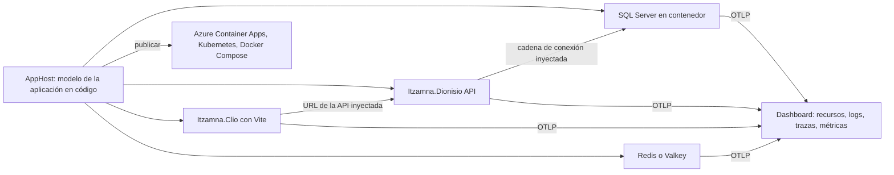

# .NET Aspire

Parte de: [[10-Radar-Herramientas/_Índice Radar de herramientas|Radar de herramientas]]

> [!info] Cómo avanzar
> `progreso`: **pendiente** → **viendo** (estudiando) → **visto** (contestaste la autoevaluación sin abrir las respuestas) → **dominado** (hiciste el laboratorio o lo aplicaste de verdad).

## Contenido

### Qué es
**Aspire** (conocido como **.NET Aspire** hasta noviembre de 2025, cuando Microsoft lo renombró con la versión 13) es un conjunto de herramientas de código abierto (licencia MIT) para **desarrollar, ejecutar, observar y desplegar aplicaciones distribuidas** definidas en código. En un proyecto llamado **AppHost** describes tus servicios (APIs, front, bases de datos, cachés, colas) y cómo se conectan; al ejecutarlo, Aspire levanta todo en local, inyecta las cadenas de conexión, configura OpenTelemetry y abre un **dashboard** con logs, trazas y métricas. Estado revisado en noviembre de 2026: la versión más reciente es la **13.5** (publicada el 18 de agosto de 2026); además de AppHosts en C#, los AppHosts en **TypeScript** ya tienen disponibilidad general.

### Cómo funciona


Piezas:

- **AppHost**: proyecto que declara recursos y referencias (`WithReference`). Es la "fuente de verdad" de cómo se arma el sistema en desarrollo.
- **Integraciones de hosting** (`Aspire.Hosting.*`): recursos listos para SQL Server, PostgreSQL, Redis, RabbitMQ, Azure Storage, proyectos Node/Vite y más.
- **Integraciones de cliente** (paquetes `Aspire.*` en tus servicios): registran clientes con health checks, reintentos y telemetría preconfigurados.
- **ServiceDefaults**: proyecto compartido con OpenTelemetry, health checks, descubrimiento de servicios y resiliencia para todos tus servicios .NET.
- **Dashboard**: interfaz web que recibe OTLP. Puede usarse también **de forma independiente** como visor de telemetría local.
- **CLI `aspire`**: crear, ejecutar, actualizar y publicar. Se instala con un script desde aspire.dev.

### Ejemplo
AppHost para tu sistema local:

```csharp
var builder = DistributedApplication.CreateBuilder(args);

var sql = builder.AddSqlServer("sql").WithDataVolume();
var dionisioDb = sql.AddDatabase("Dionisio");

var api = builder.AddProject<Projects.Itzamna_Dionisio_Api>("dionisio")
    .WithReference(dionisioDb)        // inyecta ConnectionStrings__Dionisio
    .WaitFor(dionisioDb);

builder.AddViteApp("clio", "../Itzamna.Clio")
    .WithReference(api)                // el front recibe la URL de la API
    .WaitFor(api);

builder.Build().Run();
```

En la API, `builder.AddServiceDefaults();` activa la telemetría y los health checks. Al correr el AppHost, ves en el dashboard la traza completa de una petición desde React hasta el procedimiento en SQL Server. El nombre exacto de algunos métodos de integración (como el de Vite) puede variar entre versiones; revisa la documentación de tu versión.

### Cuándo adoptarlo
- Sistemas con **varios servicios** que corren juntos en desarrollo (Clio, Dionisio, Hecate, Hermes/Iris) y hoy requieren varias terminales, scripts y cadenas copiadas a mano.
- Cuando quieres **observabilidad local** sin instalar Jaeger o Grafana: el dashboard basta.
- Para estandarizar ServiceDefaults (OTel, health checks, resiliencia) en todos tus servicios.
- Si despliegas en **Azure Container Apps** o contenedores y te sirve generar artefactos de despliegue desde el modelo.

### Cuándo descartarlo
- Una **sola API** con una base de datos: el beneficio es pequeño frente a otro proyecto más que mantener; `dotnet run` y Docker Compose bastan.
- Despliegue en **IIS** por FTP u hospedajes tradicionales: la parte de publicación no aplica (aunque el AppHost local y el dashboard siguen siendo útiles).
- Equipos que ya tienen un flujo maduro con Docker Compose o Kubernetes local y no sienten fricción.
- Si no puedes seguir su ritmo de versiones: se publican versiones menores seguido y conviene actualizar todos los paquetes `Aspire.Hosting.*` a la vez (mezclar el SDK 13.5 con integraciones 13.4 puede impedir que la app arranque).

Anillo sugerido: **Probar** en un proyecto con varios servicios; **Adoptar** si reduce medible el tiempo de arranque local (ver [[Radar - experiencia de desarrollo]]).

### Errores comunes
- **Creer que es obligatorio para producción**: es sobre todo una herramienta de desarrollo y de modelado; puedes desplegar como siempre.
- **Mezclar versiones** de paquetes de Aspire.
- **Duplicar configuración**: cadenas de conexión fijas en `appsettings` que pelean con las que inyecta el AppHost.
- **Ignorar el rename**: buscar documentación vieja de ".NET Aspire" con APIs que ya cambiaron.

### Para profundizar
- [Aspire (sitio oficial)](https://aspire.dev/)
- [Novedades de Aspire 13](https://aspire.dev/whats-new/aspire-13/)
- [Repositorio de Aspire en GitHub](https://github.com/microsoft/aspire)

## Autoevaluación

Contesta primero en voz alta o en papel; luego despliega la respuesta.

> [!question]- ¿Para qué sirve .NET Aspire?
> Para orquestar en desarrollo una app distribuida (API, workers, base, Redis, colas) desde un proyecto *AppHost* en C#, con descubrimiento de servicios, configuración y un dashboard con logs, trazas y métricas vía OpenTelemetry.

> [!question]- ¿Cuándo adoptarlo?
> Cuando tu solución tiene varios servicios y dependencias que hoy levantas a mano o con un `docker-compose` difícil de mantener, y quieres observabilidad local desde el día uno.

> [!question]- ¿Cuándo descartarlo?
> En un API único con una base: agrega proyectos y conceptos sin beneficio claro. Tampoco reemplaza tu estrategia de despliegue en producción por sí solo.

