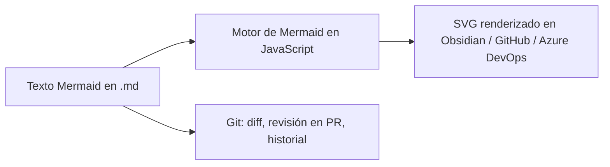
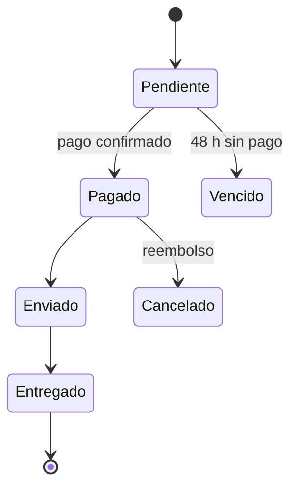
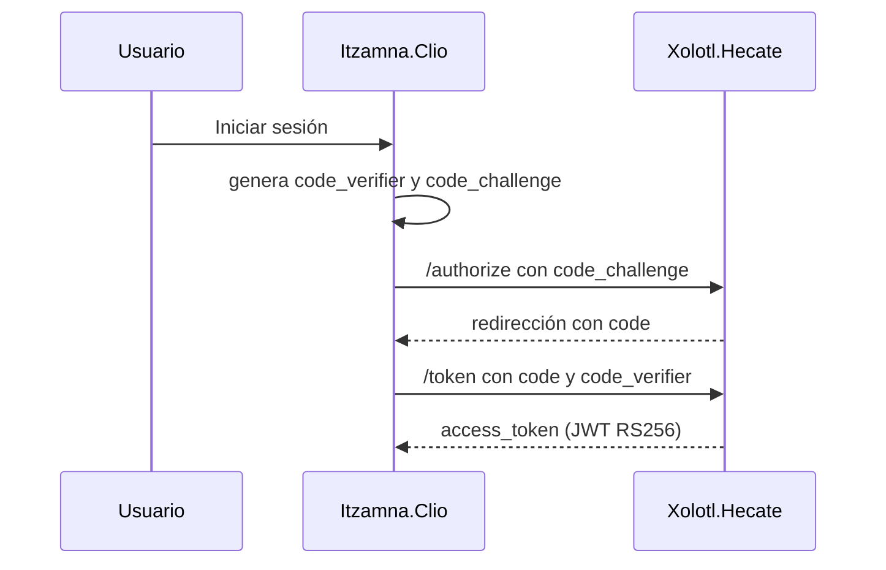

# Mermaid y diagramas como código

Parte de: [[10-Radar-Herramientas/_Índice Radar de herramientas|Radar de herramientas]]

> [!info] Cómo avanzar
> `progreso`: **pendiente** → **viendo** (estudiando) → **visto** (contestaste la autoevaluación sin abrir las respuestas) → **dominado** (hiciste el laboratorio o lo aplicaste de verdad).

## Contenido

### Qué es
**Mermaid** es una herramienta de código abierto que genera diagramas a partir de **texto** con una sintaxis parecida a Markdown: diagramas de flujo, de secuencia, de clases, entidad-relación, de estados, Gantt, cuadrantes, *mindmaps* y más. Es el ejemplo más conocido de **diagramas como código**: el diagrama vive como texto dentro de tus notas o de tu repositorio y se renderiza al visualizarlo. Obsidian, GitHub, la wiki de Azure DevOps y muchos editores lo muestran de forma nativa (en Azure DevOps la sintaxis de bloque es `::: mermaid`).

### Cómo funciona

Escribes un bloque de código con el lenguaje `mermaid`; el visor ejecuta la biblioteca de Mermaid y dibuja el SVG. Tú no acomodas cajas a mano: el motor calcula el *layout*. Las variantes más útiles para ti:

- `flowchart`: procesos, arquitectura simple, decisiones.
- `sequenceDiagram`: flujos entre servicios (login con PKCE en Xolotl.Hecate, una petición de Clio a Dionisio).
- `erDiagram`: modelo de tablas.
- `stateDiagram-v2`: estados de un pedido.
- `classDiagram`, `gantt`, `quadrantChart`, `mindmap`.

Para arquitectura existe también la notación C4 (ver [[Diagramas C4]]); Mermaid tiene soporte experimental para C4 y puedes aproximarlo con `flowchart` y subgrafos.

### Ejemplo
Estados de un pedido en Itzamna.Dionisio:

Secuencia del login con PKCE:

Para editar con vista previa inmediata puedes usar el editor en línea Mermaid Live o la vista previa de Obsidian.

### Ventaja principal de los diagramas como código
**Se versionan y se revisan como el código**: viven en el mismo repositorio, aparecen en el diff de un PR ("agregaste una flecha de Clio a Hermes"), tienen historial y se actualizan en el mismo cambio que modifica el sistema. Eso combate el problema clásico de los diagramas de imagen que nadie actualiza porque el archivo original está en la laptop de alguien. Además son ligeros, buscables con texto y fáciles de generar o corregir con un asistente de IA.

### Cuándo usar otra herramienta
- **Diagramas con *layout* preciso** o de presentación para clientes: herramientas visuales como draw.io (diagrams.net) o Excalidraw (este último tiene plugin en Obsidian) dan control total.
- **Diagramas muy grandes**: el *layout* automático de Mermaid se vuelve ilegible; divide el diagrama o usa una herramienta con más control (PlantUML, Structurizr para C4 con modelo único y varias vistas).
- **Modelos de arquitectura con varias vistas** consistentes generadas desde un modelo: Structurizr DSL.
- **Diagramas de red con íconos de Azure**: herramientas visuales con las bibliotecas oficiales de íconos.

### Errores comunes
- **Sintaxis no soportada por el visor**: cada plataforma trae su propia versión de Mermaid; un tipo de diagrama reciente puede funcionar en Mermaid Live y no en Obsidian o Azure DevOps. Prueba donde se va a ver.
- **Caracteres especiales en etiquetas** (paréntesis, comillas, `@`, `:`) sin comillas: el diagrama no renderiza. Encierra la etiqueta en `"..."`.
- **Diagramas que intentan mostrarlo todo**: mejor varios pequeños con un propósito.
- **No actualizarlos en el PR** que cambia el comportamiento, perdiendo su ventaja.

### Para profundizar
- [Documentación de Mermaid](https://mermaid.js.org/)
- [Mermaid Live Editor](https://mermaid.live/)
- [Mermaid en la wiki de Azure DevOps (Microsoft Learn)](https://learn.microsoft.com/azure/devops/project/wiki/markdown-guidance)

## Autoevaluación

Contesta primero en voz alta o en papel; luego despliega la respuesta.

> [!question]- ¿Para qué sirve Mermaid?
> Para escribir diagramas (flujo, secuencia, clases, estados, ER, Gantt) como texto dentro de Markdown; GitHub, Azure DevOps y Obsidian los renderizan.

> [!question]- ¿Ventaja principal de los diagramas como código?
> Se versionan y revisan en PR junto al código, y se actualizan con un cambio de texto; no quedan imágenes viejas imposibles de editar.

> [!question]- ¿Cuándo usar otra herramienta?
> Para diagramas muy visuales o con mucho acomodo manual (pizarra de diseño, presentaciones): Excalidraw o draw.io. Para C4 formal y varios niveles desde un solo modelo: Structurizr.

## Práctica

- [[Lab 1 - Armar mi radar personal de herramientas]]

