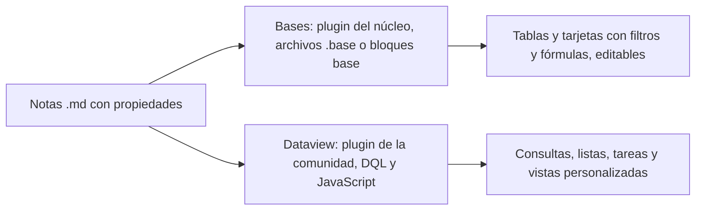

# Obsidian (frontmatter, Dataview y plugins útiles)

Parte de: [[10-Radar-Herramientas/_Índice Radar de herramientas|Radar de herramientas]]

> [!info] Cómo avanzar
> `progreso`: **pendiente** → **viendo** (estudiando) → **visto** (contestaste la autoevaluación sin abrir las respuestas) → **dominado** (hiciste el laboratorio o lo aplicaste de verdad).

## Contenido

### Qué es
**Obsidian** es una aplicación de notas basada en archivos **Markdown locales**: tu bóveda (como `D:\Obsidian\Aprendizaje`) es una carpeta de archivos `.md` que puedes versionar, respaldar y leer con cualquier editor. Su potencia está en los enlaces entre notas (`[[Nota]]`), el grafo, las **propiedades** en frontmatter y las vistas que convierten tus notas en una especie de base de datos. Esta bóveda de aprendizaje es un ejemplo: cada tema tiene `progreso`, `nivel` y `area`, y los índices muestran tablas filtradas.

### Cómo funciona
#### Frontmatter y propiedades
El **frontmatter** es un bloque YAML al inicio de la nota, entre líneas `---`. Obsidian lo muestra como **propiedades** con tipos (texto, lista, número, casilla, fecha). Sirven para filtrar, ordenar y agrupar notas:

```yaml
---
tipo: concepto
nivel: intermedio
progreso: viendo
area: Testing y calidad
tags: [testing-calidad]
---
```

Desde la versión 1.9 las propiedades especiales deben ir en plural y como listas: `tags`, `aliases` y `cssclasses` (las formas `tag`, `alias` y `cssclass` dejaron de ser compatibles).

#### Bases (núcleo) y Dataview (plugin)


- **Bases** es un plugin **del núcleo** de Obsidian, disponible desde la versión 1.9.10 (agosto de 2025). Muestra conjuntos de notas como tablas o tarjetas, filtradas por propiedades, con columnas calculadas por fórmulas, y permite editar propiedades directamente en la vista. Se guarda en archivos `.base` o se incrusta en una nota con un bloque de código `base`. Es la opción recomendada para tableros como los índices de esta bóveda.
- **Dataview** es un plugin **de la comunidad** con su propio lenguaje de consultas (DQL) y una API de JavaScript. Es más flexible (consultas de tareas, campos en línea, vistas programadas), pero es externo y, según reportes de 2026, su desarrollo está prácticamente congelado: sigue funcionando y recibe versiones de mantenimiento de la comunidad, mientras su autor original trabaja en un sucesor llamado **Datacore**. Úsalo para lo que Bases no cubre.

### Ejemplo
Vista de Bases para "temas en curso" de esta área:

```base
filters:
  and:
    - file.inFolder("13-Testing-Calidad")
    - progreso != "dominado"
views:
  - type: table
    name: En curso
    order:
      - file.name
      - nivel
      - progreso
```

La misma idea con Dataview:

```dataview
TABLE nivel, progreso
FROM "13-Testing-Calidad"
WHERE progreso != "dominado"
SORT nivel ASC
```

Revisa la sintaxis exacta de Bases en la ayuda oficial de tu versión, porque la función sigue evolucionando.

### Plugins útiles
- **Núcleo**: Bases, Canvas (los mapas mentales de esta bóveda), Plantillas, Notas diarias, Búsqueda, Enlaces salientes y entrantes.
- **Comunidad** (instala solo lo que uses y revisa su mantenimiento): Dataview, Templater (plantillas con lógica), Excalidraw (dibujos), Obsidian Git (respaldo y versionado de la bóveda), Tasks (gestión de tareas).

### Cuándo usarlo y cuándo no
Obsidian es ideal para conocimiento personal de largo plazo, documentación propia, planes de estudio y bitácoras de proyectos, con la ventaja de que tus datos son archivos tuyos. No es la mejor opción para documentación compartida de un equipo que necesita edición simultánea y permisos (ahí conviene la wiki de Azure DevOps o el repositorio con `docs/`), ni para datos que requieren una base de datos real.

### Errores comunes
- **Valores inconsistentes en propiedades** (`Visto`, `visto`, `vista`): los filtros fallan. Define un vocabulario cerrado y respétalo.
- **Tipos mezclados**: la misma propiedad como texto en unas notas y como lista en otras.
- **Demasiados plugins de la comunidad**: lentitud, conflictos y riesgo si se abandonan.
- **Renombrar archivos fuera de Obsidian**: los enlaces no se actualizan; renombra desde la aplicación.
- **Depender de Dataview para todo** cuando Bases ya cubre el caso.

### Para profundizar
- [Ayuda de Obsidian: Bases](https://help.obsidian.md/bases)
- [Ayuda de Obsidian: Propiedades](https://help.obsidian.md/properties)
- [Documentación de Dataview](https://blacksmithgu.github.io/obsidian-dataview/)
- Práctica: [[Lab 1 - Armar mi radar personal de herramientas]]

## Autoevaluación

Contesta primero en voz alta o en papel; luego despliega la respuesta.

> [!question]- ¿Para qué sirve el frontmatter en Obsidian?
> Bloque YAML al inicio de la nota (`---`) con propiedades (`progreso`, `nivel`, `tags`) que se pueden filtrar, ordenar y mostrar en tablas con Bases o Dataview.

> [!question]- Diferencia entre Bases (núcleo) y Dataview (plugin).
> Bases es una función del núcleo que muestra notas como tablas/vistas filtradas por propiedades (bloques ` ```base `). Dataview es un plugin de la comunidad con un lenguaje de consultas (DQL) y JavaScript, más flexible pero externo.

> [!question]- Error común con propiedades.
> Escribir la misma propiedad con valores distintos (`Visto`, `visto`, `vista`): los filtros fallan. Define valores permitidos y respétalos.

## Práctica

- [[Lab 1 - Armar mi radar personal de herramientas]]

