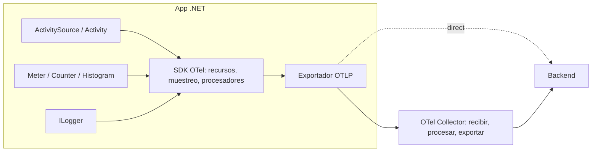

# OpenTelemetry

Parte de: [[10-Radar-Herramientas/_Índice Radar de herramientas|Radar de herramientas]]

> [!info] Cómo avanzar
> `progreso`: **pendiente** → **viendo** (estudiando) → **visto** (contestaste la autoevaluación sin abrir las respuestas) → **dominado** (hiciste el laboratorio o lo aplicaste de verdad).

## Contenido

### Qué es
**OpenTelemetry** (OTel) es un estándar abierto y un conjunto de SDKs, APIs y herramientas para **generar, recolectar y exportar telemetría**: trazas, métricas y logs. Es un proyecto de la CNCF, neutral respecto al proveedor: instrumentas tu aplicación una vez y envías los datos a cualquier backend compatible (Azure Monitor, Grafana, Jaeger, Seq, Datadog y muchos más) usando el protocolo **OTLP**. En .NET, según su documentación oficial, las tres señales (trazas, métricas y logs) están en estado **estable**. Estado revisado en noviembre de 2026; anillo sugerido en tu radar: **Adoptar**.

### Cómo funciona


Piezas principales:

- **API**: cómo el código emite datos. En .NET se apoya en clases del propio runtime: `System.Diagnostics.Activity` (spans), `System.Diagnostics.Metrics` (métricas) e `ILogger` (logs). Por eso ASP.NET Core, `HttpClient` y otros ya emiten telemetría sin depender de OTel.
- **SDK**: configura qué se recolecta, recursos (nombre del servicio, versión, ambiente), muestreo y exportadores. Paquete base para apps: `OpenTelemetry.Extensions.Hosting`.
- **Instrumentaciones**: paquetes que activan la telemetría de bibliotecas (`OpenTelemetry.Instrumentation.AspNetCore`, `.Http`, `.SqlClient`, `.Runtime`), muchos en el repositorio *contrib*.
- **Exportadores**: `OpenTelemetry.Exporter.OpenTelemetryProtocol` (OTLP), consola, y distribuciones de proveedores como la de Azure Monitor.
- **Convenciones semánticas**: nombres estándar de atributos (`http.request.method`, `db.system`) para que todos los backends entiendan los datos.
- **Instrumentación automática**: un agente que agrega telemetría sin cambiar código, útil en aplicaciones que no puedes modificar.

### El Collector y cuándo agregarlo
El **OpenTelemetry Collector** es un proceso independiente (binario o contenedor) que **recibe** telemetría (OTLP y otros formatos), la **procesa** (agrupa en lotes, filtra, elimina atributos sensibles, muestrea, agrega metadatos) y la **exporta** a uno o varios backends. Se configura con *receivers*, *processors* y *exporters* en un archivo YAML.

Agrégalo cuando:
- Tienes **varios servicios** y quieres un solo punto de salida y configuración.
- Necesitas **enviar a varios destinos** (Application Insights y Grafana a la vez) o migrar de uno a otro sin redeplegar las apps.
- Debes **filtrar datos sensibles** o aplicar muestreo de cola (*tail sampling*, conservar trazas con errores).
- Quieres quitarle a la aplicación el trabajo de reintentos y búferes.

Para un solo servicio pequeño, exportar directo desde la app es suficiente.

### Ejemplo
Itzamna.Dionisio con trazas, métricas y logs vía OTLP:

```csharp
builder.Services.AddOpenTelemetry()
    .ConfigureResource(r => r.AddService(serviceName: "Itzamna.Dionisio", serviceVersion: "1.4.0"))
    .WithTracing(t => t
        .AddAspNetCoreInstrumentation()
        .AddHttpClientInstrumentation()
        .AddSqlClientInstrumentation()
        .AddSource("Itzamna.Dionisio"))          // tus propios ActivitySource
    .WithMetrics(m => m
        .AddAspNetCoreInstrumentation()
        .AddRuntimeInstrumentation()
        .AddMeter("Itzamna.Dionisio.Pedidos"))
    .UseOtlpExporter();                           // endpoint en OTEL_EXPORTER_OTLP_ENDPOINT

builder.Logging.AddOpenTelemetry(o => o.IncludeScopes = true);
```

Un span propio alrededor de una operación de negocio:

```csharp
private static readonly ActivitySource Fuente = new("Itzamna.Dionisio");

using var act = Fuente.StartActivity("Pedidos.Cobrar");
act?.SetTag("pedido.id", pedidoId);   // dato útil en trazas, nunca en métricas (cardinalidad)
```

En desarrollo, el dashboard de Aspire recibe OTLP y te muestra las tres señales localmente sin instalar nada más (ver [[.NET Aspire]]).

### Cuándo adoptarlo
- Cualquier servicio nuevo en producción: es el estándar de facto y lo soportan todos los proveedores relevantes.
- Sistemas con varios servicios (Clio, Dionisio, Hecate, Hermes) donde necesitas trazas distribuidas.
- Cuando quieres independencia del proveedor.

Puede no valer la pena en una herramienta de consola de uso ocasional, o si un servicio ya está bien cubierto por el SDK propietario de un proveedor y no hay planes de cambio (aunque la migración suele ser sencilla).

### Errores comunes
- **No definir `service.name`**: todo aparece como "unknown_service".
- **Instrumentar todo con detalle máximo** en producción: costo y ruido. Usa muestreo.
- **Atributos con datos personales o secretos** (tokens, correos).
- **Mezclar versiones** de paquetes de OTel incompatibles; mantenlos alineados con Central Package Management.

### Para profundizar
- [OpenTelemetry para .NET](https://opentelemetry.io/docs/languages/dotnet/)
- [OpenTelemetry Collector](https://opentelemetry.io/docs/collector/)
- [Observabilidad con OpenTelemetry en .NET (Microsoft Learn)](https://learn.microsoft.com/dotnet/core/diagnostics/observability-with-otel)

## Autoevaluación

Contesta primero en voz alta o en papel; luego despliega la respuesta.

> [!question]- ¿Qué es OpenTelemetry?
> Un estándar abierto y conjunto de SDKs para generar y exportar trazas, métricas y logs de forma neutral al proveedor (protocolo OTLP).

> [!question]- ¿Cuándo adoptarlo?
> En cualquier servicio nuevo que necesite observabilidad, sobre todo si hay varios servicios y quieres trazas distribuidas o poder cambiar de backend sin reinstrumentar.

> [!question]- ¿Qué es el Collector y cuándo lo agregas?
> Un proceso que recibe telemetría, la procesa (filtra, muestrea, enriquece) y la reenvía a uno o varios backends. Lo agregas cuando quieres desacoplar la app del destino o centralizar el muestreo.

