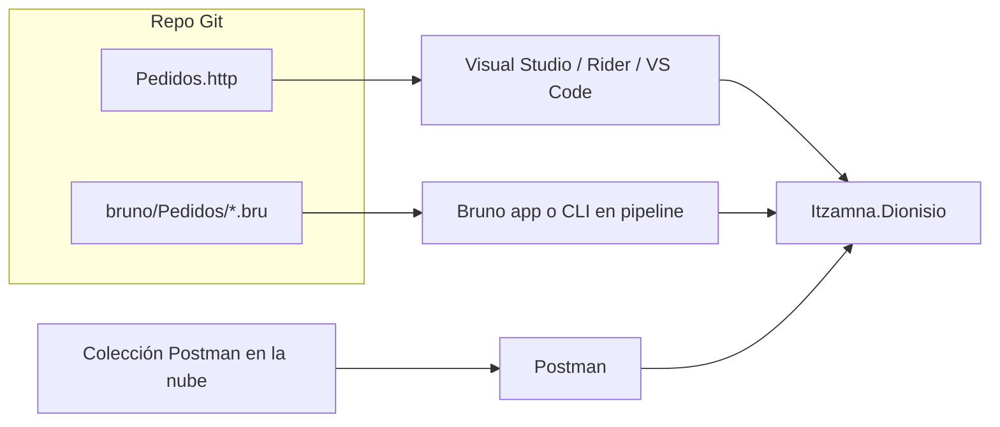

# Postman, Bruno y archivos .http

Parte de: [[10-Radar-Herramientas/_Índice Radar de herramientas|Radar de herramientas]]

> [!info] Cómo avanzar
> `progreso`: **pendiente** → **viendo** (estudiando) → **visto** (contestaste la autoevaluación sin abrir las respuestas) → **dominado** (hiciste el laboratorio o lo aplicaste de verdad).

## Contenido

### Qué es
Son tres formas de **enviar peticiones HTTP a una API** para probarla y explorarla manualmente (o semiautomáticamente) mientras desarrollas:

- **Postman**: cliente de API completo con colecciones, ambientes, scripts de pruebas, mocks, documentación y colaboración **en la nube**.
- **Bruno**: cliente de API de escritorio y de código abierto que guarda las colecciones como **archivos de texto en tu carpeta**, pensados para versionarse con Git; no requiere cuenta.
- **Archivos `.http`**: archivos de texto con peticiones que ejecutas **desde el editor**: Visual Studio (2022 17.8 o posterior), JetBrains Rider y VS Code con la extensión REST Client.

Estado revisado en noviembre de 2026.

### Cómo funciona y en qué se diferencian
| Aspecto | Postman | Bruno | Archivos `.http` |
|---|---|---|---|
| Dónde viven las colecciones | Cuenta y espacio de trabajo en la nube (exportables) | Archivos en el repo | Archivos en el repo |
| Cuenta obligatoria | Sí, para la mayoría de funciones | No | No |
| Plan gratuito | Desde marzo de 2026, el plan Free es para **un solo usuario** y no permite crear equipos | Edición Open Source gratuita; ediciones Pro (6 USD), Ultimate (11 USD) y Enterprise (18 USD) por usuario al mes, anuales | Gratuito, parte del editor |
| Scripts y pruebas | JavaScript avanzado, runner, monitores | Scripts y aserciones en JavaScript, CLI para CI | Variables, variables de petición (encadenar respuestas); scripts según el editor |
| Colaboración | Integrada en la nube | Vía Git (PR, revisión) | Vía Git |
| Ideal para | Equipos que pagan la plataforma y usan mocks, monitores y documentación | Equipos que quieren colecciones versionadas sin nube | Pruebas rápidas junto al código de la API |



### Ejemplo: archivo `.http` en Itzamna.Dionisio
```http
@host = https://localhost:7180
@token = {{login.response.body.$.access_token}}

# @name login
POST {{host}}/api/pruebas/token
Content-Type: application/json

{ "usuario": "dev@local" }

###

GET {{host}}/api/pedidos/1
Authorization: Bearer {{token}}

###

POST {{host}}/api/pedidos
Authorization: Bearer {{token}}
Content-Type: application/json

{ "clienteId": 1, "total": -5 }
```

La última petición debe devolver 400 con ProblemDetails y `codigo`. Los valores por ambiente van en `http-client.env.json` (que se versiona, sin secretos) y los valores personales en `http-client.env.json.user` (excluido del control de versiones). En Visual Studio los secretos pueden leerse de User Secrets, Azure Key Vault o DPAPI en lugar de escribirse en el archivo.

En Bruno, cada petición es un archivo de la colección en una carpeta del repo; con su CLI puedes correr la colección en un pipeline de Azure DevOps como prueba de humo.

### Cuándo prefieres `.http` o Bruno sobre una colección en la nube
- Quieres que las peticiones **cambien en el mismo PR** que el endpoint y se revisen juntas.
- No quieres depender de una cuenta, de la conectividad ni de cambios de plan del proveedor (el cambio de Postman en 2026 dejó sin colaboración gratuita a equipos pequeños).
- Tu política prohíbe subir datos o tokens de la API a servicios externos.
- Prefieres herramientas gratuitas y ligeras: `.http` para el día a día en el editor, Bruno cuando necesitas una interfaz más completa, colecciones grandes o scripts.

Postman sigue siendo razonable si tu organización ya lo paga y aprovecha mocks, monitores y su documentación pública.

### Errores comunes
- **Secretos versionados**: tokens o llaves pegados en un `.http`, en una colección exportada o en `http-client.env.json`. Usa archivos de usuario ignorados por Git, User Secrets o Key Vault.
- **Colecciones desactualizadas**: peticiones que ya no coinciden con la API; ponlas junto al código para actualizarlas en el mismo cambio.
- **Usarlas como única prueba**: son manuales; lo crítico debe estar en [[Pruebas de integración con WebApplicationFactory]].
- **Probar contra producción** con datos reales por error de ambiente seleccionado.

### Para profundizar
- [Usar archivos .http en Visual Studio (Microsoft Learn)](https://learn.microsoft.com/aspnet/core/test/http-files)
- [Bruno](https://www.usebruno.com/)
- [Planes de Postman](https://learning.postman.com/docs/billing/about-plans/)
- Práctica: [[Lab 2 - Probar un API con archivos .http y Bruno]]

## Autoevaluación

Contesta primero en voz alta o en papel; luego despliega la respuesta.

> [!question]- ¿Para qué sirven y en qué se diferencian?
> Para probar APIs a mano y guardar colecciones de peticiones. Postman: app muy completa con espacios de trabajo en la nube. Bruno: guarda las colecciones como archivos de texto en tu repositorio. Archivos `.http`: texto plano que ejecutan VS Code (REST Client) y Visual Studio, sin app extra.

> [!question]- ¿Cuándo prefieres archivos `.http` o Bruno sobre una colección en la nube?
> Cuando quieres que las peticiones vivan junto al código, se revisen en PR y no dependan de cuentas externas. Para equipos grandes con pruebas compartidas y monitores, una herramienta en la nube puede compensar.

> [!question]- Error común.
> Guardar tokens o secretos dentro de la colección versionada. Usa variables de entorno o archivos de entorno ignorados por git.

## Práctica

- [[Lab 2 - Probar un API con archivos .http y Bruno]]

