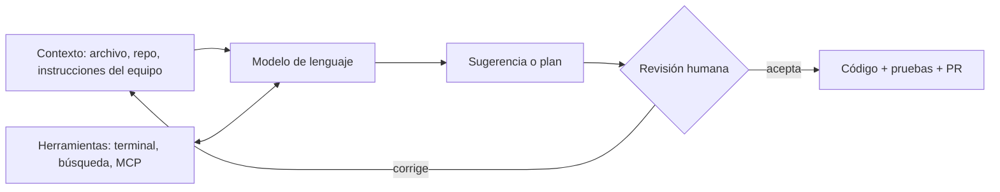

# Radar - IA para desarrollo

Parte de: [[10-Radar-Herramientas/_Índice Radar de herramientas|Radar de herramientas]]

> [!info] Cómo avanzar
> `progreso`: **pendiente** → **viendo** (estudiando) → **visto** (contestaste la autoevaluación sin abrir las respuestas) → **dominado** (hiciste el laboratorio o lo aplicaste de verdad).

## Contenido

### Qué es
Esta entrada del radar agrupa los **asistentes de IA para desarrollo**: herramientas basadas en modelos de lenguaje que completan código en el editor, responden preguntas sobre el repositorio, generan pruebas, explican errores, revisan PRs o ejecutan tareas de varios pasos como agentes (editar archivos, correr comandos, abrir PRs). Ejemplos conocidos son GitHub Copilot (integrado en VS Code, Visual Studio y GitHub), asistentes de terminal como Claude Code, y editores con IA integrada. El campo cambia cada pocos meses, así que esta nota se centra en **criterios** más que en productos. Estado revisado en noviembre de 2026.

### Cómo funciona

- **Completado en línea**: sugiere la siguiente línea o bloque según el archivo abierto.
- **Chat**: preguntas sobre el código con contexto del repo.
- **Agentes**: reciben una tarea, planean, editan varios archivos, ejecutan pruebas y te muestran el diff. Pueden conectarse a herramientas externas mediante protocolos como MCP (*Model Context Protocol*).
- **Instrucciones del repositorio**: archivos con las reglas del equipo (por ejemplo, "SQL en archivos `.sql` con una interfaz por consulta", "ProblemDetails con `codigo`") que el asistente lee para respetar tus convenciones.

Sobre costos: GitHub Copilot tiene un plan **Free** con cupo limitado (incluye un límite de 2,000 completados en línea al mes y acceso limitado a agentes), **Pro** a 10 USD al mes y **Pro+** a 39 USD al mes, según su documentación consultada en noviembre de 2026; los cupos de "créditos" cambian seguido, revísalos antes de decidir.

### Dónde rinden más
- **Código repetitivo**: DTOs, validadores de FluentValidation, mapeos, configuración de DI, migraciones de datos.
- **Pruebas**: generar casos de borde de un método, esqueletos de pruebas con xUnit, datos de prueba.
- **Explicación**: entender código legado, un plan de ejecución de SQL o un error críptico.
- **Tareas mecánicas en varios archivos**: renombrar, actualizar una API obsoleta, migrar de Swashbuckle a `Microsoft.AspNetCore.OpenApi`.
- **Documentación**: borradores de README, ADRs y comentarios.

Rinden menos en decisiones de arquitectura con mucho contexto de negocio, en código de seguridad crítico (validación de JWT en Xolotl.Hecate, criptografía) y en APIs muy nuevas que el modelo no conoce.

### Riesgos a evaluar antes de adoptarlo en un equipo
- **Privacidad y propiedad del código**: ¿el proveedor usa tu código para entrenar? ¿Dónde se procesa? Revisa los términos del plan empresarial y la política de tu empresa.
- **Secretos**: que el asistente no lea archivos con secretos ni los incluya en sugerencias; refuerza tu regla de secretos fuera del repo.
- **Calidad y seguridad del código generado**: puede proponer SQL concatenado, dependencias inexistentes o versiones vulnerables. Todo pasa por revisión, pruebas y análisis estático.
- **Licencias**: posibilidad de sugerencias parecidas a código con licencia restrictiva; algunos productos ofrecen filtros.
- **Inyección de instrucciones** (*prompt injection*): un agente que lee contenido externo (issues, páginas web) puede recibir instrucciones maliciosas. Limita permisos y revisa sus acciones.
- **Dependencia y aprendizaje**: personas junior que aceptan sin entender. Pide que expliquen el código en la revisión.
- **Costo** por usuario y por uso.

### Ejemplo
Uso razonable en Itzamna.Dionisio: pides al asistente "agrega el endpoint `GET /api/clientes/{id}/saldo` siguiendo el slice de Pedidos". El agente crea el controller, la interfaz de consulta, el archivo `.sql` y una prueba. Tú revisas que el SQL esté parametrizado, que la policy de autorización sea la correcta, corres las pruebas con Testcontainers y ajustas nombres. El PR se revisa igual que uno escrito a mano.

### Cuándo descartarlo para una tarea
- Cuando no puedes verificar el resultado (no conoces el tema lo suficiente y no hay pruebas).
- Código con datos sensibles o regulados donde la política lo prohíbe.
- Cuando estás aprendiendo un tema a fondo y quieres construir la intuición tú mismo.
- Decisiones irreversibles (migraciones destructivas en producción, cambios de permisos).

### Errores comunes
- **Aceptar sin leer**: el código "parece" correcto y compila.
- **Pegar secretos o datos de clientes** en el chat.
- **No dar contexto**: sin las reglas del equipo, el asistente inventa su propio estilo.
- **Medir solo velocidad**: si los defectos suben, no ganaste nada.

### Para profundizar
- [Planes de GitHub Copilot](https://docs.github.com/copilot/concepts/billing/individual-plans)
- [OWASP Top 10 para aplicaciones con LLM](https://genai.owasp.org/llm-top-10/)
- [Model Context Protocol](https://modelcontextprotocol.io/)

## Autoevaluación

Contesta primero en voz alta o en papel; luego despliega la respuesta.

> [!question]- ¿Para qué sirven los asistentes de IA en desarrollo y dónde rinden más?
> Autocompletar, generar código repetitivo, explicar código ajeno, escribir pruebas y documentación, y explorar alternativas. Rinden más en tareas bien acotadas con verificación rápida (pruebas, compilador).

> [!question]- ¿Qué riesgos evalúas antes de adoptar uno en un equipo?
> Confidencialidad del código y datos enviados, licencias del código sugerido, código plausible pero incorrecto o inseguro, y dependencia que frene el aprendizaje de juniors. Mitiga con revisión de código, pruebas y políticas claras.

> [!question]- ¿Cuándo lo descartarías para una tarea?
> Cuando no puedes verificar el resultado (lógica crítica sin pruebas, criptografía, cálculos regulatorios) o cuando la política del cliente prohíbe enviar código a servicios externos.

## Práctica

- [[Lab 1 - Armar mi radar personal de herramientas]]

