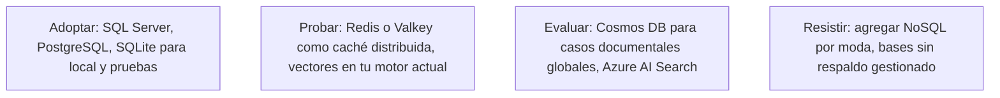

# Radar - bases de datos

Parte de: [[10-Radar-Herramientas/_Índice Radar de herramientas|Radar de herramientas]]

> [!info] Cómo avanzar
> `progreso`: **pendiente** → **viendo** (estudiando) → **visto** (contestaste la autoevaluación sin abrir las respuestas) → **dominado** (hiciste el laboratorio o lo aplicaste de verdad).

## Contenido

### Qué es
Esta entrada del radar organiza las **bases de datos y motores de almacenamiento** que usas o podrías usar, y sobre todo los **criterios** para agregar uno nuevo. Tu base es relacional: SQL Server en Itzamna.Dionisio y PostgreSQL en Pochteca.Nomisma. Cada motor adicional (documental, clave-valor, búsqueda, vectorial) trae beneficios pero también costo de operación, respaldo, seguridad y aprendizaje. Estado revisado en noviembre de 2026.

### Cómo funciona: panorama por anillo

Hechos recientes que afectan las decisiones:

- **SQL Server 2025** salió a disponibilidad general el 18 de noviembre de 2025. Agrega un tipo de dato `vector` con funciones y búsqueda vectorial, una edición **Standard Developer** gratuita para desarrollo que imita los límites de Standard, y **Express** con bases de hasta 50 GB (sigue limitada a un núcleo); la edición Web se descontinuó.
- **PostgreSQL** sigue siendo la opción abierta de referencia, con extensiones como `pgvector` (ver [[Embeddings y bases vectoriales (pgvector y Azure AI Search)]]).
- **Redis** volvió a una licencia de código abierto (AGPLv3) con Redis 8 en 2025, después de su cambio a licencias no abiertas en 2024; ese cambio originó **Valkey**, un fork bajo la Linux Foundation respaldado por grandes nubes. Para caché, cualquiera de los dos funciona; revisa licencia y servicio gestionado disponible (ver [[Redis más allá de la caché (locks, colas y contadores)]]).
- [[Cosmos DB]] para datos documentales a escala global con baja latencia, con modelo de costo por unidades de solicitud.

### Preguntas antes de adoptar una base distinta
1. **¿Qué problema concreto no resuelve mi base actual?** Con medición, no suposición. SQL Server y PostgreSQL ya manejan JSON, texto completo, datos temporales y ahora vectores.
2. **¿Cuál es el patrón de acceso?** Lecturas por clave a altísima velocidad (caché), búsquedas difusas de texto, grafos, series de tiempo, documentos con esquema muy variable.
3. **¿Qué consistencia necesito?** Transacciones que abarcan varias entidades son naturales en relacional y difíciles en muchos NoSQL.
4. **¿Quién lo opera?** Respaldos, restauración probada, parches, monitoreo, seguridad. Un servicio gestionado reduce la carga pero cuesta.
5. **¿Cómo sincronizo datos** entre la base principal y la nueva? (patrón Outbox, CDC, procesos de carga).
6. **¿Costo total?** Licencias, nube, horas del equipo, curva de aprendizaje.
7. **¿Plan de salida?** Si no funciona, ¿qué tan difícil es volver?

### Cuándo descartar agregar una base nueva
- El volumen y la latencia actuales caben en tu motor relacional con buenos índices.
- El problema real es de diseño (consultas N+1, índices faltantes, falta de caché en memoria) y no de motor.
- El equipo no tiene tiempo para operarla y no hay servicio gestionado asequible.
- La razón principal es "aprenderla" o "está de moda": eso va a un laboratorio, no a producción.

### Ejemplo de buen caso para una base especializada
Itzamna.Clio necesita un **buscador de productos** tolerante a errores de escritura ("tornilo" encuentra "tornillo"), con filtros por facetas y ordenado por relevancia, sobre 2 millones de productos, respondiendo en menos de 100 ms. El texto completo de SQL Server funciona, pero la relevancia difusa y las facetas son limitadas. Un motor de búsqueda (Azure AI Search, o uno autohospedado) indexado a partir de SQL Server con eventos del [[Patrón Outbox]] resuelve un problema medido, mientras SQL Server sigue siendo la **fuente de verdad** para pedidos y precios. Otro buen caso: una caché distribuida en Redis/Valkey cuando varias instancias de la API necesitan compartir datos calientes (con [[HybridCache]]).

### Errores comunes
- **Persistencia políglota prematura**: tres bases para un sistema pequeño.
- **Usar la base nueva como fuente de verdad** sin garantías de consistencia o respaldo.
- **No probar la restauración** de respaldos.
- **Ignorar cambios de licencia** de motores de terceros.

### Para profundizar
- [Novedades de SQL Server 2025 (Microsoft Learn)](https://learn.microsoft.com/sql/sql-server/what-s-new-in-sql-server-2025)
- [PostgreSQL](https://www.postgresql.org/)
- [Valkey](https://valkey.io/)
- [Elegir un almacén de datos en Azure (Microsoft Learn)](https://learn.microsoft.com/azure/architecture/guide/technology-choices/data-store-overview)

## Autoevaluación

Contesta primero en voz alta o en papel; luego despliega la respuesta.

> [!question]- ¿Qué preguntas haces antes de adoptar una base de datos distinta a la relacional que ya usas?
> ¿Qué patrón de acceso tiene el problema (clave-valor, documentos, grafos, series de tiempo, búsqueda)? ¿Necesito transacciones y joins? ¿Quién la operará y respaldará? ¿El equipo la conoce?

> [!question]- ¿Cuándo descartas agregar una base nueva?
> Cuando la relacional actual lo resuelve razonablemente (JSON, índices de texto completo, tablas temporales). Cada motor nuevo suma operación, respaldos, seguridad y aprendizaje.

> [!question]- Ejemplo de buen caso para una base especializada.
> Redis para caché y contadores de baja latencia; un motor de búsqueda para texto con relevancia y facetas; series de tiempo para métricas de alto volumen.

