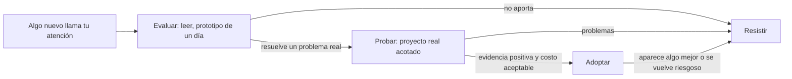

# Radar - cómo usarlo

Parte de: [[10-Radar-Herramientas/_Índice Radar de herramientas|Radar de herramientas]]

> [!info] Cómo avanzar
> `progreso`: **pendiente** → **viendo** (estudiando) → **visto** (contestaste la autoevaluación sin abrir las respuestas) → **dominado** (hiciste el laboratorio o lo aplicaste de verdad).

## Contenido

### Qué es
Un **radar de tecnología** es una forma visual y periódica de registrar qué herramientas, técnicas, plataformas y lenguajes estás usando, probando, evaluando o abandonando, y **por qué**. El formato lo popularizó Thoughtworks con su *Technology Radar*, que publica dos veces al año. Para ti, el radar personal (o del equipo) sirve para no adoptar cosas por moda, para recordar qué evaluaste y con qué conclusión, y para tener una conversación ordenada sobre tecnología con tu equipo. Las demás notas de esta área son tus "blips" (entradas del radar).

### Cómo funciona
El radar tiene **cuadrantes** (categorías) y **anillos** (nivel de confianza). En el formato de Thoughtworks:

- **Cuadrantes**: Técnicas, Herramientas, Plataformas, Lenguajes y frameworks. En tu radar personal puedes usar los de esta área: IA para desarrollo, observabilidad, infraestructura como código, bases de datos, testing, experiencia de desarrollo.
- **Anillos**:
  - **Adoptar** (*Adopt*): lo usas por defecto; tienes evidencia de que funciona en tu contexto.
  - **Probar** (*Trial*): vale la pena usarlo en un proyecto real con riesgo acotado.
  - **Evaluar** (*Assess*): interesante; investígalo con un prototipo o lectura, sin compromiso.
  - **Resistir / Retener** (*Hold*): no lo inicies en proyectos nuevos (obsoleto, riesgoso o no te funcionó).



Cada entrada lleva: nombre, cuadrante, anillo, fecha de la última revisión, problema que resuelve, evidencia y siguiente paso. En Obsidian, esas son propiedades del frontmatter y una vista de Bases las agrupa por anillo (ver [[Obsidian (frontmatter, Dataview y plugins útiles)]]).

### Criterios para moverse de anillo
De **Evaluar a Probar**:
- Resuelve un problema que **tienes hoy** (no uno hipotético).
- Un prototipo pequeño funcionó con tu stack (.NET 10, SQL Server, Azure DevOps).
- La licencia y el costo son aceptables (preferencia por herramientas gratuitas).
- Tiene comunidad o respaldo suficiente y documentación.

De **Probar a Adoptar**:
- La usaste en al menos un proyecto real (por ejemplo, en Itzamna.Dionisio o Wee.Reporteria) durante semanas y midió mejor que la alternativa: menos tiempo, menos errores, menos costo.
- El equipo puede mantenerla: alguien más que tú sabe usarla.
- Conoces sus límites y tienes plan de salida si deja de mantenerse.

A **Resistir**: cambios de licencia, abandono, problemas de seguridad, costos inesperados o una alternativa claramente superior. Ejemplos reales que justificaron reacomodos: el retiro de Azure Data Studio el 28 de febrero de 2026, o el cambio del plan gratuito de Postman a un solo usuario en marzo de 2026 (ver [[SSMS, Azure Data Studio y DBeaver]] y [[Postman, Bruno y archivos .http]]).

### Ejemplo
Entrada de tu radar en una nota con frontmatter:

```yaml
---
tipo: radar
cuadrante: testing
anillo: adoptar
revisado: 2026-11-09
---
```

```markdown
**Testcontainers** — Problema: probar procedimientos de SQL Server reales en CI.
Evidencia: suite de integración de Dionisio en agente Ubuntu de Azure DevOps, 3 min.
Siguiente paso: documentar fixture compartida en el README.
```

### Cuándo usarlo y cuándo no
Úsalo como herramienta de decisión: revísalo cada 3 a 6 meses, cuando inicias un proyecto o cuando alguien propone una herramienta nueva. Para un equipo, sirve para acordar estándares ("en proyectos nuevos usamos X"). No lo conviertas en una lista de deseos de tecnologías de moda ni en un documento que nadie revisa: un radar sin fechas de revisión pierde valor rápido.

### Errores comunes
- **Adoptar sin probar**: saltar de "lo vi en una charla" a "lo usamos en producción".
- **Copiar el radar de otra empresa**: el contexto (tamaño, stack, regulación) cambia todo.
- **No registrar el porqué**: en seis meses no recuerdas por qué descartaste algo.
- **Nunca mover nada a Resistir**: el radar se llena y deja de orientar.
- **Demasiadas entradas en Probar** al mismo tiempo: dispersa la atención del equipo.

### Para profundizar
- [Thoughtworks Technology Radar](https://www.thoughtworks.com/radar)
- [Construye tu propio radar (Thoughtworks)](https://www.thoughtworks.com/radar/byor)
- Práctica: [[Lab 1 - Armar mi radar personal de herramientas]]

## Autoevaluación

Contesta primero en voz alta o en papel; luego despliega la respuesta.

> [!question]- ¿Qué es un radar de tecnología y cuáles son sus anillos típicos?
> Un mapa de herramientas y técnicas clasificadas según qué tanto recomiendas usarlas. Anillos típicos: **Adoptar** (uso por defecto), **Probar** (en un proyecto real con riesgo acotado), **Evaluar** (investigar, prototipo) y **Detener/En espera** (no iniciar nada nuevo con ella).

> [!question]- ¿Qué criterio usas para mover algo de *Evaluar* a *Probar* o *Adoptar*?
> Evidencia propia: un prototipo que resolvió un problema real, costo de adopción aceptable (aprendizaje, licencias, operación), comunidad/soporte suficiente y una salida razonable si sale mal.

> [!question]- Error común al usar un radar.
> Llenarlo de cosas de moda sin un problema que resuelvan, o no revisarlo nunca. Cada entrada debe decir *por qué* está en su anillo y cuándo se revisó.

## Práctica

- [[Lab 1 - Armar mi radar personal de herramientas]]

