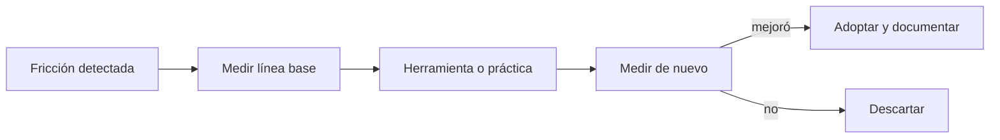

# Radar - experiencia de desarrollo

Parte de: [[10-Radar-Herramientas/_Índice Radar de herramientas|Radar de herramientas]]

> [!info] Cómo avanzar
> `progreso`: **pendiente** → **viendo** (estudiando) → **visto** (contestaste la autoevaluación sin abrir las respuestas) → **dominado** (hiciste el laboratorio o lo aplicaste de verdad).

## Contenido

### Qué es
La **experiencia de desarrollo** (DX, *developer experience*) es qué tan fácil, rápido y agradable es para una persona desarrolladora hacer su trabajo en un proyecto: clonar y tener todo corriendo, recibir retroalimentación de sus cambios, entender el código, desplegar y diagnosticar. Una buena DX no es un lujo: reduce errores, acelera la incorporación de gente nueva y libera tiempo para lo importante. Esta entrada del radar agrupa herramientas y prácticas que la mejoran. Estado revisado en noviembre de 2026.

### Cómo se mide
DX es en parte percepción, así que se combina lo **medible** con lo **percibido**:

- **Ciclos de retroalimentación**: cuánto tarda compilar, correr las pruebas, ver un cambio en el navegador (*hot reload*) y obtener el resultado del pipeline de un PR.
- **Tiempo a la primera contribución**: cuánto tarda alguien nuevo en clonar, levantar el proyecto y hacer su primer PR.
- **Métricas DORA** (del equipo): frecuencia de despliegue, tiempo de entrega de cambios, tasa de fallas en cambios y tiempo de recuperación.
- **Carga cognitiva y estado de flujo**: encuestas breves y periódicas ("¿qué te frenó esta semana?"). Los marcos SPACE y DevEx proponen estas dimensiones.
- **Fricciones repetidas**: pasos manuales en el README, secretos que hay que pedir, scripts que solo funcionan en una máquina.



### Ejemplos de herramientas que mejoran DX
- **Arranque local en un comando**: Docker Compose o el AppHost de [[.NET Aspire|Aspire]] para levantar API, SQL Server y caché juntos, con su dashboard de telemetría.
- **Ambientes reproducibles**: *dev containers* (`.devcontainer/devcontainer.json`) y [[GitHub Codespaces]]; todos usan el mismo SDK y herramientas.
- **Retroalimentación rápida**: `dotnet watch` con *hot reload*, el servidor de Vite con HMR para Itzamna.Clio, pruebas unitarias en milisegundos.
- **Probar la API sin salir del editor**: archivos `.http` versionados ([[Postman, Bruno y archivos .http]]).
- **Consistencia automática**: `.editorconfig`, `dotnet format`, analizadores con warnings como errores, Central Package Management ([[Directory.Build.props y Central Package Management]]).
- **Plantillas**: `dotnet new` con tu plantilla de slice (controller, consulta, archivo `.sql`, validador y prueba) para que crear un endpoint sea rápido y uniforme.
- **Secretos sin fricción y seguros**: User Secrets y Key Vault en lugar de archivos compartidos por chat.
- **Disco optimizado en Windows**: *Dev Drive* para compilaciones con muchos archivos.
- **Asistentes de IA** con instrucciones del repositorio ([[Radar - IA para desarrollo]]).

### Ejemplo
Antes, levantar Itzamna.Dionisio en una máquina nueva requería instalar SQL Server, correr 12 scripts a mano, pedir la cadena de conexión y configurar el certificado: medio día. Después:

```bash
git clone https://dev.azure.com/<org>/Itzamna/_git/Itzamna.Dionisio
cd Itzamna.Dionisio
dotnet tool restore
dotnet run --project src/Itzamna.AppHost   # levanta SQL Server en contenedor, aplica scripts, abre el dashboard
```

La medición pasó de unas 4 horas a 15 minutos para la primera ejecución. Eso es una mejora de DX con evidencia, suficiente para mover la herramienta a **Adoptar** en tu radar.

### Cuándo una herramienta de DX no vale la pena
- Cuando resuelve una fricción que nadie tiene o que ocurre una vez al año.
- Cuando **agrega más complejidad de la que quita**: un sistema de scripts mágicos que solo entiende su autor.
- Cuando su mantenimiento recae en una sola persona y se rompe en cuanto se va.
- Cuando obliga a todo el equipo a cambiar de editor o de flujo sin beneficio medible.
- Cuando su costo por usuario no se justifica frente a una alternativa gratuita equivalente.

### Errores comunes
- **Optimizar la máquina de uno** en lugar del flujo del equipo.
- **No medir** antes y después: la DX se discute por gustos.
- **Ignorar el pipeline**: un PR que tarda 40 minutos en validar es mala DX aunque el editor sea perfecto.
- **Documentación de arranque desactualizada**.

### Para profundizar
- [DORA](https://dora.dev/)
- [Development Containers](https://containers.dev/)
- [Dev Drive en Windows (Microsoft Learn)](https://learn.microsoft.com/windows/dev-drive/)

## Autoevaluación

Contesta primero en voz alta o en papel; luego despliega la respuesta.

> [!question]- ¿Qué es la experiencia de desarrollo (DX) y cómo se mide?
> Qué tan fácil y rápido es para un desarrollador ir de la idea a producción. Señales: tiempo para correr el proyecto en una máquina nueva, tiempo de build/pruebas, tiempo de revisión de PR, frecuencia de despliegue.

> [!question]- Ejemplos de herramientas que mejoran DX.
> Dev containers, `dotnet watch`/hot reload, formateadores y analizadores automáticos (`dotnet format`, EditorConfig), plantillas de proyecto, scripts de arranque de un comando, .NET Aspire para orquestar localmente.

> [!question]- ¿Cuándo una herramienta de DX no vale la pena?
> Cuando ahorra segundos a una persona pero obliga a todos a instalar y mantener algo frágil.

