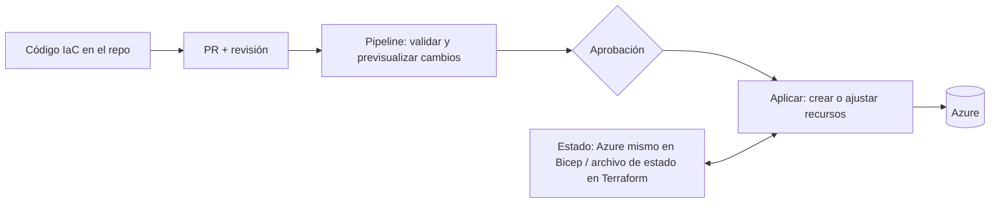

# Radar - infraestructura como código

Parte de: [[10-Radar-Herramientas/_Índice Radar de herramientas|Radar de herramientas]]

> [!info] Cómo avanzar
> `progreso`: **pendiente** → **viendo** (estudiando) → **visto** (contestaste la autoevaluación sin abrir las respuestas) → **dominado** (hiciste el laboratorio o lo aplicaste de verdad).

## Contenido

### Qué es
La **infraestructura como código** (IaC) es definir la infraestructura (App Service, Azure SQL, Key Vault, redes, identidades) en archivos de texto versionados, en lugar de crearla a mano en el portal. Una herramienta lee esos archivos y crea o ajusta los recursos para que coincidan. Esta entrada del radar compara las opciones relevantes para ti. Los conceptos base están en [[Infraestructura como código - conceptos]]. Estado revisado en noviembre de 2026.

### Para qué sirve
- **Reproducibilidad**: el ambiente de pruebas y el de producción salen del mismo código; adiós a "en QA funciona".
- **Revisión y auditoría**: los cambios de infraestructura pasan por PR en Azure DevOps como cualquier código.
- **Recuperación**: si se borra un grupo de recursos, lo recreas.
- **Documentación viva**: el código describe qué existe y cómo está configurado.
- **Automatización**: el pipeline aplica los cambios con una identidad controlada, no con la cuenta personal de alguien.

### Cómo funciona


Dos modelos de estado: **Bicep** (y ARM) usa el propio Azure Resource Manager como fuente de verdad, sin archivo de estado propio; **Terraform/OpenTofu** guardan un **archivo de estado** que debes almacenar de forma segura y compartida (por ejemplo, en una cuenta de Azure Storage con bloqueo).

#### Panorama de herramientas
| Herramienta | Alcance | Licencia / estado | Nota |
|---|---|---|---|
| [[Bicep]] | Solo Azure | Gratuita, de Microsoft | Lenguaje declarativo que compila a ARM; soporte inmediato de recursos nuevos; `what-if` para previsualizar. |
| [[Terraform]] | Multinube y muchos proveedores (GitHub, Cloudflare, etc.) | Business Source License 1.1 desde 2023; HashiCorp es parte de IBM desde 2025 | Ecosistema enorme; estado propio; HCP Terraform como servicio. |
| OpenTofu | Igual que Terraform | MPL 2.0, bajo la Linux Foundation | Fork abierto de Terraform; agrega funciones propias como cifrado del estado. |
| Pulumi | Multinube con lenguajes generales (C#, TypeScript) | Núcleo abierto, servicio comercial | Útil si prefieres C# a un DSL. |
| Azure Developer CLI (`azd`) | Flujo de proyecto en Azure | Gratuita | Orquesta Bicep o Terraform más el despliegue de la app. |

A octubre de 2026 las versiones reportadas eran Terraform 1.17 y OpenTofu 1.13; ambos han empezado a divergir en funciones, así que mezclar módulos entre ellos requiere cuidado.

### Cómo elegir entre Bicep y Terraform
- **Todo en Azure** (tu caso con App Service, Azure SQL, Key Vault y Azure DevOps): **Bicep**. Sin archivo de estado que proteger, sintaxis concisa, soporte de recursos nuevos desde el primer día y buena integración con VS Code y `az deployment`.
- **Varias nubes o proveedores** (Azure más Cloudflare, GitHub o Datadog), o un equipo que ya domina HCL: **Terraform u OpenTofu**. Si te preocupa la licencia BSL (por ejemplo, si construyes un producto que compite con HashiCorp), OpenTofu es la opción abierta.
- **Equipo de desarrolladores C#** que quiere pruebas unitarias de la infraestructura con su lenguaje: evaluar Pulumi.

### Ejemplo
Bicep para la base de Itzamna.Dionisio:

```bicep
param ubicacion string = resourceGroup().location
param nombreApp string = 'dionisio-${uniqueString(resourceGroup().id)}'

resource plan 'Microsoft.Web/serverfarms@2023-12-01' = {
  name: '${nombreApp}-plan'
  location: ubicacion
  sku: { name: 'B1' }
  kind: 'linux'
  properties: { reserved: true }
}

resource app 'Microsoft.Web/sites@2023-12-01' = {
  name: nombreApp
  location: ubicacion
  identity: { type: 'SystemAssigned' }   // identidad para leer Key Vault sin secretos
  properties: {
    serverFarmId: plan.id
    httpsOnly: true
    siteConfig: { linuxFxVersion: 'DOTNETCORE|10.0' }
  }
}
```

En el pipeline: `az deployment group what-if` en el PR y `az deployment group create` tras la aprobación del ambiente. Revisa las versiones de API y los valores de `linuxFxVersion` disponibles en tu región al usarlo (Pendiente de confirmar para .NET 10 en tu plan).

### Cuándo no vale la pena IaC
- Experimentos de una tarde en el sandbox de Microsoft Learn que vas a borrar.
- Un único recurso que nunca cambia y que no necesitas recrear (aunque incluso ahí, exportar la plantilla documenta).
- Cuando nadie en el equipo puede mantener el código: IaC abandonado y desfasado del portal es peor que nada. En ese caso empieza por lo crítico (base de datos, red) y crece poco a poco.

### Errores comunes
- **Cambios manuales en el portal** después de usar IaC (*drift*): la siguiente ejecución los revierte o falla.
- **Secretos en el código**: usa Key Vault e identidades administradas.
- **Archivo de estado de Terraform en el repo** o sin bloqueo: corrupción y fugas de secretos.
- **Sin previsualización** (`what-if`, `plan`) antes de aplicar.

### Para profundizar
- [Bicep (Microsoft Learn)](https://learn.microsoft.com/azure/azure-resource-manager/bicep/overview)
- [OpenTofu](https://opentofu.org/)
- [Terraform (HashiCorp)](https://developer.hashicorp.com/terraform)
- [Azure Developer CLI (Microsoft Learn)](https://learn.microsoft.com/azure/developer/azure-developer-cli/overview)

## Autoevaluación

Contesta primero en voz alta o en papel; luego despliega la respuesta.

> [!question]- ¿Para qué sirve la infraestructura como código (IaC)?
> Definir recursos en archivos versionados y reproducibles (Bicep, Terraform/OpenTofu, Pulumi), revisables por PR y aplicables igual en dev, QA y producción.

> [!question]- ¿Cómo eliges entre una herramienta nativa de la nube (Bicep) y una multinube (Terraform)?
> Nativa: si solo usas esa nube y quieres soporte inmediato de sus recursos sin manejar estado. Multinube: si gestionas varios proveedores o servicios externos (DNS, GitHub) con una sola herramienta, aceptando manejar el archivo de estado.

> [!question]- ¿Cuándo no vale la pena IaC?
> Para un experimento desechable de una tarde. En cuanto algo vaya a producción o se recree más de una vez, sí.

