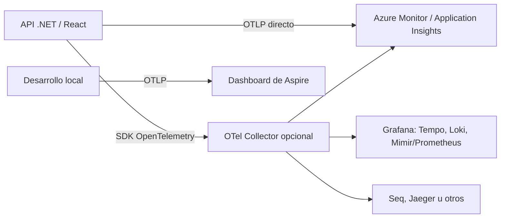

# Radar - observabilidad

Parte de: [[10-Radar-Herramientas/_Índice Radar de herramientas|Radar de herramientas]]

> [!info] Cómo avanzar
> `progreso`: **pendiente** → **viendo** (estudiando) → **visto** (contestaste la autoevaluación sin abrir las respuestas) → **dominado** (hiciste el laboratorio o lo aplicaste de verdad).

## Contenido

### Qué es
Esta entrada del radar cubre las herramientas para **observar sistemas en producción**: recolectar, guardar, consultar y alertar sobre métricas, trazas y logs (ver [[Métricas, trazas y logs]]). Incluye la instrumentación (cómo emite datos tu aplicación), el transporte (agentes y collectors) y los *backends* (dónde se guardan y visualizan). Estado revisado en noviembre de 2026.

### Cómo funciona


Separar la **instrumentación** del **backend** es la decisión clave: si instrumentas con un estándar abierto, puedes cambiar de proveedor sin tocar el código.

#### Panorama por anillo (radar personal sugerido)
- **Adoptar**: [[OpenTelemetry]] como instrumentación en .NET (trazas, métricas y logs son estables en el SDK de .NET); [[Application Insights]] / Azure Monitor como backend en Azure, con la distribución de OpenTelemetry de Azure Monitor; [[Logging estructurado]] con `ILogger`.
- **Probar**: el **dashboard de Aspire** como visor local de OTLP (también puede correr solo, sin usar Aspire para orquestar); **Grafana Cloud** con su plan gratuito para proyectos personales (ver [[Grafana Cloud - plan gratuito]]); [[Sentry]] para errores del front de React.
- **Evaluar**: el **OpenTelemetry Collector** cuando tengas varios servicios o quieras filtrar datos sensibles y muestrear antes de enviar; perfiles continuos (*continuous profiling*).
- **Resistir**: SDKs propietarios acoplados al código cuando existe la alternativa con OpenTelemetry; logs en archivos de texto en el servidor como única fuente.

### Preguntas para elegir herramientas
1. **¿Qué necesito responder?** "¿Está caído?" (disponibilidad y alertas), "¿por qué está lento?" (trazas), "¿qué pasó con este pedido?" (logs con TraceId).
2. **¿Dónde corre el sistema?** En Azure, Application Insights se integra sin infraestructura extra; en un VPS o IIS propio, quizá Grafana o Seq.
3. **¿Cuánto cuesta por volumen?** La mayoría cobra por GB ingerido o retenido. Estima con tu tráfico y define muestreo y retención.
4. **¿Soporta OpenTelemetry/OTLP de forma nativa?**
5. **¿Cumple requisitos de datos?** Región de almacenamiento, retención, control de datos personales.
6. **¿El equipo sabe consultarlo?** KQL en Azure, PromQL/LogQL en Grafana: la curva de aprendizaje cuenta.
7. **¿Tiene alertas útiles** y se integra con tus canales (correo, Teams)?

### Por qué instrumentar con OpenTelemetry aunque uses un proveedor comercial
- **Evita el *vendor lock-in***: cambias de Application Insights a Grafana (o mandas a ambos) cambiando el exportador, no tu código.
- **Un solo modelo** para todas las bibliotecas: ASP.NET Core, `HttpClient` y `SqlClient` ya emiten `Activity` y métricas compatibles.
- **Propagación estándar** (W3C Trace Context) entre servicios en distintos lenguajes: tu API .NET y un servicio Node o Java comparten trazas.
- **Flexibilidad local**: en desarrollo envías OTLP al dashboard de Aspire; en producción, al proveedor.

### Ejemplo
Configuración en Itzamna.Dionisio que funciona igual en local y en Azure:

```csharp
builder.Services.AddOpenTelemetry()
    .ConfigureResource(r => r.AddService("Itzamna.Dionisio"))
    .WithTracing(t => t.AddAspNetCoreInstrumentation().AddHttpClientInstrumentation())
    .WithMetrics(m => m.AddAspNetCoreInstrumentation().AddRuntimeInstrumentation())
    .UseOtlpExporter(); // el destino se define con OTEL_EXPORTER_OTLP_ENDPOINT

builder.Logging.AddOpenTelemetry(o => { o.IncludeFormattedMessage = true; o.IncludeScopes = true; });
```

En local, `OTEL_EXPORTER_OTLP_ENDPOINT` apunta al dashboard de Aspire; en Azure, a un Collector o se reemplaza por la distribución de Azure Monitor.

### Señal de que tu observabilidad no sirve
- Te enteras de los incidentes **por los usuarios**, no por una alerta.
- Ante un error no puedes ir del log a la traza de esa petición (no hay TraceId).
- Las alertas suenan tanto que el equipo las silencia.
- Tienes tableros llenos de gráficas que nadie consulta durante un incidente.
- No sabes cuánto pagas ni qué datos personales estás guardando.

### Errores comunes
- **Elegir backend antes de definir qué preguntas responder**.
- **Etiquetas de alta cardinalidad** que disparan costos.
- **Sin muestreo ni retención**: facturas sorpresa.
- **Datos sensibles** en atributos de spans y logs.

### Para profundizar
- [OpenTelemetry para .NET](https://opentelemetry.io/docs/languages/dotnet/)
- [Observabilidad con OpenTelemetry en .NET (Microsoft Learn)](https://learn.microsoft.com/dotnet/core/diagnostics/observability-with-otel)
- [Dashboard de Aspire](https://aspire.dev/dashboard/overview/)

## Autoevaluación

Contesta primero en voz alta o en papel; luego despliega la respuesta.

> [!question]- ¿Qué preguntas te haces para elegir herramientas de observabilidad?
> ¿Cubre logs, métricas y trazas correlacionadas? ¿Usa estándares abiertos (OpenTelemetry) para no quedar atado? ¿Cómo crece el costo con el volumen de datos? ¿Tiene alertas útiles?

> [!question]- ¿Por qué conviene instrumentar con OpenTelemetry aunque uses un proveedor comercial?
> Separas la instrumentación del backend: puedes cambiar de Application Insights a Grafana, Datadog u otro cambiando el exportador, no el código. Ver [[OpenTelemetry]].

> [!question]- Señal de que tu observabilidad no sirve.
> Te enteras de los incidentes por los usuarios, o no puedes seguir una petición de punta a punta entre servicios.

