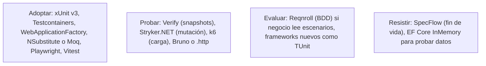

# Radar - testing

Parte de: [[10-Radar-Herramientas/_Índice Radar de herramientas|Radar de herramientas]]

> [!info] Cómo avanzar
> `progreso`: **pendiente** → **viendo** (estudiando) → **visto** (contestaste la autoevaluación sin abrir las respuestas) → **dominado** (hiciste el laboratorio o lo aplicaste de verdad).

## Contenido

### Qué es
Esta entrada del radar agrupa las **herramientas de pruebas** para tu stack: frameworks de pruebas unitarias, dobles, pruebas de integración, e2e, carga, snapshots y calidad de pruebas. La teoría está en el área de testing ([[Pirámide de pruebas]]); aquí decides **qué herramienta usar** y en qué anillo está cada una. Estado revisado en noviembre de 2026.

### Cómo funciona: panorama por anillo


Estado relevante:

- **xUnit v3**: la versión 4.0 se publicó el 14 de agosto de 2026, con soporte para Native AOT en proyectos de prueba, paralelización completa configurable y Microsoft Testing Platform v2 por defecto (VSTest sigue disponible como opción). Las herramientas de consola nuevas requieren el SDK de .NET 10.
- **Microsoft Testing Platform (MTP)**: plataforma moderna de ejecución de pruebas de Microsoft que reemplaza gradualmente a VSTest; cambia algunos parámetros de `dotnet test`.
- **SpecFlow** llegó a fin de vida el 31 de diciembre de 2024; su sucesor comunitario es **Reqnroll** (ver [[BDD]]).
- **k6** de Grafana alcanzó su versión 1.0 en mayo de 2025 (ver [[Pruebas de carga (k6 y NBomber)]]).
- **Moq** tuvo en 2023 la polémica de SponsorLink; muchos equipos prefieren **NSubstitute** (ver [[Moq y NSubstitute]]).
- **Playwright** soporta Chromium, Firefox y WebKit, y tiene versión para .NET; **Cypress** soporta familia Chrome, Edge y Firefox, con WebKit experimental.

### Qué evaluar en una herramienta de pruebas nueva
1. **¿Qué problema de mi suite resuelve?** Lentitud, fragilidad, falta de cobertura de un tipo de riesgo.
2. **Integración con tu flujo**: `dotnet test`, Test Explorer de Visual Studio y VS Code, reportes en Azure DevOps (formato TRX o JUnit), ejecución en agentes Linux.
3. **Velocidad y paralelismo**.
4. **Determinismo**: ¿reduce o aumenta pruebas intermitentes?
5. **Mantenimiento y comunidad**: frecuencia de versiones, issues atendidos, quién la respalda.
6. **Licencia y costo**: gratuita, de pago por usuario, o con servicio en la nube de pago para funciones clave.
7. **Curva de aprendizaje** y legibilidad para el equipo.
8. **Costo de salida**: ¿qué tan atado queda tu código de pruebas?

### Ejemplo de herramienta que suele pasar a Adoptar: Testcontainers
[[Testcontainers]] es un buen ejemplo de entrada que suele moverse rápido de Probar a Adoptar para pruebas de integración:

- Resuelve un problema real y frecuente: probar SQL, procedimientos y transacciones contra el **mismo motor** que producción, sin bases compartidas.
- Funciona igual en tu PC (Docker Desktop) y en un agente Ubuntu de Azure DevOps.
- Cada ejecución arranca limpia: menos intermitencias por datos sucios.
- Tiene módulos listos para SQL Server, PostgreSQL, Redis y colas, con API sencilla en C#.
- El costo es acotado: requiere Docker y algunos segundos de arranque, que se amortizan compartiendo el contenedor entre pruebas.

```yaml
# Fragmento de azure-pipelines.yml para pruebas de integración
- job: integracion
  pool: { vmImage: 'ubuntu-latest' }   # trae Docker
  steps:
    - task: UseDotNet@2
      inputs: { packageType: sdk, version: '10.0.x' }
    - script: dotnet test tests/Dionisio.Integracion --logger trx
    - task: PublishTestResults@2
      inputs: { testResultsFormat: VSTest, testResultsFiles: '**/*.trx' }
```

### Cuándo descartar una herramienta de e2e
- Si no soporta los navegadores que usan tus clientes (por ejemplo, Safari/WebKit en iPhone si tu público usa iOS).
- Si sus pruebas son intermitentes de forma crónica en tu aplicación y la depuración es difícil.
- Si las funciones esenciales (paralelismo, reportes) solo existen en un servicio de pago que no puedes costear.
- Si el equipo no puede escribirlas en un lenguaje que domina.
- Si la aplicación cambia tanto que mantener e2e cuesta más que lo que detectan; en ese caso, invierte en integración.

### Errores comunes
- **Cambiar de framework sin necesidad**: migrar 2,000 pruebas por una moda.
- **Adoptar varias herramientas para lo mismo** (dos librerías de mocks, dos de aserciones).
- **No fijar versiones** de imágenes y paquetes: pruebas que cambian solas.
- **Evaluar solo con ejemplos de juguete**: pruébala con una parte real de tu suite.

### Para profundizar
- [Notas de la versión 4.0 de xUnit v3](https://xunit.net/releases/v3/4.0.0)
- [Microsoft Testing Platform (Microsoft Learn)](https://learn.microsoft.com/dotnet/core/testing/microsoft-testing-platform-intro)
- [Testcontainers para .NET](https://dotnet.testcontainers.org/)
- [Playwright](https://playwright.dev/)

## Autoevaluación

Contesta primero en voz alta o en papel; luego despliega la respuesta.

> [!question]- ¿Qué evalúas en una herramienta de pruebas nueva?
> Velocidad y estabilidad (sin pruebas intermitentes), integración con el IDE y CI, legibilidad de las pruebas y de los errores, y que no obligue a reescribir las existentes.

> [!question]- Ejemplo de herramienta que suele pasar a *Adoptar* para pruebas de integración y por qué.
> Testcontainers: levanta dependencias reales (SQL Server, Redis) en contenedores desechables, así las pruebas no dependen de una base compartida. Requiere Docker en desarrollo y CI.

> [!question]- ¿Cuándo descartarías una herramienta de e2e?
> Si genera pruebas frágiles que fallan por tiempos, o el equipo no puede mantenerlas. Ver [[Pirámide de pruebas]].

