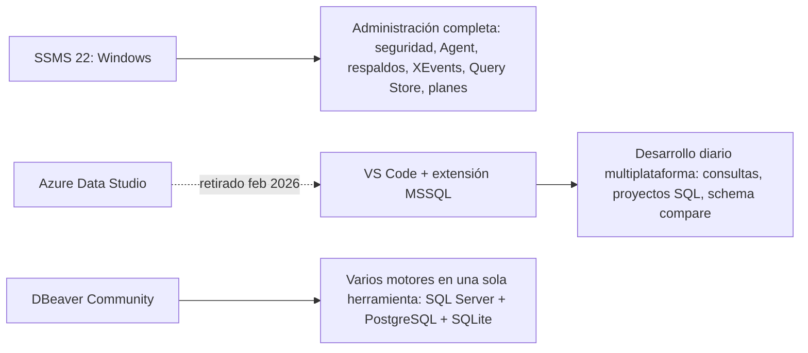

# SSMS, Azure Data Studio y DBeaver

Parte de: [[10-Radar-Herramientas/_Índice Radar de herramientas|Radar de herramientas]]

> [!info] Cómo avanzar
> `progreso`: **pendiente** → **viendo** (estudiando) → **visto** (contestaste la autoevaluación sin abrir las respuestas) → **dominado** (hiciste el laboratorio o lo aplicaste de verdad).

## Contenido

### Qué es
Son herramientas gráficas para trabajar con bases de datos: escribir y ejecutar consultas, explorar objetos, ver planes de ejecución y administrar servidores. Estado revisado en noviembre de 2026:

- **SQL Server Management Studio (SSMS)**: la herramienta de Microsoft para Windows, la más completa para **administrar SQL Server** y Azure SQL. La versión **SSMS 22** está disponible de forma general desde noviembre de 2025, con soporte para Windows en ARM64, integración con GitHub Copilot (en vista previa al momento de su lanzamiento) y soporte para SQL Server 2025. Es gratuita.
- **Azure Data Studio (ADS)**: editor multiplataforma de Microsoft basado en VS Code. **Fue retirado el 28 de febrero de 2026**: ya no recibe actualizaciones ni parches de seguridad. Microsoft recomienda **VS Code con la extensión MSSQL** para el desarrollo diario (consultas, proyectos de base de datos, comparación de esquemas, diseñador de esquema, Query Profiler) y **SSMS** para la administración completa, incluido SQL Server Agent.
- **DBeaver**: cliente universal multiplataforma que se conecta a muchos motores por JDBC (SQL Server, PostgreSQL, MySQL, SQLite, Oracle y más). La edición **Community** es gratuita y de código abierto; existen ediciones comerciales con funciones adicionales.

### Cómo funciona: qué ofrece cada uno


| Necesidad | Mejor opción |
|---|---|
| Plan de ejecución real, Query Store, índices faltantes | SSMS |
| SQL Server Agent (trabajos programados), seguridad y logins, respaldos y restauración | SSMS |
| Extended Events, XEvent Profiler | SSMS (o Query Profiler en la extensión MSSQL) |
| Editar archivos `.sql` del repo con Git, en Windows, Mac o Linux | VS Code + MSSQL |
| Proyectos de base de datos SQL (SDK-style) y comparación de esquemas | VS Code + MSSQL o Visual Studio |
| Trabajar con PostgreSQL (Pochteca.Nomisma) y SQL Server desde la misma herramienta | DBeaver (o VS Code con la extensión de PostgreSQL) |
| Explorar rápidamente una base SQLite | DBeaver |

### Ejemplo
Flujo típico con Itzamna.Dionisio:

1. Escribes y versionas los procedimientos en archivos `.sql` dentro del repo, editándolos en **VS Code con la extensión MSSQL** conectada a tu SQL Server local o al contenedor de pruebas.
2. Cuando un endpoint está lento, abres la consulta en **SSMS**, activas *Include Actual Execution Plan* (Ctrl+M), ejecutas con los parámetros reales y revisas operadores costosos, *scans*, advertencias de conversión implícita y el índice sugerido. Luego revisas en **Query Store** si el plan cambió recientemente.
3. Para revisar datos en la base PostgreSQL de Pochteca.Nomisma y compararlos con SQL Server, usas **DBeaver**.

```sql
-- En SSMS: estadísticas de I/O y tiempo junto con el plan real
SET STATISTICS IO, TIME ON;
EXEC dbo.Pedido_ListarPorCliente @ClienteId = 42, @Desde = '2026-01-01';
SET STATISTICS IO, TIME OFF;
```

### Cuándo DBeaver
- Trabajas con **varios motores** y quieres una sola herramienta y una sola forma de trabajar.
- Usas **Mac o Linux** y necesitas una interfaz gráfica completa para explorar datos y esquemas (diagramas ER, edición de tablas, exportar a CSV o Excel).
- Necesitas conectarte a motores para los que Microsoft no ofrece herramienta.

No es la mejor opción para tareas profundas de administración de SQL Server (Agent, Query Store, análisis fino de planes): ahí SSMS es superior.

### Cuándo usarlo y cuándo no
Anillos sugeridos en tu radar: **Adoptar** SSMS para administración y diagnóstico de SQL Server, y VS Code con MSSQL para editar los `.sql` del repo; **Probar** DBeaver Community para escenarios multimotor; **Resistir** Azure Data Studio (retirado; migra tus cuadernos, conexiones y extensiones a VS Code).

### Errores comunes
- **Seguir usando Azure Data Studio**: sin parches de seguridad desde febrero de 2026.
- **Editar procedimientos directo en el servidor** desde SSMS sin pasar el cambio al archivo del repo: la base y el código divergen.
- **Conectarte a producción con un usuario con todos los privilegios** desde tu herramienta de escritorio. Usa cuentas de solo lectura para consultar.
- **Juzgar el rendimiento con el plan estimado** en lugar del real, o sin los mismos parámetros que la aplicación.

### Para profundizar
- [SQL Server Management Studio (Microsoft Learn)](https://learn.microsoft.com/ssms/sql-server-management-studio-ssms)
- [Qué pasa con Azure Data Studio (Microsoft Learn)](https://learn.microsoft.com/azure-data-studio/whats-happening-azure-data-studio)
- [Extensión MSSQL para VS Code](https://marketplace.visualstudio.com/items?itemName=ms-mssql.mssql)
- [DBeaver](https://dbeaver.io/)

## Autoevaluación

Contesta primero en voz alta o en papel; luego despliega la respuesta.

> [!question]- ¿Para qué sirve cada uno?
> SSMS: herramienta completa de Microsoft para administrar SQL Server (solo Windows). Azure Data Studio: editor ligero multiplataforma con notebooks (Pendiente de confirmar su estado de soporte actual; Microsoft anunció su retiro en favor de la extensión MSSQL de VS Code). DBeaver: cliente universal para muchos motores.

> [!question]- ¿Cuál eliges para administrar SQL Server (planes de ejecución, Agent, seguridad)?
> SSMS: es la más completa para administración, planes de ejecución y SQL Agent.

> [!question]- ¿Cuándo DBeaver?
> Cuando trabajas con varios motores (SQL Server, PostgreSQL, MySQL, SQLite) y quieres una sola herramienta.

