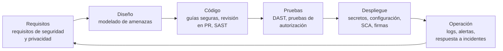

# Ciclo de desarrollo seguro (SSDLC)

Parte de: [[12-Seguridad/01 Fundamentos de seguridad/_Índice Fundamentos de seguridad|Fundamentos de seguridad]]

> [!info] Cómo avanzar
> `progreso`: **pendiente** → **viendo** (estudiando) → **visto** (contestaste la autoevaluación sin abrir las respuestas) → **dominado** (hiciste el laboratorio o lo aplicaste de verdad).

## Contenido

### Qué es
Un **ciclo de desarrollo seguro** (SSDLC, *Secure Software Development Life Cycle*) es la forma de meter actividades de seguridad en **cada etapa** del ciclo normal de desarrollo: requisitos, diseño, código, pruebas, despliegue y operación. La idea es que la seguridad no sea una auditoría al final ("ya está listo, pásalo a seguridad"), sino un hábito del equipo que se nota en las historias de usuario, en los pull requests y en el pipeline.

Sirve para encontrar los problemas cuando todavía son baratos de corregir. Un defecto de diseño detectado en una sesión de pizarrón cuesta una conversación; el mismo defecto detectado en producción cuesta un incidente, un parche urgente y, a veces, una notificación legal.

### Cómo funciona
A cada fase le corresponde una práctica concreta:



**Shift left** ("mover a la izquierda") significa adelantar esas prácticas en la línea de tiempo: en lugar de esperar a un pentest antes de salir a producción, el analizador estático corre en cada PR, el escaneo de dependencias falla el build y el modelado de amenazas se hace cuando se diseña la funcionalidad. No elimina las pruebas tardías; las complementa para que lleguen con menos hallazgos.

Los marcos de referencia más usados son:
- **Microsoft SDL** (Security Development Lifecycle): el proceso que Microsoft publicó a partir de su propia experiencia; muy práctico para equipos .NET y Azure.
- **NIST SSDF** (SP 800-218, *Secure Software Development Framework*): lista de prácticas agrupadas en preparar la organización, proteger el software, producir software bien asegurado y responder a vulnerabilidades.
- **OWASP SAMM** (*Software Assurance Maturity Model*): modelo de madurez para medir dónde está tu equipo y planear mejoras por niveles.

### Ejemplo
Cómo se ve en una funcionalidad de Itzamna.Dionisio, "exportar pedidos a Excel":

1. **Requisito**: solo el rol `Ventas` del mismo tenant puede exportar; el archivo no incluye datos personales sensibles.
2. **Diseño**: 15 minutos de [[Mentalidad de seguridad y modelado de amenazas|modelado de amenazas]]: ¿qué pasa si alguien cambia el `tenantId` en la URL? ¿Y si pide un rango de 10 años y tumba el servidor?
3. **Código**: consulta en archivo `.sql` con parámetros, filtro por tenant tomado del token, límite de filas. El PR usa una lista de revisión con puntos de seguridad.
4. **Pipeline de Azure DevOps**: análisis estático, escaneo de dependencias y de secretos en cada build.

```yaml
# azure-pipelines.yml (fragmento)
steps:
  - script: dotnet build --configuration Release -warnaserror
    displayName: Compilar (analizadores como errores)
  - script: dotnet list package --vulnerable --include-transitive
    displayName: Revisar paquetes con vulnerabilidades conocidas
  - script: dotnet test --configuration Release
    displayName: Pruebas, incluidas las de autorización
```

5. **Operación**: se registra cada exportación (quién, cuándo, cuántas filas) sin guardar el contenido.

### Cuándo usarlo y cuándo no
Siempre, pero **proporcional al riesgo**. Un script interno de un solo uso no necesita un modelo de amenazas formal; una API de identidad como Xolotl.Hecate sí. Empieza por lo que más rinde: revisión de PR con checklist, analizadores y escaneo de dependencias en el pipeline, y secretos fuera del repo. Después sube de nivel con SAMM como guía.

### Errores comunes
- **Comprar una herramienta y llamarlo SSDLC.** Un escáner sin nadie que atienda los hallazgos solo produce ruido. Define quién revisa y en cuánto tiempo.
- **Bloquear todo el pipeline desde el día uno.** El equipo termina desactivando el paso. Empieza en modo informativo, limpia lo existente y luego conviértelo en bloqueante.
- **Dejar la seguridad solo al final.** El pentest previo a producción encuentra fallas de diseño que obligan a rehacer módulos.
- **No cerrar el ciclo.** Si un incidente no genera una regla nueva de revisión o una prueba automatizada, se repetirá.

### Para profundizar
- [Microsoft Security Development Lifecycle](https://www.microsoft.com/en-us/securityengineering/sdl)
- [NIST SSDF (SP 800-218)](https://csrc.nist.gov/projects/ssdf)
- [OWASP SAMM](https://owaspsamm.org/)

## Autoevaluación

Contesta primero en voz alta o en papel; luego despliega la respuesta.

> [!question]- ¿Qué es un SSDLC?
> Integrar actividades de seguridad en cada fase del ciclo: requisitos (requisitos de seguridad), diseño (modelado de amenazas), código (revisión, SAST), pruebas (DAST, pruebas de seguridad), despliegue (configuración segura) y operación (monitoreo, respuesta a incidentes).

> [!question]- ¿Qué significa "shift left"?
> Mover las actividades de seguridad hacia el inicio del ciclo, donde corregir es más barato que en producción.

> [!question]- Menciona dos marcos de referencia de desarrollo seguro.
> Microsoft SDL, NIST SSDF (SP 800-218) y OWASP SAMM.

