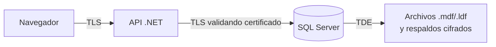

# Cifrado en reposo y en tránsito

Parte de: [[12-Seguridad/01 Fundamentos de seguridad/_Índice Fundamentos de seguridad|Fundamentos de seguridad]]

> [!info] Cómo avanzar
> `progreso`: **pendiente** → **viendo** (estudiando) → **visto** (contestaste la autoevaluación sin abrir las respuestas) → **dominado** (hiciste el laboratorio o lo aplicaste de verdad).

## Contenido

### Qué es
- **Cifrado en tránsito**: protege los datos mientras viajan por la red (navegador → API, API → SQL Server, API → otro servicio). Normalmente es TLS.
- **Cifrado en reposo**: protege los datos mientras están guardados (archivos de la base, respaldos, discos, blobs). Ejemplos: TDE de SQL Server, cifrado de discos administrados en Azure, cifrado de Azure Storage.

Son complementarios: el primero evita que alguien que escucha la red lea o altere el tráfico; el segundo evita que alguien que se lleva un disco, un respaldo o un archivo `.mdf` lo pueda leer.

### Cómo funciona
**En tránsito (TLS)**: el cliente y el servidor negocian llaves con criptografía asimétrica, el servidor demuestra su identidad con un certificado firmado por una autoridad en la que el cliente confía, y a partir de ahí todo viaja cifrado con criptografía simétrica (ver [[Cifrado simétrico y asimétrico]]). La parte crítica es **validar el certificado**: sin esa validación el cifrado existe, pero no sabes con quién estás hablando, y un intermediario puede ponerse en medio.

**En reposo**: la información se cifra antes de escribirse en disco y se descifra al leerla. Con **TDE** (*Transparent Data Encryption*) SQL Server cifra los archivos de datos, el log y los respaldos; es "transparente" porque la aplicación no cambia nada. Eso también es su límite: **cualquiera que se conecte y consulte con permisos válidos ve los datos en claro**, porque el motor los descifra para él. TDE protege contra el robo del archivo o del respaldo, no contra un DBA, ni contra un atacante que compromete tu API y usa su cadena de conexión.

Si necesitas que ni el DBA vea ciertas columnas (CURP, RFC, datos de salud), existe **Always Encrypted**: el cifrado y descifrado ocurren en el cliente (el driver), y las llaves viven fuera del servidor, por ejemplo en Azure Key Vault. Tiene costo: limita las operaciones que puedes hacer en SQL sobre esas columnas.



### Ejemplo
Cadena de conexión de Itzamna.Dionisio con `Microsoft.Data.SqlClient`:

```text
Server=tcp:sql-dionisio.database.windows.net,1433;Database=Dionisio;
Authentication=Active Directory Default;Encrypt=True;TrustServerCertificate=False;
```

- `Encrypt=True` pide TLS (en `Microsoft.Data.SqlClient` 4.0 y posteriores ya es el valor por defecto).
- `TrustServerCertificate=False` obliga a validar que el certificado del servidor sea de confianza y corresponda al nombre del host.
- `Authentication=Active Directory Default` evita poner contraseña en la cadena (usa identidad administrada en Azure).

`TrustServerCertificate=True` significa "cifra, pero **acepta cualquier certificado**". Es común en desarrollo local con un SQL Server que usa un certificado autofirmado, y peligroso en producción: un atacante en la red puede presentar su propio certificado, descifrar el tráfico, leer credenciales y datos, y reenviarlos al servidor real sin que la aplicación lo note. La solución correcta es instalar un certificado válido en el servidor o confiar explícitamente en su CA, no apagar la validación.

En el lado web: HTTPS obligatorio con `app.UseHttpsRedirection()` y HSTS (`app.UseHsts()`) en producción, para que el navegador no vuelva a intentar HTTP.

### Cuándo usarlo y cuándo no
- **En tránsito**: siempre, también dentro de la red "interna". Las redes internas se comprometen y el tráfico entre servicios suele llevar tokens.
- **En reposo**: siempre que el proveedor lo ofrezca (en Azure SQL, TDE viene activado por defecto en bases nuevas). Añade cifrado a nivel de columna o de aplicación solo para datos muy sensibles, porque complica búsquedas e índices.
- Para contraseñas no se usa cifrado sino hash lento (PBKDF2, bcrypt, Argon2).

### Errores comunes
- **Creer que TDE protege de todo.** Protege archivos y respaldos; no protege de consultas legítimas ni de SQL injection.
- **`TrustServerCertificate=True` copiado de desarrollo a producción.** Revisa las cadenas de cada ambiente en el pipeline.
- **Terminar TLS en el balanceador y seguir en HTTP hacia atrás sin pensarlo.** Decide conscientemente y documenta si el tramo interno va cifrado.
- **Cifrar y guardar la llave junto a los datos.** Si la llave está en la misma base o en el repo, el cifrado no sirve. Usa Key Vault.

### Para profundizar
- [Transparent Data Encryption (Microsoft Learn)](https://learn.microsoft.com/en-us/sql/relational-databases/security/encryption/transparent-data-encryption)
- [Always Encrypted (Microsoft Learn)](https://learn.microsoft.com/en-us/sql/relational-databases/security/encryption/always-encrypted-database-engine)
- [SqlConnectionStringBuilder.TrustServerCertificate](https://learn.microsoft.com/en-us/dotnet/api/microsoft.data.sqlclient.sqlconnectionstringbuilder.trustservercertificate)
- [OWASP Transport Layer Security Cheat Sheet](https://cheatsheetseries.owasp.org/cheatsheets/Transport_Layer_Security_Cheat_Sheet.html)

## Autoevaluación

Contesta primero en voz alta o en papel; luego despliega la respuesta.

> [!question]- Define cifrado en reposo y en tránsito.
> **En tránsito**: los datos viajan cifrados por la red (TLS/HTTPS, `Encrypt=True` en SQL Server). **En reposo**: los datos guardados en disco, respaldo o base de datos están cifrados (TDE, cifrado de discos, Storage cifrado).

> [!question]- Si tu base tiene TDE, ¿un DBA o un atacante con acceso a la app puede leer los datos?
> Sí. TDE protege los archivos y respaldos robados, no las consultas de alguien autenticado. Para ocultar columnas incluso al DBA existe Always Encrypted o cifrado a nivel de aplicación.

> [!question]- ¿Qué significa `TrustServerCertificate=True` en una cadena de conexión y por qué es riesgoso?
> El cliente acepta cualquier certificado del servidor sin validarlo: la conexión va cifrada pero alguien en medio podría hacerse pasar por el servidor. Úsalo solo en desarrollo local.

