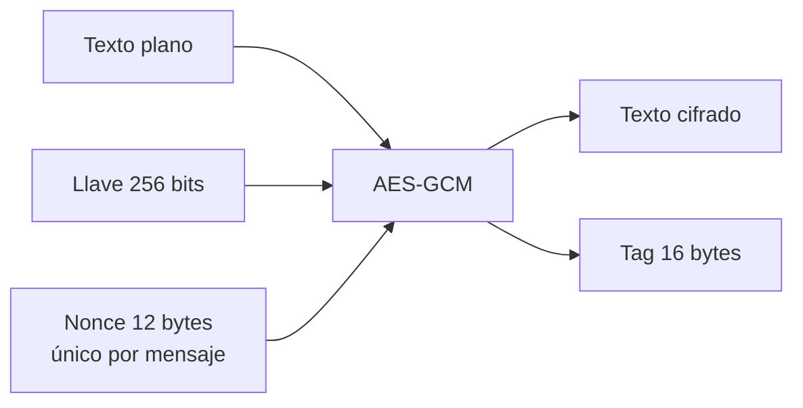

# Cifrado simétrico (AES)

Parte de: [[Cifrado simétrico y asimétrico]]

> [!info] Cómo avanzar
> `progreso`: **pendiente** → **viendo** (estudiando) → **visto** (contestaste la autoevaluación sin abrir las respuestas) → **dominado** (hiciste el laboratorio o lo aplicaste de verdad).

## Contenido

### Qué es
**AES** (*Advanced Encryption Standard*) es el algoritmo de cifrado simétrico estándar: la misma llave cifra y descifra. Trabaja con bloques de 128 bits y admite llaves de **128, 192 o 256 bits**. Es rápido, tiene aceleración por hardware en casi cualquier procesador moderno y es lo que protege la mayor parte del tráfico TLS, los discos cifrados y los archivos en la nube.

AES por sí solo solo sabe cifrar un bloque de 16 bytes. Para cifrar datos reales se usa con un **modo de operación**, y la elección del modo importa tanto como la del algoritmo.

### Cómo funciona
- **ECB** cifra cada bloque por separado con la misma llave. Bloques iguales producen texto cifrado igual, así que los patrones del original se notan (el ejemplo clásico es una imagen cifrada en ECB donde se sigue viendo la silueta). Además no detecta alteraciones. **No lo uses.**
- **CBC** encadena bloques con un IV aleatorio; oculta patrones, pero no autentica: alguien puede alterar el texto cifrado y, con mensajes de error indiscretos, incluso descifrarlo (ataques de *padding oracle*). Requiere añadir un HMAC aparte.
- **GCM** es un modo de **cifrado autenticado** (AEAD): cifra y además produce una **etiqueta** (*tag*) que permite detectar cualquier modificación. Si alguien cambia un byte, el descifrado falla. Por eso es el recomendado.

En GCM cada mensaje usa un **nonce** de 12 bytes que **nunca debe repetirse con la misma llave**. Si se repite, un atacante que tenga los dos textos cifrados puede obtener la combinación (XOR) de ambos textos originales y, peor, recuperar la llave interna de autenticación y fabricar mensajes que pasen como válidos. Es de los errores más graves en criptografía aplicada. La forma práctica de evitarlo es generar un nonce aleatorio por mensaje con `RandomNumberGenerator` y rotar la llave antes de cifrar una cantidad enorme de mensajes.



### Ejemplo
Cifrado autenticado en .NET 10 con `AesGcm`:

```csharp
using System.Security.Cryptography;
using System.Text;

public static class CifradoCampo
{
    public static byte[] Cifrar(byte[] llave, string texto)
    {
        byte[] plano = Encoding.UTF8.GetBytes(texto);
        byte[] nonce = RandomNumberGenerator.GetBytes(AesGcm.NonceByteSizes.MaxSize); // 12
        byte[] cifrado = new byte[plano.Length];
        byte[] tag = new byte[AesGcm.TagByteSizes.MaxSize]; // 16

        using var aes = new AesGcm(llave, tag.Length);
        aes.Encrypt(nonce, plano, cifrado, tag);

        // Formato: nonce | tag | cifrado (el nonce no es secreto, pero sí debe ser único)
        return [.. nonce, .. tag, .. cifrado];
    }

    public static string Descifrar(byte[] llave, byte[] paquete)
    {
        var nonce = paquete.AsSpan(0, 12);
        var tag = paquete.AsSpan(12, 16);
        var cifrado = paquete.AsSpan(28);
        byte[] plano = new byte[cifrado.Length];

        using var aes = new AesGcm(llave, tag.Length);
        aes.Decrypt(nonce, cifrado, tag, plano); // lanza AuthenticationTagMismatchException si se alteró
        return Encoding.UTF8.GetString(plano);
    }
}
```

La llave de 32 bytes no se escribe en el código: se obtiene de Azure Key Vault o de la configuración protegida.

### Cuándo usarlo y cuándo no
- **Úsalo** para cifrar datos propios: una columna con un dato muy sensible, un archivo antes de subirlo a Blob Storage, un token de terceros que debes guardar.
- **No lo uses para contraseñas**: ahí va un hash lento con sal (PBKDF2 con `Rfc2898DeriveBytes.Pbkdf2`, o el `PasswordHasher` de ASP.NET Core Identity).
- Si solo necesitas proteger cookies o tokens internos de ASP.NET Core, la **Data Protection API** ya resuelve llaves, rotación y formato por ti.

### Errores comunes
- **Usar ECB** porque es el modo por defecto de alguna librería o ejemplo viejo.
- **Nonce fijo o contador que se reinicia** al reiniciar la app. Usa aleatorio por mensaje.
- **Derivar la llave de una contraseña con un simple SHA-256.** Si la llave sale de una contraseña, usa PBKDF2 con sal y muchas iteraciones.
- **Ignorar la excepción de tag inválido** y seguir con datos alterados. Trátala como dato corrupto o manipulado.

### Para profundizar
- [Clase AesGcm (Microsoft Learn)](https://learn.microsoft.com/en-us/dotnet/api/system.security.cryptography.aesgcm)
- [Data Protection en ASP.NET Core](https://learn.microsoft.com/en-us/aspnet/core/security/data-protection/introduction)
- [OWASP Cryptographic Storage Cheat Sheet](https://cheatsheetseries.owasp.org/cheatsheets/Cryptographic_Storage_Cheat_Sheet.html)

## Autoevaluación

Contesta primero en voz alta o en papel; luego despliega la respuesta.

> [!question]- ¿Qué es AES y qué tamaños de llave admite?
> Advanced Encryption Standard, cifrado por bloques de 128 bits con llaves de 128, 192 o 256 bits.

> [!question]- ¿Por qué se recomienda AES-GCM y no AES-ECB?
> ECB cifra igual los bloques iguales y deja ver patrones. GCM es un modo autenticado: además de cifrar, detecta si alguien alteró el texto cifrado.

> [!question]- ¿Qué pasa si reutilizas el mismo nonce/IV con la misma llave en AES-GCM?
> Se rompe la seguridad: se puede recuperar información de los mensajes y falsificar la autenticación. El nonce debe ser único por mensaje con esa llave.

> [!question]- En .NET, ¿qué clase usarías para cifrado autenticado?
> `System.Security.Cryptography.AesGcm`, con un nonce aleatorio de 12 bytes por mensaje y guardando nonce + tag junto al texto cifrado.

