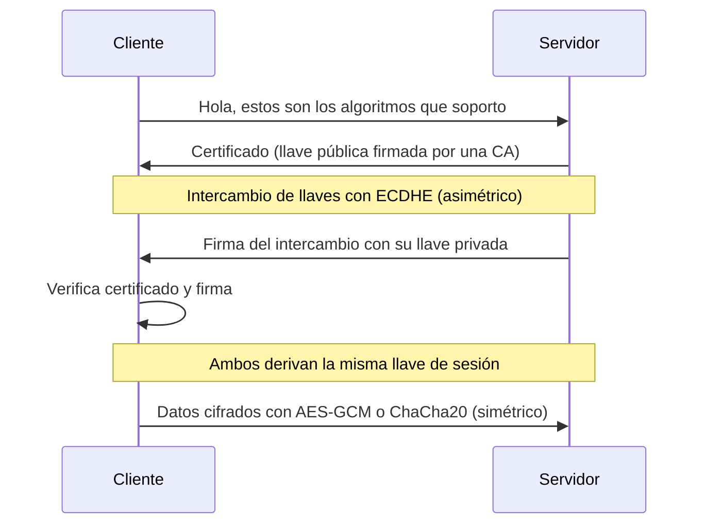

# Cifrado simétrico y asimétrico

Parte de: [[12-Seguridad/01 Fundamentos de seguridad/_Índice Fundamentos de seguridad|Fundamentos de seguridad]]

> [!info] Cómo avanzar
> `progreso`: **pendiente** → **viendo** (estudiando) → **visto** (contestaste la autoevaluación sin abrir las respuestas) → **dominado** (hiciste el laboratorio o lo aplicaste de verdad).

## Contenido

### Qué es
Son las dos grandes familias de cifrado:
- **Simétrico**: una sola llave secreta, compartida, cifra y descifra. Es muy rápido. El reto es cómo hacer llegar esa llave a la otra parte sin que nadie la vea. Detalle en [[Cifrado simétrico (AES)]].
- **Asimétrico**: un par de llaves, pública y privada. Resuelve el problema de repartir llaves y permite firmar, pero es lento y solo procesa datos pequeños. Detalle en [[Cifrado asimétrico (RSA y ECC)]].

La diferencia principal, entonces, es **cuántas llaves hay y quién las tiene**: en el simétrico ambos lados comparten el mismo secreto; en el asimétrico cada parte tiene su secreto y publica la otra mitad.

### Cómo funciona
En la práctica casi nunca se usa una sola familia: se combinan. **TLS** es el ejemplo perfecto:



1. Lo **asimétrico** sirve para dos cosas: acordar una llave de sesión sin enviarla por la red (ECDHE) y **autenticar** al servidor (su certificado y su firma).
2. Lo **simétrico** cifra todos los datos de la conversación, porque es rápido.

El mismo patrón híbrido aparece al cifrar archivos con una llave AES que a su vez se protege con RSA o con Key Vault ("cifrado de sobre").

**Cifrar no es lo mismo que hacer hash.** Cifrar es reversible si tienes la llave; un hash (SHA-256) es una función de un solo sentido que produce una huella de tamaño fijo y no tiene llave. El hash sirve para verificar integridad o para guardar contraseñas (con algoritmos lentos y sal); el cifrado sirve para ocultar datos que después necesitarás leer. Si "cifras" contraseñas, alguien con la llave las puede recuperar todas; si las hasheas bien, no.

### Ejemplo
Elegir la herramienta correcta en tus proyectos:

| Necesidad | Qué usar en .NET |
|---|---|
| Proteger el tráfico API ↔ navegador | TLS (HTTPS), lo hace Kestrel o Azure |
| Cifrar una columna con CURP | `AesGcm` con llave en Key Vault, o Always Encrypted |
| Firmar JWT en Xolotl.Hecate | `RSA` o `ECDsa` (RS256 / ES256) |
| Guardar contraseñas | `PasswordHasher<T>` o `Rfc2898DeriveBytes.Pbkdf2` |
| Verificar que un archivo no cambió | `SHA256.HashData` |
| Cifrar un respaldo para otra empresa | Híbrido: AES para el archivo, RSA de la otra empresa para la llave |

```csharp
// Hash: sin llave, sin vuelta atrás
byte[] huella = System.Security.Cryptography.SHA256.HashData(File.ReadAllBytes("reporte.xlsx"));
Console.WriteLine(Convert.ToHexString(huella));
```

### Cuándo usarlo y cuándo no
- **Simétrico** cuando las dos partes ya comparten la llave de forma segura, o cuando tú mismo cifras y descifras (datos en reposo).
- **Asimétrico** cuando las partes no comparten secreto, cuando necesitas firmas verificables por terceros o para repartir llaves simétricas.
- **Ninguno** cuando lo que necesitas es un hash (contraseñas, integridad) o un HMAC (autenticar mensajes entre dos sistemas que comparten secreto). Ver [[Firmas digitales]].

### Errores comunes
- **Inventar tu propio algoritmo** ("le sumo 3 a cada byte y luego lo volteo"). La seguridad de un algoritmo no puede depender de que nadie sepa cómo funciona (principio de Kerckhoffs); los algoritmos estándar han resistido décadas de análisis público, y los caseros suelen romperse en minutos. También es error implementar AES o RSA "a mano": usa las clases de `System.Security.Cryptography`.
- **Confundir codificar con cifrar.** Base64 no protege nada; cualquiera lo decodifica.
- **Elegir el modo o el relleno equivocado** (ECB, RSA sin OAEP).
- **Descuidar las llaves.** El algoritmo más fuerte no sirve si la llave está en `appsettings.json`.

### Para profundizar
- [Modelo de criptografía en .NET](https://learn.microsoft.com/en-us/dotnet/standard/security/cryptography-model)
- [RFC 8446 - TLS 1.3](https://www.rfc-editor.org/rfc/rfc8446)
- [OWASP Cryptographic Storage Cheat Sheet](https://cheatsheetseries.owasp.org/cheatsheets/Cryptographic_Storage_Cheat_Sheet.html)

## Subtemas

- [[Cifrado simétrico (AES)]]
- [[Cifrado asimétrico (RSA y ECC)]]

## Autoevaluación

Contesta primero en voz alta o en papel; luego despliega la respuesta.

> [!question]- ¿Diferencia principal entre cifrado simétrico y asimétrico?
> Simétrico: la misma llave cifra y descifra (AES); rápido, pero hay que compartir la llave de forma segura. Asimétrico: par de llaves pública/privada (RSA, curvas elípticas); más lento, resuelve el intercambio de llaves y permite firmas.

> [!question]- ¿Cómo se combinan en TLS?
> Se usa criptografía asimétrica para autenticar al servidor (certificado) y acordar una llave de sesión (intercambio Diffie-Hellman de curva elíptica); luego los datos viajan con cifrado simétrico (por ejemplo AES-GCM o ChaCha20-Poly1305).

> [!question]- ¿Cifrar es lo mismo que hacer hash?
> No. Cifrar es reversible con la llave; un hash es de una sola vía. Las contraseñas se guardan con hash lento y sal (ver [[Hashing de contraseñas]]), nunca cifradas.

> [!question]- Error común: "inventé mi propio algoritmo de cifrado". ¿Por qué no?
> Los algoritmos seguros pasan años de análisis público. Usa algoritmos y librerías estándar (`System.Security.Cryptography`) y no implementes primitivas a mano.

## Progreso de los subtemas

```base
filters:
  and:
    - file.inFolder("12-Seguridad/01 Fundamentos de seguridad/Cifrado simétrico y asimétrico")
    - file.name != "Cifrado simétrico y asimétrico"
views:
  - type: table
    name: Progreso
    order:
      - file.name
      - progreso
      - nivel
```
