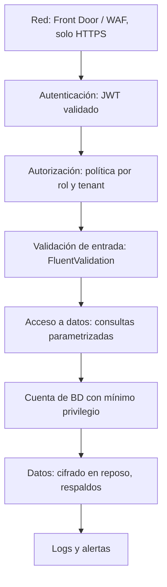

# Defensa en profundidad

Parte de: [[12-Seguridad/01 Fundamentos de seguridad/_Índice Fundamentos de seguridad|Fundamentos de seguridad]]

> [!info] Cómo avanzar
> `progreso`: **pendiente** → **viendo** (estudiando) → **visto** (contestaste la autoevaluación sin abrir las respuestas) → **dominado** (hiciste el laboratorio o lo aplicaste de verdad).

## Contenido

### Qué es
**Defensa en profundidad** es diseñar la seguridad en **capas independientes**, de forma que si una falla (y alguna fallará) las demás sigan conteniendo el daño. Viene de la idea militar de no confiar en una sola muralla. En software significa que ningún control es "el" control: validación, autorización, permisos de base de datos, red, monitoreo y respaldos se suman.

Sirve para dos cosas: **reducir la probabilidad** de que un ataque llegue hasta el dato y **reducir el impacto** cuando llega.

### Cómo funciona
Cada capa debe proteger por sí misma, sin asumir que la anterior funcionó. Piensa en las capas de una API como Itzamna.Dionisio:



La clave es la **independencia**: si la validación y el acceso a datos dependen de la misma suposición ("el front ya filtró"), una sola falla tumba ambas.

### Ejemplo
**Capas contra SQL injection** en un endpoint de búsqueda de clientes:

1. **Consultas parametrizadas** con Dapper (`@Nombre`), la defensa principal. Ver [[SQL injection - consultas parametrizadas]].
2. **Validación de entrada** con FluentValidation: longitud máxima, formato esperado; rechaza lo que no tenga sentido antes de llegar a la base.
3. **Listas blancas** para lo que no se puede parametrizar (columna de orden).
4. **Mínimo privilegio** en la cuenta de la API: solo `EXECUTE` sobre sus procedimientos, sin `db_owner`. Si algo se cuela, no puede borrar tablas ni leer otras bases. Ver [[SQL injection - mínimo privilegio en la cuenta de base de datos]].
5. **Errores genéricos** al cliente (ProblemDetails con `codigo`), sin mensajes de SQL que ayuden a afinar un ataque.
6. **WAF** como capa externa que frena intentos automatizados. Ver [[SQL injection - WAF como capa adicional]].
7. **Monitoreo**: alerta si un mismo cliente provoca muchos errores 500 o de validación seguidos.

```csharp
public sealed class BuscarClientesValidator : AbstractValidator<BuscarClientesQuery>
{
    public BuscarClientesValidator()
    {
        RuleFor(x => x.Nombre).MaximumLength(100);
        RuleFor(x => x.Orden).Must(o => o is null or "nombre" or "fecha")
            .WithErrorCode("ORDEN_INVALIDO");
    }
}
```

### Cuándo usarlo y cuándo no
Siempre como enfoque, pero con criterio: cada capa debe aportar protección real frente a una amenaza identificada en tu [[Mentalidad de seguridad y modelado de amenazas|modelado de amenazas]]. Agregar controles redundantes que nadie mantiene (reglas de WAF en modo detección que nadie revisa) da una falsa sensación de seguridad y suma complejidad, que también es un riesgo.

### Errores comunes
- **Usar una capa "fuerte" como excusa para quitar otra.** Ejemplos típicos: "tenemos WAF, no hace falta parametrizar"; "la API está en red privada, no hace falta autenticación"; "usamos parámetros, la cuenta puede ser `sa`". Cada una de esas frases convierte una falla única en una brecha completa.
- **Capas que dependen entre sí.** Si el back confía en que el front validó, en realidad hay una sola capa (y el atacante no usa tu front).
- **Olvidar la detección.** Prevenir sin registrar significa que te enteras de la brecha por un tercero.
- **No probar las capas internas.** Haz pruebas que simulen que la capa exterior falló (por ejemplo, llamar la API sin pasar por el WAF en un ambiente de pruebas).

### Para profundizar
- [OWASP Secure Product Design Cheat Sheet](https://cheatsheetseries.owasp.org/cheatsheets/Secure_Product_Design_Cheat_Sheet.html)
- [OWASP SQL Injection Prevention Cheat Sheet](https://cheatsheetseries.owasp.org/cheatsheets/SQL_Injection_Prevention_Cheat_Sheet.html)
- [Microsoft Learn: defensa en profundidad en Azure](https://learn.microsoft.com/en-us/azure/security/fundamentals/overview)

## Autoevaluación

Contesta primero en voz alta o en papel; luego despliega la respuesta.

> [!question]- ¿Qué es la defensa en profundidad?
> Poner varias capas independientes de control para que si una falla, otra detenga o limite el daño. Ejemplo contra XSS: codificar la salida + CSP + cookies HttpOnly.

> [!question]- Da un ejemplo de capas contra SQL injection.
> Consultas parametrizadas (capa principal) + cuenta de base de datos con mínimo privilegio + errores genéricos al usuario + WAF + monitoreo de consultas anómalas.

> [!question]- Error común: usar una capa "fuerte" como excusa para quitar otra. Ejemplo.
> "Tenemos WAF, no hace falta parametrizar". El WAF se puede evadir con codificaciones o variantes; la causa raíz (concatenar) sigue ahí.

## Práctica

- [[Lab 2 - Modelado de amenazas STRIDE de una app propia]]

