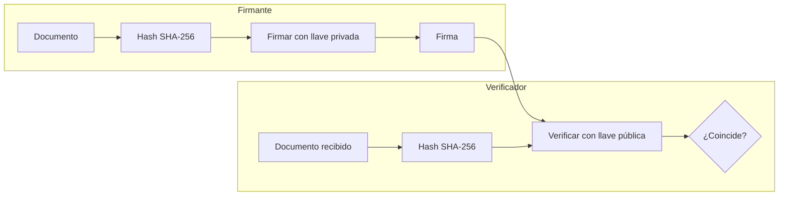

# Firmas digitales

Parte de: [[12-Seguridad/01 Fundamentos de seguridad/_Índice Fundamentos de seguridad|Fundamentos de seguridad]]

> [!info] Cómo avanzar
> `progreso`: **pendiente** → **viendo** (estudiando) → **visto** (contestaste la autoevaluación sin abrir las respuestas) → **dominado** (hiciste el laboratorio o lo aplicaste de verdad).

## Contenido

### Qué es
Una **firma digital** es un valor que se calcula sobre un documento o mensaje con la **llave privada** del firmante y que cualquiera puede verificar con su **llave pública**. Garantiza tres cosas:
- **Integridad**: si alguien cambia un solo byte del documento, la verificación falla.
- **Autenticidad**: solo quien tiene la llave privada pudo producir esa firma.
- **No repudio**: como solo el firmante tiene la llave privada, no puede negar razonablemente haber firmado (siempre que la llave no se haya filtrado).

No ofrece **confidencialidad**: el documento firmado sigue legible. Si necesitas ocultarlo, además lo cifras.

### Cómo funciona
A grandes rasgos:



1. Se calcula el **hash** del documento (por eficiencia, se firma la huella y no el archivo entero).
2. Se aplica el algoritmo de firma (RSA-PSS, ECDSA, Ed25519) sobre ese hash con la llave privada.
3. El verificador recalcula el hash y comprueba la firma con la llave pública.

¿Y cómo sabe el verificador que esa llave pública es realmente de quien dice? Con **certificados**: una autoridad certificadora firma un documento que dice "esta llave pública pertenece a este sujeto". Es lo que pasa en HTTPS, en la e.firma del SAT o en la firma de código.

**Firma vs HMAC.** Un HMAC (por ejemplo HMAC-SHA256) también garantiza integridad y autenticidad, pero usa una **llave secreta compartida**: quien verifica también podría haber generado el valor. Por eso un HMAC **no da no repudio** y solo sirve entre partes que confían entre sí y comparten el secreto. En JWT: **HS256** es HMAC (emisor y API comparten la llave, y cualquier API podría emitir tokens), **RS256/ES256** son firmas (solo el emisor firma; las APIs verifican con la pública). Por eso Xolotl.Hecate usa RS256.

### Ejemplo
Firmar un archivo de reporte de Wee.Reporteria para que el cliente compruebe que no se alteró:

```csharp
using System.Security.Cryptography;

byte[] contenido = File.ReadAllBytes("ventas-2026-10.xlsx");

using RSA rsa = RSA.Create(3072); // en producción: llave en Key Vault o certificado
byte[] firma = rsa.SignData(contenido, HashAlgorithmName.SHA256, RSASignaturePadding.Pss);
File.WriteAllBytes("ventas-2026-10.xlsx.sig", firma);

// Lado del cliente, con la llave pública
bool ok = rsa.VerifyData(contenido, firma, HashAlgorithmName.SHA256, RSASignaturePadding.Pss);
```

Comparación con HMAC para un webhook entre dos sistemas tuyos:

```csharp
byte[] secreto = Convert.FromBase64String(config["Webhook:Secreto"]!);
byte[] mac = HMACSHA256.HashData(secreto, cuerpoBytes);
// El receptor recalcula y compara en tiempo constante
bool valido = CryptographicOperations.FixedTimeEquals(mac, macRecibido);
```

### Cuándo usarlo y cuándo no
- **Firma**: tokens que verifican muchos servicios, paquetes y artefactos de build, documentos que un tercero debe poder validar, evidencia con valor legal.
- **HMAC**: webhooks y mensajes entre dos sistemas que comparten secreto; es más simple y rápido.
- **Ninguno** si solo necesitas detectar corrupción accidental: basta un hash.

### Errores comunes
- **Comparar firmas o MAC con `==`** sobre cadenas: usa `FixedTimeEquals` para no filtrar información por tiempos.
- **Aceptar el algoritmo que dice el propio mensaje** (el famoso `alg` de JWT). Fija los algoritmos permitidos en la validación. Ver [[Ataques a JWT y cómo evitarlos]].
- **Firmar algo distinto de lo que se verifica** (por ejemplo, firmar el JSON y luego reserializarlo con otro orden de campos).
- **Proteger mal la llave privada**: si se filtra, cualquiera firma en tu nombre y pierdes el no repudio.

### Para profundizar
- [Firmas criptográficas en .NET (Microsoft Learn)](https://learn.microsoft.com/en-us/dotnet/standard/security/cryptographic-signatures)
- [RFC 2104 - HMAC](https://www.rfc-editor.org/rfc/rfc2104)
- [Clase HMACSHA256](https://learn.microsoft.com/en-us/dotnet/api/system.security.cryptography.hmacsha256)

## Autoevaluación

Contesta primero en voz alta o en papel; luego despliega la respuesta.

> [!question]- ¿Qué garantiza una firma digital?
> Integridad (el contenido no cambió), autenticidad (lo firmó quien tiene la llave privada) y no repudio (el firmante no puede negar haber firmado).

> [!question]- ¿Cómo se firma un documento a grandes rasgos?
> Se calcula un hash del contenido y se firma ese hash con la llave privada. Quien verifica recalcula el hash y comprueba la firma con la llave pública.

> [!question]- ¿En qué se diferencia una firma de un HMAC?
> El HMAC usa una llave secreta compartida: ambos lados pueden generarlo, así que no da no repudio. La firma usa llave privada que solo tiene el firmante. Ver [[Firmas de JWT (HS256 vs RS256) y JWKS]].

