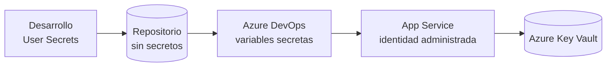

# Manejo de secretos

Parte de: [[12-Seguridad/01 Fundamentos de seguridad/_Índice Fundamentos de seguridad|Fundamentos de seguridad]]

> [!info] Cómo avanzar
> `progreso`: **pendiente** → **viendo** (estudiando) → **visto** (contestaste la autoevaluación sin abrir las respuestas) → **dominado** (hiciste el laboratorio o lo aplicaste de verdad).

## Contenido

### Qué es
Un **secreto** es cualquier dato que da acceso o identidad: contraseñas y cadenas de conexión, llaves de API, llaves privadas y certificados (como la llave RS256 de Xolotl.Hecate), *client secrets* de OAuth, tokens personales de Azure DevOps o GitHub, llaves de cifrado, URLs con firma (SAS de Azure Storage) y secretos de webhooks. Manejar secretos es decidir **dónde viven, quién los lee, cómo se rotan y qué haces si se filtran**.

La regla de tus proyectos lo resume: **secretos fuera del repo**.

### Cómo funciona
ASP.NET Core lee la configuración por capas (archivos, User Secrets, variables de entorno, Key Vault), y la última capa gana. Eso permite que el código sea igual en todos los ambientes y que solo cambie **de dónde** viene el valor:

| Etapa | Dónde va el secreto |
|---|---|
| Desarrollo local | **User Secrets** (`dotnet user-secrets`), fuera de la carpeta del proyecto. No está cifrado; solo evita que llegue a Git. |
| Pipeline de Azure DevOps | Variables secretas o grupos de variables enlazados a Key Vault; nunca en el YAML. |
| Producción en Azure | **Azure Key Vault**, leído con **identidad administrada** (sin contraseña para leer contraseñas). Alternativa: configuración de App Service con referencias a Key Vault. |

**¿Qué va en `appsettings.json` y `appsettings.Production.json`?** Solo configuración no secreta: niveles de log, URLs públicas, nombres de recursos, *feature flags*, timeouts y la **URI** del Key Vault. Las claves de secretos pueden aparecer vacías como recordatorio de que existen, pero sin valor.

**Rotación** es cambiar un secreto periódicamente o tras cualquier sospecha. Importa porque limita la ventana en que un secreto robado sirve y porque obliga a que el cambio sea un proceso conocido y no una emergencia. Lo ideal es que la app soporte dos versiones a la vez (la actual y la siguiente) para rotar sin caídas; Key Vault guarda versiones y puede avisar antes de la expiración.



### Ejemplo
`Program.cs` de Itzamna.Dionisio leyendo Key Vault en producción:

```csharp
using Azure.Identity;

var builder = WebApplication.CreateBuilder(args);

if (builder.Environment.IsProduction())
{
    var uri = new Uri(builder.Configuration["KeyVault:Uri"]!);
    builder.Configuration.AddAzureKeyVault(uri, new DefaultAzureCredential());
}

// Igual en todos los ambientes: el valor viene de la capa que corresponda
string cadena = builder.Configuration.GetConnectionString("Dionisio")
    ?? throw new InvalidOperationException("Falta la cadena de conexión");
```

En Key Vault el secreto se llama `ConnectionStrings--Dionisio` (el doble guion se traduce a `:`). Localmente:

```bash
dotnet user-secrets init
dotnet user-secrets set "ConnectionStrings:Dionisio" "Server=localhost;Database=Dionisio;Integrated Security=True;TrustServerCertificate=True"
```

### Qué hacer si se filtra una llave
Se filtró una llave en un commit público. El orden importa:
1. **Revocar o rotar el secreto de inmediato** en el proveedor. Borrar el commit no basta: los bots que vigilan repositorios públicos lo copian en minutos, y el historial, los forks y las cachés lo conservan.
2. Actualizar la app con el nuevo valor.
3. Revisar los logs del proveedor para ver si se usó.
4. Después, limpiar el historial si hace falta y agregar escaneo de secretos al pipeline. Ver [[Secretos en repositorios]] y [[Escaneo de dependencias y de secretos]].

### Cuándo usarlo y cuándo no
Key Vault con identidad administrada es lo indicado para cualquier app en Azure. Si un servicio permite **no tener secreto** (identidad administrada contra Azure SQL o Storage), es todavía mejor: no hay nada que rotar ni filtrar.

### Errores comunes
- **Secretos en `appsettings.Development.json` subidos al repo** "porque es solo desarrollo"; suelen ser los mismos de pruebas compartidas.
- **Imprimir la configuración en los logs** al arrancar.
- **Un solo secreto para todos los ambientes**: comprometer desarrollo compromete producción.
- **Cuentas de servicio con permiso de administrar Key Vault** cuando solo necesitan leer. Ver [[Principio de mínimo privilegio]].

### Para profundizar
- [Almacenamiento seguro de secretos en desarrollo (Microsoft Learn)](https://learn.microsoft.com/en-us/aspnet/core/security/app-secrets)
- [Proveedor de configuración de Azure Key Vault](https://learn.microsoft.com/en-us/aspnet/core/security/key-vault-configuration)
- [OWASP Secrets Management Cheat Sheet](https://cheatsheetseries.owasp.org/cheatsheets/Secrets_Management_Cheat_Sheet.html)

## Autoevaluación

Contesta primero en voz alta o en papel; luego despliega la respuesta.

> [!question]- ¿Qué cuenta como secreto?
> Contraseñas y cadenas de conexión, llaves de API, llaves de firma de JWT, certificados con llave privada, tokens de acceso, llaves de cifrado.

> [!question]- ¿Dónde va un secreto en cada etapa?
> Desarrollo: [[Secretos con User Secrets]] o variables de entorno locales. Pipelines: variables secretas o grupos de variables enlazados a Key Vault. Producción: [[Key Vault]] leído con identidad administrada o configuración del App Service. Repositorio: **nunca** (ver [[Secretos en repositorios]]).

> [!question]- ¿Qué pones en `appsettings.json` y `appsettings.Production.json`?
> Solo configuración no secreta (niveles de log, URLs públicas, banderas). Los valores secretos se dejan vacíos o como marcador y se sobrescriben por variables de entorno o Key Vault en el destino de publicación.

> [!question]- ¿Qué es la rotación de secretos y por qué importa?
> Cambiar periódicamente (o ante sospecha de fuga) el valor del secreto sin tumbar el servicio, por ejemplo con dos llaves activas mientras se migra. Limita cuánto tiempo sirve un secreto filtrado.

> [!question]- Se filtró una llave en un commit público. ¿Qué haces primero?
> **Revocar/rotar** la llave de inmediato. Borrar el commit no basta: ya pudo ser copiada. Después limpias el historial y revisas los registros de uso de esa llave.

## Práctica

- [[Lab 1 - Sacar secretos del código en una API .NET]]

