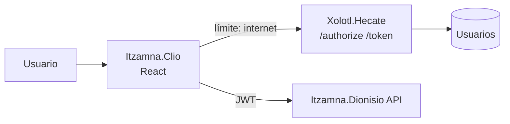

# Mentalidad de seguridad y modelado de amenazas

Parte de: [[12-Seguridad/01 Fundamentos de seguridad/_Índice Fundamentos de seguridad|Fundamentos de seguridad]]

> [!info] Cómo avanzar
> `progreso`: **pendiente** → **viendo** (estudiando) → **visto** (contestaste la autoevaluación sin abrir las respuestas) → **dominado** (hiciste el laboratorio o lo aplicaste de verdad).

## Contenido

### Qué es
La **mentalidad de seguridad** es el hábito de preguntarte, ante cualquier funcionalidad, "¿cómo podría usarse esto de una forma que no planeé?". El **modelado de amenazas** es la versión estructurada de ese hábito: un ejercicio en equipo para entender qué estás construyendo, qué puede salir mal, qué vas a hacer al respecto y si lo hiciste bien.

Se hace **al diseñar** (antes de escribir mucho código, cuando cambiar es barato) y se **repite** cuando hay cambios importantes: una integración nueva, exponer un endpoint a internet, manejar un tipo de dato nuevo, cambiar el esquema de autenticación.

### Cómo funciona
Las **cuatro preguntas clásicas** (popularizadas por Adam Shostack) guían el ejercicio:
1. **¿En qué estamos trabajando?** Dibuja un diagrama de flujo de datos: actores, procesos, almacenes y, sobre todo, los **límites de confianza** (donde los datos pasan de una zona a otra: internet → API, API → base).
2. **¿Qué puede salir mal?** Recorre cada elemento con **STRIDE**.
3. **¿Qué vamos a hacer al respecto?** Para cada amenaza: mitigar, eliminar la funcionalidad, transferir el riesgo o aceptarlo de forma explícita.
4. **¿Hicimos un buen trabajo?** Revisa que las mitigaciones existan en el código y en pruebas.

**STRIDE**, cada letra con la propiedad que viola:

| Letra | Amenaza | Propiedad que protege | Ejemplo en tu stack |
|---|---|---|---|
| **S** | *Spoofing*, suplantación | Autenticación | Usar un JWT robado o mal validado |
| **T** | *Tampering*, alteración | Integridad | Cambiar el precio en el cuerpo de la petición |
| **R** | *Repudiation*, repudio | No repudio | "Yo no aprobé ese pago" y no hay registro |
| **I** | *Information disclosure*, divulgación | Confidencialidad | Errores con detalles de SQL, IDOR |
| **D** | *Denial of service*, denegación | Disponibilidad | Exportación sin límite que agota la base |
| **E** | *Elevation of privilege*, elevación | Autorización | Un usuario normal llama un endpoint de admin |

### Ejemplo
Modelado rápido del flujo de login PKCE de Itzamna.Clio con Xolotl.Hecate:

- **S**: ¿qué impide que otra app use el código de autorización? → PKCE con `code_verifier` y `redirect_uri` registrada exactamente.
- **T**: ¿pueden alterar el token? → firma RS256 validada con algoritmos fijos.
- **R**: ¿sabemos quién inició sesión y desde dónde? → log de eventos de login.
- **I**: ¿dónde guarda el token el front? → en memoria, no en `localStorage`.
- **D**: ¿límite de intentos en `/token`? → *rate limiting*.
- **E**: ¿la API revisa el rol y el tenant en cada endpoint? → políticas de autorización.

El resultado son tareas concretas en el backlog, cada una con criterio de aceptación verificable. Para practicar con tu propia app está [[Lab 2 - Modelado de amenazas STRIDE de una app propia]].

### Cuándo usarlo y cuándo no
Úsalo en funcionalidades que cruzan límites de confianza o tocan datos sensibles. No necesitas un documento de 30 páginas: una pizarra, 30 a 60 minutos y una lista de tareas suele bastar. Para cambios triviales (un texto, un estilo), no hace falta.

### Errores comunes
- **"Nadie va a atacar nuestra app interna".** Los atacantes no eligen por fama: escanean de forma automática, y una app interna suele ser el siguiente paso después de comprometer una cuenta de correo o una VPN. Además, muchos incidentes vienen de usuarios internos curiosos o molestos, y las apps internas suelen tener controles más débiles y datos valiosos.
- **Hacerlo una vez y archivarlo.** El modelo envejece con cada cambio.
- **Solo pensar en atacantes externos** y olvidar el abuso por usuarios legítimos.
- **Listar amenazas sin decidir nada.** Cada amenaza necesita una decisión y un responsable.

### Para profundizar
- [OWASP Threat Modeling Cheat Sheet](https://cheatsheetseries.owasp.org/cheatsheets/Threat_Modeling_Cheat_Sheet.html)
- [Microsoft Threat Modeling Tool](https://learn.microsoft.com/en-us/azure/security/develop/threat-modeling-tool)
- [Threat Modeling Manifesto](https://www.threatmodelingmanifesto.org/)

## Autoevaluación

Contesta primero en voz alta o en papel; luego despliega la respuesta.

> [!question]- ¿Qué es el modelado de amenazas y cuándo se hace?
> Analizar en el diseño qué puede salir mal: qué activos hay, quién los ataca, por dónde entra y qué controles faltan. Se hace **antes** de construir y se repasa cuando cambia la arquitectura (nuevo endpoint externo, nuevo tipo de dato).

> [!question]- ¿Qué significa cada letra de STRIDE?
> **S**poofing (suplantación), **T**ampering (alteración), **R**epudiation (repudio), **I**nformation disclosure (fuga de información), **D**enial of service (denegación de servicio), **E**levation of privilege (elevación de privilegios).

> [!question]- Las cuatro preguntas clásicas del modelado de amenazas son…
> 1. ¿En qué estamos trabajando? (diagrama de flujo de datos)
> 2. ¿Qué puede salir mal? (STRIDE)
> 3. ¿Qué vamos a hacer al respecto? (mitigaciones)
> 4. ¿Hicimos un buen trabajo? (revisión)

> [!question]- Error común: "nadie va a atacar nuestra app interna". ¿Por qué es un error?
> Las redes internas se comprometen (phishing, VPN robada, empleado malicioso). Muchos ataques son automatizados y no eligen víctima. Además, los límites de confianza (trust boundaries) existen también dentro de la red.

## Práctica

- [[Lab 2 - Modelado de amenazas STRIDE de una app propia]]

