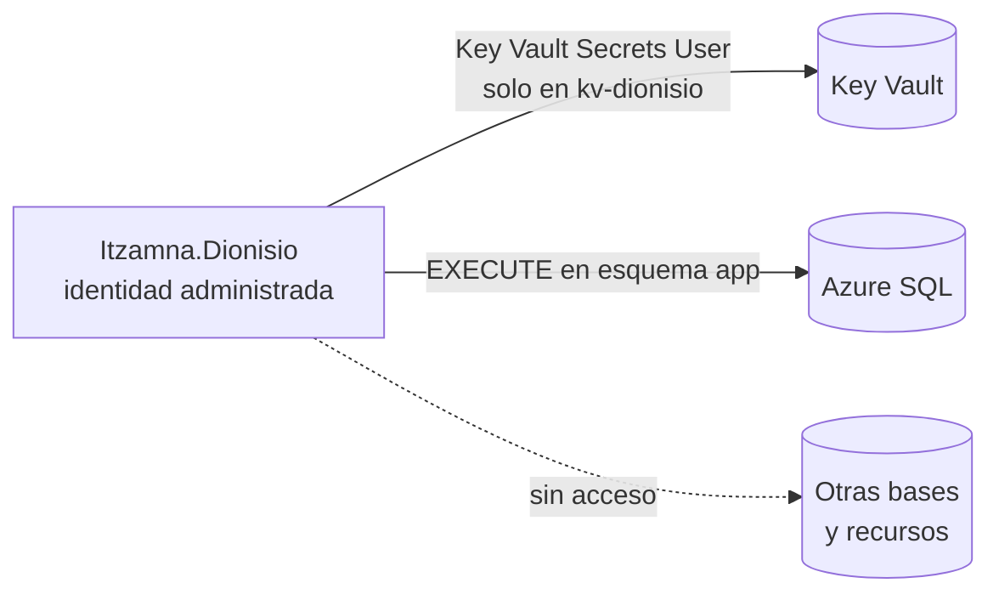

# Principio de mínimo privilegio

Parte de: [[12-Seguridad/01 Fundamentos de seguridad/_Índice Fundamentos de seguridad|Fundamentos de seguridad]]

> [!info] Cómo avanzar
> `progreso`: **pendiente** → **viendo** (estudiando) → **visto** (contestaste la autoevaluación sin abrir las respuestas) → **dominado** (hiciste el laboratorio o lo aplicaste de verdad).

## Contenido

### Qué es
El **principio de mínimo privilegio** dice que cada usuario, proceso o servicio debe tener **solo los permisos que necesita para su función, solo sobre los recursos que necesita y solo durante el tiempo que los necesita**. Nada de "dale admin para que funcione".

Su valor aparece cuando algo sale mal: no evita que te comprometan, pero **limita el radio de daño** (*blast radius*). Si la cuenta de tu API solo puede ejecutar sus procedimientos, una inyección o una credencial robada no sirve para borrar tablas, leer otras bases o crear usuarios.

### Cómo funciona
Se aplica en todas las capas:
- **Base de datos**: una cuenta por aplicación, sin `sa`, sin `db_owner`, con permisos al esquema o a los procedimientos que usa.
- **Nube**: identidades administradas con roles RBAC acotados al recurso concreto, no a la suscripción.
- **Aplicación**: roles y políticas de autorización; el usuario de ventas no ve la administración.
- **Pipeline**: la *service connection* de Azure DevOps solo puede desplegar al grupo de recursos de ese proyecto.
- **Personas**: acceso administrativo solo cuando hace falta y con caducidad (por ejemplo, con Privileged Identity Management).



### Ejemplo
**Cadena de conexión de la API**. En lugar de:

```text
Server=...;Database=Dionisio;User Id=sa;Password=...;
```

usa una identidad propia, sin contraseña, con permisos mínimos:

```sql
-- En Azure SQL, conectado como administrador de Entra ID
CREATE USER [app-dionisio-prod] FROM EXTERNAL PROVIDER;
CREATE ROLE rol_api_dionisio;
GRANT EXECUTE ON SCHEMA::app TO rol_api_dionisio;   -- solo ejecutar procedimientos del esquema app
ALTER ROLE rol_api_dionisio ADD MEMBER [app-dionisio-prod];
-- Sin db_owner, sin ALTER, sin acceso a dbo
```

```text
Server=tcp:sql-dionisio.database.windows.net;Database=Dionisio;Authentication=Active Directory Default;Encrypt=True;
```

**Qué ganas si la API se ve comprometida**: el atacante obtiene exactamente lo que la API podía hacer, y nada más. No puede borrar el esquema, cambiar permisos, leer la base de reportes de Wee.Reporteria ni pivotar a otros servidores. El incidente pasa de "perdimos todo" a "estos procedimientos quedaron expuestos", que es más fácil de contener y de explicar.

**Azure Key Vault**: asigna a la identidad administrada de la app el rol **Key Vault Secrets User** (solo leer secretos) con alcance **en ese vault**, no en el grupo de recursos ni en la suscripción. No le des *Key Vault Administrator* ni permisos sobre llaves o certificados si no los usa. Si el vault es compartido, separa uno por aplicación y ambiente.

### Cuándo usarlo y cuándo no
Siempre. El costo es que hay que pensar permisos de antemano y ajustar cuando aparece un "permiso denegado". Ese error es una señal útil (algo pidió más de lo previsto), no un estorbo. Documenta los permisos como código (scripts SQL, Bicep o Terraform) para que no dependan de clics manuales.

### Errores comunes
- **"Mientras, dale admin y luego lo bajamos".** Nunca se baja. Empieza mínimo y agrega.
- **Una sola cuenta para la app, las migraciones y los reportes.** Las migraciones necesitan `ALTER`; la API en tiempo de ejecución no. Usa cuentas separadas.
- **Roles en el nivel de suscripción** por comodidad en Azure.
- **Permisos que se acumulan**: personas que cambian de equipo y conservan accesos. Haz revisiones periódicas.
- **Olvidar los tokens**: un PAT de Azure DevOps con alcance "Full access" es lo contrario al principio.

### Para profundizar
- [Azure Key Vault con RBAC (Microsoft Learn)](https://learn.microsoft.com/en-us/azure/key-vault/general/rbac-guide)
- [Identidades administradas para recursos de Azure](https://learn.microsoft.com/en-us/entra/identity/managed-identities-azure-resources/overview)
- [GRANT sobre esquemas (T-SQL)](https://learn.microsoft.com/en-us/sql/t-sql/statements/grant-schema-permissions-transact-sql)

## Autoevaluación

Contesta primero en voz alta o en papel; luego despliega la respuesta.

> [!question]- ¿Qué dice el principio de mínimo privilegio?
> Cada usuario, servicio o proceso debe tener solo los permisos necesarios para su tarea y por el tiempo necesario, ni uno más.

> [!question]- Aplica el principio a la cadena de conexión de tu API.
> La API no debe conectarse como `sa` ni como `db_owner`. Usa un usuario con `EXECUTE` sobre los procedimientos o permisos de lectura/escritura en las tablas que usa, sin `ALTER` ni `DROP`. Las migraciones se corren con otra identidad.

> [!question]- ¿Qué ganas si la API se ve comprometida y su cuenta tiene mínimo privilegio?
> Se limita el radio de daño: el atacante no puede borrar tablas, crear usuarios ni leer bases de otros sistemas.

> [!question]- En Azure, ¿cómo aplicarías mínimo privilegio a una app que lee secretos?
> Identidad administrada con un rol de solo lectura de secretos (por ejemplo *Key Vault Secrets User*) sobre ese Key Vault, no *Contributor* sobre la suscripción.

## Práctica

- [[Lab 2 - Modelado de amenazas STRIDE de una app propia]]

