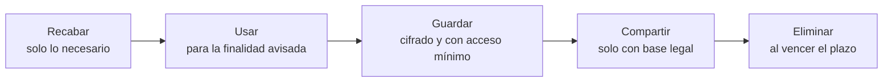

# Privacidad y protección de datos (ley mexicana y GDPR)

Parte de: [[12-Seguridad/01 Fundamentos de seguridad/_Índice Fundamentos de seguridad|Fundamentos de seguridad]]

> [!info] Cómo avanzar
> `progreso`: **pendiente** → **viendo** (estudiando) → **visto** (contestaste la autoevaluación sin abrir las respuestas) → **dominado** (hiciste el laboratorio o lo aplicaste de verdad).

## Contenido

### Qué es
La **privacidad** es el derecho de las personas a decidir sobre su información; la **protección de datos** es el conjunto de reglas y controles para respetar ese derecho. Para un desarrollador, la seguridad responde "¿quién puede acceder?", y la privacidad agrega "¿deberíamos tener este dato, para qué y por cuánto tiempo?".

Un **dato personal** es cualquier información sobre una persona física identificada o identificable: nombre, correo, teléfono, CURP, RFC, dirección IP, ubicación, una foto, un identificador de dispositivo. "Identificable" importa: un id de cliente también es dato personal si con otras tablas llegas a la persona. Un **dato personal sensible** es el que toca la esfera más íntima o puede causar discriminación o daño grave: salud, origen étnico, religión, preferencia sexual, opiniones políticas, datos genéticos y biométricos. Requiere más protección y, en general, consentimiento expreso.

Esta nota da el panorama; el detalle de cada marco legal está en:
- [[Privacidad - ley mexicana de datos personales (LFPDPPP)]]: la ley que aplica a empresas privadas en México.
- [[Privacidad - GDPR para desarrolladores]]: el reglamento europeo, referencia mundial.

### Cómo funciona
Ambos marcos comparten la misma lógica: el **responsable** (la empresa) decide para qué se usan los datos, informa al **titular** (la persona) en un aviso, obtiene una base legal o consentimiento, protege los datos y atiende los derechos del titular (ARCO en México; acceso, supresión, portabilidad y otros en el GDPR). Un **encargado** (por ejemplo, tu proveedor de nube) trata datos por cuenta del responsable bajo contrato.

**Principios que aplicas al diseñar una base de datos**:
- **Minimización**: no agregues columnas "por si acaso". Si no necesitas la fecha de nacimiento completa, guarda solo si es mayor de edad.
- **Limitación de finalidad**: separa datos por uso; lo que se recabó para facturar no se usa para mercadotecnia sin consentimiento.
- **Limitación de conservación**: define cuánto vive cada dato y automatiza la purga o anonimización.
- **Seudonimización**: en tablas de análisis usa identificadores sin nombre ni correo.
- **Seguridad**: cifrado, control de acceso, bitácora de quién consulta datos sensibles.
- **Exactitud y derechos**: diseña para poder exportar, corregir y borrar todo lo de una persona.



### Ejemplo
Revisión de privacidad de una tabla de clientes en Itzamna.Dionisio:

| Columna | ¿Se necesita? | Decisión |
|---|---|---|
| Nombre, correo | Sí, para el servicio | Conservar, acceso por rol |
| RFC | Solo si factura | Opcional, cifrado |
| Fecha de nacimiento | Solo para verificar mayoría de edad | Reemplazar por `EsMayorDeEdad BIT` |
| Notas médicas | No para este sistema | Eliminar del diseño |
| IP de registro | Para seguridad, por tiempo limitado | Conservar 90 días y purgar |

**¿Por qué el GDPR podría aplicarle a una empresa mexicana?** Porque su alcance es territorial **por las personas**, no por la empresa: si ofreces bienes o servicios a personas en la UE (tienda en línea que vende a España, app disponible allá con precios en euros) o monitoreas su comportamiento (analítica, perfiles), te aplica aunque no tengas oficinas en Europa. También te puede alcanzar por contrato si eres proveedor (encargado) de una empresa europea.

### Cuándo usarlo y cuándo no
Siempre que un sistema maneje datos de personas, que es casi siempre. Lo que varía es la profundidad: un catálogo de productos sin cuentas casi no tiene implicaciones; un sistema de nómina o de salud requiere análisis de impacto y la participación del área legal.

### Errores comunes
- **Pensar que privacidad es solo el aviso legal** en el pie de página; sin cambios técnicos, el aviso es una promesa vacía.
- **Copiar datos de producción a desarrollo** para pruebas. Usa datos sintéticos o anonimizados.
- **Guardar todo para siempre**: cada año extra es más riesgo y más obligaciones.
- **Tratar el id interno como "no personal"**: si lleva a la persona, lo es.

### Para profundizar
- [Texto vigente de la LFPDPPP](https://www.diputados.gob.mx/LeyesBiblio/pdf/LFPDPPP.pdf)
- [Reglamento (UE) 2016/679 en EUR-Lex](https://eur-lex.europa.eu/eli/reg/2016/679/oj)
- [OWASP User Privacy Protection Cheat Sheet](https://cheatsheetseries.owasp.org/cheatsheets/User_Privacy_Protection_Cheat_Sheet.html)

## Subtemas

- [[Privacidad - ley mexicana de datos personales (LFPDPPP)]]
- [[Privacidad - GDPR para desarrolladores]]

## Autoevaluación

Contesta primero en voz alta o en papel; luego despliega la respuesta.

> [!question]- ¿Qué es un dato personal y qué es un dato personal sensible?
> Dato personal: cualquier información que identifica o hace identificable a una persona (nombre, correo, IP en ciertos contextos). Sensible: el que puede causar discriminación o riesgo grave si se revela (salud, origen étnico, creencias, preferencia sexual, datos biométricos).

> [!question]- ¿Qué principios de privacidad aplicas al diseñar una base de datos?
> Minimización (guardar solo lo necesario), finalidad (usar el dato solo para lo que se informó), conservación limitada (borrar cuando ya no se necesita), seguridad (cifrado, control de acceso) y privacidad desde el diseño.

> [!question]- ¿Por qué GDPR podría aplicarle a una empresa mexicana?
> Porque aplica a quien ofrece bienes o servicios a personas en la Unión Europea o monitorea su comportamiento, aunque la empresa no esté en la UE.

## Progreso de los subtemas

```base
filters:
  and:
    - file.inFolder("12-Seguridad/01 Fundamentos de seguridad/Privacidad y protección de datos (ley mexicana y GDPR)")
    - file.name != "Privacidad y protección de datos (ley mexicana y GDPR)"
views:
  - type: table
    name: Progreso
    order:
      - file.name
      - progreso
      - nivel
```
