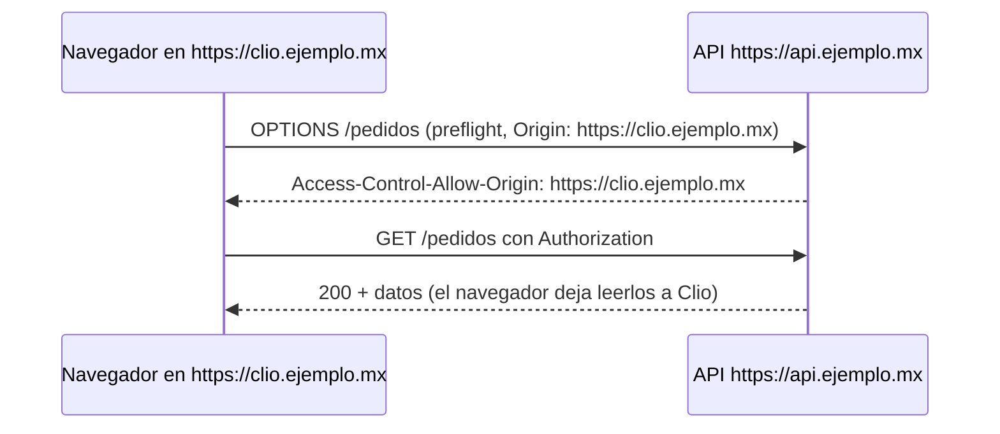

# Same-origin policy

Parte de: [[12-Seguridad/01 Fundamentos de seguridad/_Índice Fundamentos de seguridad|Fundamentos de seguridad]]

> [!info] Cómo avanzar
> `progreso`: **pendiente** → **viendo** (estudiando) → **visto** (contestaste la autoevaluación sin abrir las respuestas) → **dominado** (hiciste el laboratorio o lo aplicaste de verdad).

## Contenido

### Qué es
La **same-origin policy** (política del mismo origen) es la regla de seguridad más importante del navegador: el código JavaScript de una página solo puede **leer** recursos y datos de su **mismo origen**. Sin ella, cualquier sitio que visitaras podría leer tu correo, tu banca o tu Itzamna.Clio con tu sesión abierta.

Un **origen** es la combinación de **esquema + host + puerto**:

| URL | ¿Mismo origen que `https://clio.ejemplo.mx`? |
|---|---|
| `https://clio.ejemplo.mx/pedidos` | Sí (la ruta no cuenta) |
| `http://clio.ejemplo.mx` | No (cambia el esquema) |
| `https://api.ejemplo.mx` | No (cambia el host, aunque sea subdominio) |
| `https://clio.ejemplo.mx:8443` | No (cambia el puerto) |

### Cómo funciona
La política distingue entre **enviar** y **leer**:
- Una página **sí puede enviar** peticiones a otros orígenes (formularios, imágenes, `fetch`), incrustar imágenes, scripts y hojas de estilo de otros sitios.
- Lo que **impide** es que el JavaScript **lea la respuesta** de otro origen, que acceda al DOM de un `iframe` de otro origen y que lea sus cookies o su `localStorage`.

Esa diferencia explica dos cosas:
1. **CSRF existe** porque el navegador sí envía la petición (con cookies) a otro origen aunque la página atacante no pueda leer la respuesta. Ver [[CSRF]].
2. **XSS es tan grave** porque el código inyectado corre **dentro** de tu origen: la política ya no lo detiene.

**CORS** (*Cross-Origin Resource Sharing*) es el mecanismo para **relajar** la same-origin policy de forma controlada. El servidor dice, con encabezados como `Access-Control-Allow-Origin`, qué otros orígenes pueden leer sus respuestas. CORS no es una protección del servidor: es un permiso que el servidor le da al navegador para que haga una excepción. Ver [[CORS]].



### Ejemplo
Itzamna.Clio (Vite en `http://localhost:5173`) llama a Itzamna.Dionisio (`https://localhost:7001`). Son orígenes distintos, así que el navegador bloqueará la lectura hasta que la API lo permita:

```csharp
builder.Services.AddCors(o => o.AddPolicy("Clio", p => p
    .WithOrigins("http://localhost:5173", "https://clio.ejemplo.mx") // lista blanca exacta
    .WithMethods("GET", "POST", "PUT", "DELETE")
    .WithHeaders("Authorization", "Content-Type")));

var app = builder.Build();
app.UseCors("Clio");
```

Alternativa en desarrollo: el *proxy* de Vite (`server.proxy`) hace que el front y la API parezcan del mismo origen y evita configurar CORS local.

### Cuándo usarlo y cuándo no
La política no se "usa": siempre está activa. Lo que decides es **cuándo relajarla** con CORS: solo para los orígenes de tus propios front-ends y nunca con comodines cuando hay credenciales. Si front y API pueden servirse desde el mismo origen (por ejemplo, detrás de Azure Front Door con rutas `/` y `/api`), te ahorras CORS por completo.

### Errores comunes
- **Pensar que CORS protege la API.** Herramientas como curl o Postman ignoran CORS; la API debe autenticar y autorizar igual.
- **Reflejar el header `Origin`** recibido en `Access-Control-Allow-Origin` "para que funcione con todos". Equivale a desactivar la política.
- **Combinar `AllowAnyOrigin` con credenciales**: ASP.NET Core lo impide, y la "solución" de reflejar el origen es peor.
- **Confundir sitio con origen**: `api.ejemplo.mx` y `clio.ejemplo.mx` son el mismo *sitio* para cookies `SameSite`, pero distinto *origen*.

### Para profundizar
- [MDN: Same-origin policy](https://developer.mozilla.org/en-US/docs/Web/Security/Same-origin_policy)
- [MDN: CORS](https://developer.mozilla.org/en-US/docs/Web/HTTP/CORS)
- [Habilitar CORS en ASP.NET Core](https://learn.microsoft.com/en-us/aspnet/core/security/cors)
- [RFC 6454 - The Web Origin Concept](https://www.rfc-editor.org/rfc/rfc6454)

## Autoevaluación

Contesta primero en voz alta o en papel; luego despliega la respuesta.

> [!question]- ¿Qué es un origen?
> La combinación de **esquema + host + puerto**. `https://app.com` y `https://app.com:8443` son orígenes distintos; también `http://` vs `https://`.

> [!question]- ¿Qué impide la same-origin policy?
> Que un script de un origen **lea** respuestas o el DOM de otro origen. No impide que el navegador **envíe** peticiones a otro origen (por eso existe CSRF).

> [!question]- ¿Qué relación tiene CORS con la same-origin policy?
> CORS es el mecanismo para que un servidor **relaje** la SOP de forma controlada, indicando con headers qué orígenes pueden leer sus respuestas. No es una protección del servidor: es un permiso para el navegador.

