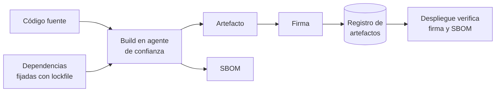

# Seguridad de la cadena de suministro (SBOM y firmas)

Parte de: [[12-Seguridad/01 Fundamentos de seguridad/_Índice Fundamentos de seguridad|Fundamentos de seguridad]]

> [!info] Cómo avanzar
> `progreso`: **pendiente** → **viendo** (estudiando) → **visto** (contestaste la autoevaluación sin abrir las respuestas) → **dominado** (hiciste el laboratorio o lo aplicaste de verdad).

## Contenido

### Qué es
La **cadena de suministro de software** es todo lo que interviene para que tu código llegue a producción: paquetes NuGet y npm (y sus dependencias transitivas), imágenes de contenedor, herramientas de build, extensiones del pipeline, agentes de Azure DevOps y el propio repositorio. Un **ataque a la cadena de suministro** compromete uno de esos eslabones para llegar a muchas víctimas a la vez: no ataca tu código, ataca algo en lo que tu código confía.

Casos conocidos: el compromiso del sistema de build de **SolarWinds** (2020), que distribuyó una actualización con puerta trasera a miles de clientes, y la puerta trasera insertada en **xz utils** (2024) por un mantenedor que se ganó la confianza del proyecto durante años. En npm son frecuentes los paquetes con nombres parecidos a otros populares (*typosquatting*) y las cuentas de mantenedores robadas que publican versiones maliciosas. OWASP incluyó las fallas en la cadena de suministro como categoría propia en su Top 10 2025.

### Cómo funciona
Vectores típicos:
- **Dependencia maliciosa o comprometida** que se instala con una actualización automática.
- **Confusión de dependencias**: un paquete público con el mismo nombre que uno interno gana en la resolución.
- **Pipeline comprometido**: secretos de despliegue expuestos, tareas de terceros sin fijar versión.
- **Artefacto alterado** entre el build y el despliegue.

Las defensas atacan cada punto: saber qué tienes (SBOM), fijar lo que instalas (lockfiles), verificar que es auténtico (firmas y procedencia), y vigilar vulnerabilidades (SCA).

Un **SBOM** (*Software Bill of Materials*) es el inventario de componentes de un artefacto: cada paquete, su versión, su licencia y su origen, en un formato estándar (**SPDX** o **CycloneDX**). Sirve para responder en minutos "¿estamos afectados?" cuando sale una vulnerabilidad nueva, para auditar licencias y como requisito de clientes y gobiernos.



### Ejemplo
Prácticas en un proyecto .NET + React con Azure DevOps:

```xml
<!-- Directory.Build.props: lockfile de NuGet para builds reproducibles -->
<Project>
  <PropertyGroup>
    <RestorePackagesWithLockFile>true</RestorePackagesWithLockFile>
  </PropertyGroup>
</Project>
```

```yaml
steps:
  - script: dotnet restore --locked-mode     # falla si cambian dependencias sin actualizar el lockfile
  - script: npm ci                           # instala exactamente lo de package-lock.json
    workingDirectory: clio
  - script: dotnet list package --vulnerable --include-transitive
  - script: npm audit --audit-level=high
    workingDirectory: clio
  # Generar SBOM con la herramienta de Microsoft (revisa su documentación para los parámetros)
  - script: sbom-tool generate -b $(Build.ArtifactStagingDirectory) -bc $(Build.SourcesDirectory) -pn Dionisio -pv $(Build.BuildNumber) -ps MiEmpresa
```

Otras prácticas:
- **Package Source Mapping** en `nuget.config` para que los paquetes internos solo se resuelvan desde tu feed de Azure Artifacts y no desde nuget.org.
- **Fijar versiones** de tareas y acciones del pipeline, y de imágenes de contenedor por *digest*.
- **Verificar firmas** de paquetes NuGet firmados y la procedencia (*provenance*) en npm cuando exista.
- **Revisar antes de agregar** una dependencia: mantenimiento, popularidad, permisos de scripts de instalación.
- Marcos de referencia como **SLSA** para medir la madurez del build.

### Cuándo usarlo y cuándo no
Lockfiles, escaneo de dependencias y revisión de paquetes nuevos: siempre. SBOM y firma de artefactos: cuando distribuyes software a terceros, cuando un cliente o regulación lo pide, o cuando tienes muchos servicios y necesitas responder rápido ante una vulnerabilidad. Ver [[Componentes y dependencias vulnerables]] y [[Escaneo de dependencias y de secretos]].

### Errores comunes
- **Rangos de versión abiertos** (`^`, `*`) sin lockfile en el repo.
- **`npm install` en el pipeline** en lugar de `npm ci`.
- **Generar el SBOM y nunca consultarlo.** Su valor está en cruzarlo con avisos de vulnerabilidades.
- **Agentes de build compartidos con permisos amplios** y secretos disponibles para cualquier rama.
- **Confiar en que "es popular, es seguro"**: los paquetes populares son el objetivo preferido.

### Para profundizar
- [OWASP Software Supply Chain Security Cheat Sheet](https://cheatsheetseries.owasp.org/cheatsheets/Software_Supply_Chain_Security_Cheat_Sheet.html)
- [CycloneDX](https://cyclonedx.org/) y [SPDX](https://spdx.dev/)
- [Microsoft SBOM Tool](https://github.com/microsoft/sbom-tool)
- [SLSA](https://slsa.dev/)

## Autoevaluación

Contesta primero en voz alta o en papel; luego despliega la respuesta.

> [!question]- ¿Qué es un ataque a la cadena de suministro de software?
> Comprometer algo de lo que tu software depende (un paquete NuGet/npm, una herramienta de build, una acción de CI) para que el código malicioso llegue a tu app de forma "legítima".

> [!question]- ¿Qué es un SBOM y para qué sirve?
> Software Bill of Materials: inventario de componentes y versiones de tu software (formatos CycloneDX o SPDX). Sirve para saber en minutos si te afecta una vulnerabilidad nueva.

> [!question]- ¿Qué prácticas reducen el riesgo?
> Fijar versiones con archivo de bloqueo, revisar paquetes nuevos (typosquatting), fuentes de paquetes confiables, fijar acciones de CI por hash de commit, firmar artefactos y verificar firmas (por ejemplo Sigstore).

