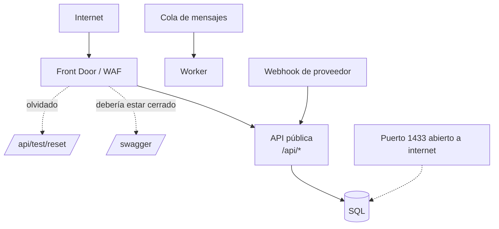

# Superficie de ataque

Parte de: [[12-Seguridad/01 Fundamentos de seguridad/_Índice Fundamentos de seguridad|Fundamentos de seguridad]]

> [!info] Cómo avanzar
> `progreso`: **pendiente** → **viendo** (estudiando) → **visto** (contestaste la autoevaluación sin abrir las respuestas) → **dominado** (hiciste el laboratorio o lo aplicaste de verdad).

## Contenido

### Qué es
La **superficie de ataque** es la suma de todos los puntos por donde un atacante puede intentar meter datos o sacar información de tu sistema: endpoints HTTP, parámetros, encabezados, cookies, archivos subidos, colas, webhooks, puertos abiertos, paneles de administración, cuentas de servicio, dependencias e incluso las personas con acceso. Cuanto más grande, más lugares hay que proteger y más probabilidad de que uno se quede sin cuidar.

### Cómo funciona
Para analizarla haces un inventario de **puntos de entrada** y, para cada uno, te preguntas: ¿quién puede llegar (anónimo, usuario, admin, red interna)?, ¿qué datos acepta?, ¿qué puede hacer o leer?, ¿qué controles tiene? El inventario sale de tu código (controllers, rutas), de tu infraestructura (reglas de red, puertos) y de tus integraciones.



Las líneas punteadas son superficie innecesaria: cada una es una puerta que nadie vigila.

**Formas de reducirla**:
1. **Quitar lo que no se usa**: endpoints viejos, versiones anteriores de la API, funcionalidades apagadas, paquetes sin uso.
2. **Restringir el alcance de red**: SQL y Key Vault con *private endpoints* o reglas de firewall, paneles de administración solo desde la red corporativa o VPN.
3. **Exigir autenticación por defecto**: política global `RequireAuthenticatedUser` y excepciones explícitas con `[AllowAnonymous]`.
4. **Deshabilitar en producción** Swagger, páginas de error detalladas y endpoints de diagnóstico.
5. **Limitar los datos de entrada**: tamaño máximo de petición, tipos de archivo permitidos, campos esperados.

### Ejemplo
Autenticación por defecto en Itzamna.Dionisio, para que un controller nuevo no quede abierto por olvido:

```csharp
builder.Services.AddAuthorization(o =>
{
    o.FallbackPolicy = new AuthorizationPolicyBuilder()
        .RequireAuthenticatedUser()
        .Build();
});

var app = builder.Build();

if (app.Environment.IsDevelopment())
{
    app.UseSwagger();
    app.UseSwaggerUI();      // solo en desarrollo
}

app.MapControllers();
```

**Por qué un endpoint "de pruebas" olvidado en producción es grave**: suele haberse escrito sin autenticación ni validación ("es solo para probar"), a veces con permisos especiales (reiniciar datos, crear usuarios, ver configuración), nadie lo monitorea porque nadie recuerda que existe y no aparece en la documentación que revisa seguridad. Los escáneres automáticos y las listas de rutas comunes lo encuentran con facilidad. Un `/api/test/reset` o un `/api/debug/config` puede ser un borrado total o una fuga de secretos con una sola petición.

Una revisión rápida: lista todas las rutas que expone tu app (por ejemplo, con un endpoint de diagnóstico solo en desarrollo que enumere `EndpointDataSource`) y compárala con lo que debería existir.

### Cuándo usarlo y cuándo no
El análisis de superficie conviene en el diseño, antes de cada salida importante y periódicamente (cada trimestre, por ejemplo). Reducirla siempre es buena idea, con un matiz: no confundas "esconder" con "reducir". Una ruta con nombre raro sigue siendo superficie.

### Errores comunes
- **Seguridad por oscuridad**: "nadie conoce esa URL".
- **Versiones viejas de la API** (`/v1`) que siguen vivas sin los controles nuevos de `/v2`.
- **Superficie interna ignorada**: colas y webhooks también reciben datos no confiables; valida igual.
- **Ambientes de prueba expuestos** con datos reales y menos controles.
- **Dependencias como superficie invisible**: cada paquete trae código que corre con los permisos de tu app.

### Para profundizar
- [OWASP Attack Surface Analysis Cheat Sheet](https://cheatsheetseries.owasp.org/cheatsheets/Attack_Surface_Analysis_Cheat_Sheet.html)
- [Autorización por políticas en ASP.NET Core](https://learn.microsoft.com/en-us/aspnet/core/security/authorization/policies)
- [Azure Private Link](https://learn.microsoft.com/en-us/azure/private-link/private-link-overview)

## Autoevaluación

Contesta primero en voz alta o en papel; luego despliega la respuesta.

> [!question]- ¿Qué es la superficie de ataque?
> El conjunto de puntos por donde un atacante puede interactuar con el sistema: endpoints, formularios, puertos abiertos, archivos subidos, dependencias, paneles de administración, personas con acceso.

> [!question]- Menciona tres formas de reducirla.
> Quitar endpoints y funciones que nadie usa; no exponer puertos de administración o bases de datos a internet; quitar dependencias innecesarias; deshabilitar Swagger en producción si no es público; acceso por red privada.

> [!question]- ¿Por qué un endpoint "de pruebas" olvidado en producción es grave?
> Suele saltarse autenticación y validaciones, nadie lo monitorea y no aparece en la documentación, así que tampoco se revisa en pruebas de seguridad.

## Práctica

- [[Lab 2 - Modelado de amenazas STRIDE de una app propia]]

