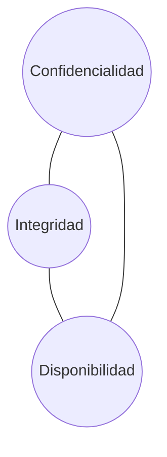

# Tríada CIA (confidencialidad, integridad y disponibilidad)

Parte de: [[12-Seguridad/01 Fundamentos de seguridad/_Índice Fundamentos de seguridad|Fundamentos de seguridad]]

> [!info] Cómo avanzar
> `progreso`: **pendiente** → **viendo** (estudiando) → **visto** (contestaste la autoevaluación sin abrir las respuestas) → **dominado** (hiciste el laboratorio o lo aplicaste de verdad).

## Contenido

### Qué es
La **tríada CIA** (por sus siglas en inglés: *Confidentiality, Integrity, Availability*) es el modelo básico para pensar qué protege la seguridad de la información:
- **Confidencialidad**: solo las personas y sistemas autorizados pueden **leer** la información.
- **Integridad**: la información solo la **modifican** quienes están autorizados y de la forma prevista; cualquier alteración no autorizada se previene o se detecta.
- **Disponibilidad**: la información y el servicio están **accesibles** cuando los usuarios legítimos los necesitan.

Sirve para clasificar amenazas y controles, y para preguntar en cada diseño "¿qué pasa si se rompe cada pilar?".

### Cómo funciona
Cada pilar tiene sus amenazas y controles típicos:

| Pilar | Amenazas | Controles |
|---|---|---|
| Confidencialidad | Fuga por SQL injection, IDOR, logs con datos, robo de respaldos | Autorización, cifrado (TLS, TDE), mínimo privilegio, enmascarado |
| Integridad | Alterar precios en la petición, manipular tokens, inyección que modifica datos | Validación del lado del servidor, hashes, firmas digitales, HMAC, auditoría, control de versiones |
| Disponibilidad | DoS, consultas sin límite, ransomware, borrado accidental, caída de región | Rate limiting, paginación, réplicas, respaldos probados, escalamiento |

Los pilares se tensionan entre sí: cifrar todo con llaves que se pueden perder protege la confidencialidad pero amenaza la disponibilidad; tener diez réplicas mejora la disponibilidad pero multiplica los lugares donde hay que proteger la confidencialidad. El diseño busca el equilibrio según el valor de cada dato.

**¿Qué control protege sobre todo la integridad?** El **hash y la firma** (o el HMAC). El cifrado protege la confidencialidad (aunque los modos autenticados como AES-GCM también detectan alteraciones), y la réplica protege la disponibilidad: de hecho, una réplica copia fielmente un dato corrupto o alterado.



### Ejemplo
**Ransomware que cifra tu base de datos**: afecta claramente la **disponibilidad** (no puedes usar los datos) y la **integridad** (los datos fueron modificados sin autorización). Los grupos actuales casi siempre **extraen** los datos antes de cifrarlos para extorsionar con publicarlos, así que también suele romperse la **confidencialidad**. Por eso los respaldos (que recuperan disponibilidad) no resuelven todo el incidente.

Aplicado a un endpoint de Itzamna.Dionisio que confirma un pedido:

```csharp
[HttpPost("{id:int}/confirmar")]
[Authorize(Policy = "Ventas")]                     // Confidencialidad e integridad: solo quien debe
[EnableRateLimiting("por-usuario")]                // Disponibilidad: evita abuso
public async Task<IActionResult> Confirmar(int id, CancellationToken ct)
{
    var tenant = User.FindFirst("tenant")!.Value;
    // Integridad: el total se recalcula en el servidor, no se acepta el del cliente
    var resultado = await confirmar.EjecutarAsync(id, tenant, ct);
    return resultado.Ok ? NoContent() : Problem(statusCode: 409, extensions: new Dictionary<string, object?> { ["codigo"] = resultado.Codigo });
}
```

### Cuándo usarlo y cuándo no
Úsala como primera clasificación al modelar amenazas, al priorizar incidentes y al hablar con negocio ("si esto falla, ¿qué perdemos?"). Para análisis más finos se complementa con otras propiedades: autenticidad, no repudio y responsabilidad (*accountability*), que STRIDE cubre mejor. Ver [[Mentalidad de seguridad y modelado de amenazas]].

### Errores comunes
- **Pensar solo en confidencialidad.** Muchos equipos protegen bien la lectura y olvidan que un dato alterado (un precio, un permiso) puede ser peor que uno filtrado.
- **Creer que respaldos = seguridad.** Si no se prueban restauraciones, la disponibilidad es una suposición.
- **Ignorar la disponibilidad como tema de seguridad**: un reporte que bloquea la base durante horas es un riesgo, aunque no haya atacante.
- **Confiar en datos de integridad que vienen del cliente** (totales, roles, ids de tenant).

### Para profundizar
- [NIST Glossary: Confidentiality, Integrity, Availability](https://csrc.nist.gov/glossary/term/cia_triad)
- [Rate limiting en ASP.NET Core](https://learn.microsoft.com/en-us/aspnet/core/performance/rate-limit)

## Autoevaluación

Contesta primero en voz alta o en papel; luego despliega la respuesta.

> [!question]- Define cada elemento de la tríada CIA.
> **Confidencialidad**: solo quien debe puede leer el dato. **Integridad**: el dato no se altera sin autorización (o se detecta). **Disponibilidad**: el sistema y los datos están accesibles cuando se necesitan.

> [!question]- Un ataque de ransomware cifra tu base de datos. ¿Qué pilares afecta?
> Disponibilidad (no puedes usar los datos) y, si además los exfiltran para extorsionar, confidencialidad. Respaldo fuera de línea y probado es la defensa principal de la disponibilidad.

> [!question]- ¿Qué control protege sobre todo la integridad: cifrado, hash/firma o réplica?
> Hash con llave (HMAC) o firma digital: detectan cambios. El cifrado protege confidencialidad y la réplica, disponibilidad.

## Práctica

- [[Lab 2 - Modelado de amenazas STRIDE de una app propia]]

