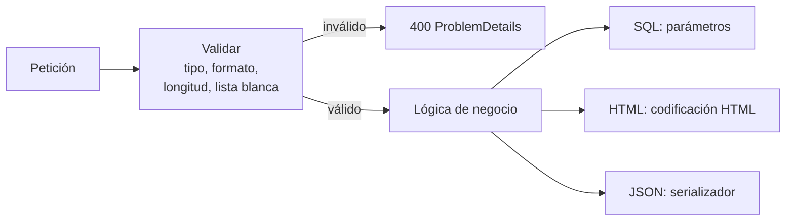

# Validación de entrada, codificación de salida y listas blancas

Parte de: [[12-Seguridad/01 Fundamentos de seguridad/_Índice Fundamentos de seguridad|Fundamentos de seguridad]]

> [!info] Cómo avanzar
> `progreso`: **pendiente** → **viendo** (estudiando) → **visto** (contestaste la autoevaluación sin abrir las respuestas) → **dominado** (hiciste el laboratorio o lo aplicaste de verdad).

## Contenido

### Qué es
Son tres técnicas distintas que suelen confundirse:
- **Validación de entrada**: comprobar, al **recibir** un dato, que tiene el tipo, formato, longitud y rango esperados para el negocio, y rechazarlo si no. Responde "¿este dato tiene sentido?".
- **Codificación de salida** (*output encoding*): transformar un dato al **enviarlo** a otro intérprete (HTML, JavaScript, URL, SQL, shell) para que se trate como texto y no como código. Responde "¿cómo pongo este dato aquí sin que cambie el significado?".
- **Listas blancas** (*allowlists*): definir explícitamente lo **permitido** y rechazar todo lo demás.

La diferencia clave: la validación depende del **negocio** y ocurre una vez a la entrada; la codificación depende del **contexto de destino** y ocurre cada vez que el dato sale hacia un intérprete. Un mismo nombre "O'Brien & Hijos" es una entrada válida, y aun así necesita codificación distinta si va a HTML, a una URL o a un atributo.

### Cómo funciona


**¿Por qué listas blancas y no listas negras?** Una lista negra intenta enumerar lo prohibido ("rechaza `<script>`", "rechaza `DROP`"), y siempre se queda corta: existen otras etiquetas, mayúsculas mezcladas, codificaciones alternativas y caracteres que nadie previó. Además bloquea datos legítimos (el apellido O'Brien, un texto que menciona "drop"). Una lista blanca define un conjunto pequeño y conocido (estos tres valores de orden, este patrón de código postal, estos tipos de archivo), así que lo inesperado se rechaza por defecto.

**¿Dónde validar?** En el **back**, siempre. La validación del front (formularios de React) es para la **experiencia de usuario**: avisa rápido y evita viajes al servidor. Pero cualquiera puede llamar tu API sin pasar por tu front, así que la validación que protege es la del servidor.

### Ejemplo
Validación con FluentValidation en Itzamna.Dionisio:

```csharp
public sealed record CrearClienteCommand(string Nombre, string? Rfc, string CodigoPostal, string Tipo);

public sealed class CrearClienteValidator : AbstractValidator<CrearClienteCommand>
{
    private static readonly string[] TiposPermitidos = ["persona", "empresa"]; // lista blanca

    public CrearClienteValidator()
    {
        RuleFor(x => x.Nombre).NotEmpty().MaximumLength(120);
        RuleFor(x => x.Rfc).Matches(@"^[A-ZÑ&]{3,4}\d{6}[A-Z0-9]{3}$")
            .When(x => x.Rfc is not null).WithErrorCode("RFC_INVALIDO");
        RuleFor(x => x.CodigoPostal).Matches(@"^\d{5}$").WithErrorCode("CP_INVALIDO");
        RuleFor(x => x.Tipo).Must(t => TiposPermitidos.Contains(t)).WithErrorCode("TIPO_INVALIDO");
    }
}
```

Codificación de salida en el front (Itzamna.Clio) y en JavaScript sin framework:

```tsx
// React codifica el texto automáticamente
<td>{cliente.nombre}</td>
```

```js
// JS sin framework: textContent trata el dato como texto
celda.textContent = cliente.nombre;
```

**¿Validar la entrada te protege completamente de XSS?** No. Muchos datos válidos contienen caracteres especiales para HTML (comillas, `&`, `<` en un comentario técnico), y hay datos que llegan por otras vías (importaciones, otra app que escribe en la misma base, datos viejos). La defensa principal contra XSS es la **codificación de salida según el contexto**; la validación reduce la superficie, no la sustituye. Lo mismo con SQL: la defensa es parametrizar. Ver [[XSS - codificación de salida según el contexto]] y [[SQL injection - consultas parametrizadas]].

### Cuándo usarlo y cuándo no
- **Validación**: en todo límite de confianza (API, colas, archivos importados).
- **Codificación**: cada vez que un dato se inserta en un lenguaje interpretado; prefiere las APIs que lo hacen por ti (parámetros, Razor, React, `textContent`).
- **Listas blancas**: siempre que el conjunto de valores válidos sea finito o tenga un formato estricto. Para texto libre (comentarios) no aplica: ahí valida longitud y codifica a la salida.

### Errores comunes
- **"Sanitizar" la entrada quitando caracteres** y creer que con eso basta: rompe datos legítimos y no cubre todos los contextos.
- **Validar solo en el front.**
- **Codificar al guardar** en la base en lugar de al mostrar: el dato queda atado a un contexto y se codifica dos veces.
- **Expresiones regulares sin anclas** (`^...$`) que aceptan basura alrededor del patrón válido.

### Para profundizar
- [OWASP Input Validation Cheat Sheet](https://cheatsheetseries.owasp.org/cheatsheets/Input_Validation_Cheat_Sheet.html)
- [OWASP Cross Site Scripting Prevention Cheat Sheet](https://cheatsheetseries.owasp.org/cheatsheets/Cross_Site_Scripting_Prevention_Cheat_Sheet.html)
- [FluentValidation](https://docs.fluentvalidation.net/)

## Autoevaluación

Contesta primero en voz alta o en papel; luego despliega la respuesta.

> [!question]- ¿Cuál es la diferencia entre validar entrada y codificar salida?
> Validar: comprobar al recibir que el dato tiene el tipo, formato y rango esperados. Codificar: al mostrar o insertar el dato en otro contexto (HTML, SQL, URL), convertirlo para que se trate como dato y no como código. Se necesitan ambas.

> [!question]- ¿Por qué se prefieren listas blancas (permitidos) a listas negras (prohibidos)?
> Porque es imposible enumerar todas las variantes peligrosas (codificaciones, mayúsculas, caracteres Unicode). Con lista blanca solo pasa lo que conoces como válido.

> [!question]- ¿Dónde debe hacerse la validación: en el front o en el back?
> En el back siempre. La del front es solo comodidad para el usuario: cualquiera puede saltársela con curl o las DevTools.

> [!question]- ¿Validar la entrada te protege completamente de XSS?
> No. Un texto válido (un nombre con `<` o comillas) puede ser peligroso en un contexto de salida. La defensa principal de XSS es la codificación de salida según el contexto.

