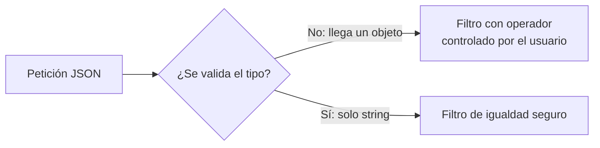

# Inyección NoSQL

Parte de: [[12-Seguridad/02 Inyección SQL/_Índice Inyección SQL|Inyección SQL]]

> [!info] Cómo avanzar
> `progreso`: **pendiente** → **viendo** (estudiando) → **visto** (contestaste la autoevaluación sin abrir las respuestas) → **dominado** (hiciste el laboratorio o lo aplicaste de verdad).

## Contenido

### Qué es
La **inyección NoSQL** ocurre cuando datos del usuario terminan modificando la **estructura** de una consulta a una base no relacional (MongoDB, Cosmos DB, CouchDB, etc.). "NoSQL" significa que no se usa SQL, no que no exista un lenguaje de consulta: Mongo tiene sus documentos de filtro con **operadores** (`$eq`, `$ne`, `$gt`, `$regex`, `$where`...), y si el atacante logra que su dato se interprete como operador en lugar de como valor, cambia el sentido de la consulta.

### Cómo funciona
Hay dos variantes conceptuales:

1. **Inyección de operadores.** La app espera un **texto** (por ejemplo, el nombre de usuario) y lo coloca en el filtro. Si el cuerpo JSON de la petición trae en ese campo un **objeto** con un operador en lugar de un texto, y la app lo pasa sin revisar el tipo, el filtro deja de comparar igualdad y pasa a expresar una condición que el atacante elige (por ejemplo, "cualquier valor distinto de vacío"). Esto es típico en Node.js con Express, donde `req.body` se deserializa a objetos arbitrarios.
2. **Inyección de sintaxis.** La app arma el filtro **concatenando texto** (`BsonDocument.Parse("{ usuario: '" + u + "' }")`) o usa operadores que evalúan JavaScript en el servidor (`$where`, `$function`), y el dato rompe la sintaxis igual que en SQL.



Las consecuencias son las mismas que en SQL: saltarse el login, leer documentos de otros usuarios o tenants, y en el caso de JavaScript del lado del servidor, consumir recursos o ejecutar lógica arbitraria.

### Ejemplo
**.NET con el driver oficial de MongoDB**: usar filtros tipados hace que el valor sea siempre un valor.

```csharp
public sealed record Usuario(string Id, string Nombre, string Tenant);

public async Task<Usuario?> BuscarAsync(IMongoCollection<Usuario> col, string nombre, string tenant)
{
    // El tipo string del parámetro impide que llegue un objeto con operadores
    var filtro = Builders<Usuario>.Filter.Eq(u => u.Nombre, nombre)
               & Builders<Usuario>.Filter.Eq(u => u.Tenant, tenant);
    return await col.Find(filtro).FirstOrDefaultAsync();
}

// Evita: armar el filtro como texto
// var f = BsonDocument.Parse("{ Nombre: '" + nombre + "' }");
```

**Node.js / JavaScript**: valida el tipo antes de consultar, por ejemplo con una librería de esquemas como zod.

```js
import { z } from "zod";

const LoginSchema = z.object({
  usuario: z.string().max(50),
  password: z.string().max(200),
});

app.post("/login", async (req, res) => {
  const r = LoginSchema.safeParse(req.body);
  if (!r.success) return res.status(400).json({ codigo: "DATOS_INVALIDOS" });
  const user = await db.collection("usuarios").findOne({ usuario: { $eq: r.data.usuario } });
  // ...comparar el hash de la contraseña en código, nunca en la consulta
});
```

Usar `$eq` explícito también fuerza la comparación de igualdad aunque el valor fuera un objeto. Mongoose ofrece la opción `sanitizeFilter`, que neutraliza operadores dentro de filtros construidos con datos del usuario.

### Cuándo usarlo y cuándo no
Aplica en cualquier base que acepte filtros estructurados o lenguajes propios, incluidas las consultas SQL de Cosmos DB (que también se parametrizan con `QueryDefinition.WithParameter`). La defensa es la misma idea de siempre: **separar código de datos** con APIs tipadas o parametrizadas, y **validar tipos** en el límite. Evita por completo `$where` y la evaluación de JavaScript en el servidor con datos del usuario.

### Errores comunes
- **Pensar que "NoSQL significa que no hay inyección".** Cambia la sintaxis, no el problema.
- **No validar tipos** en APIs JavaScript: el JSON permite objetos donde esperabas un texto.
- **Comparar contraseñas dentro de la consulta** en lugar de traer el usuario y verificar el hash en código.
- **Permitir `$regex` con texto del usuario** sin escapar: además de cambiar la búsqueda, una expresión costosa puede tumbar la base.

### Para profundizar
- [PortSwigger: NoSQL injection](https://portswigger.net/web-security/nosql-injection)
- [OWASP Injection Prevention Cheat Sheet](https://cheatsheetseries.owasp.org/cheatsheets/Injection_Prevention_Cheat_Sheet.html)
- [Consultas parametrizadas en Azure Cosmos DB](https://learn.microsoft.com/en-us/azure/cosmos-db/nosql/query/parameterized-queries)

> [!warning] Ética
> Las pruebas de esta nota se hacen solo en tu propio código, en tu máquina o en plataformas de entrenamiento (PortSwigger Web Security Academy, DVWA, OWASP Juice Shop). Ver [[Marco legal y autorización por escrito]].

## Autoevaluación

Contesta primero en voz alta o en papel; luego despliega la respuesta.

> [!question]- ¿Cómo ocurre la inyección en MongoDB conceptualmente?
> Cuando la app pasa un objeto recibido del cliente directo al filtro de la consulta: el usuario puede mandar un objeto con operadores de consulta en lugar de un valor simple y cambiar el significado del filtro.

> [!question]- ¿Cómo se defiende?
> Validar tipos con un esquema (que un campo sea string, no objeto), construir filtros con los builders del driver usando valores tipados, no aceptar operadores del cliente y evitar ejecutar JavaScript del lado del servidor.

> [!question]- ¿"NoSQL" significa "no hay inyección"?
> No. Cambia el lenguaje, pero el problema de mezclar datos con la estructura de la consulta existe igual.

