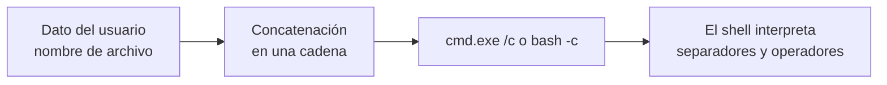

# Inyección de comandos del sistema operativo

Parte de: [[12-Seguridad/02 Inyección SQL/_Índice Inyección SQL|Inyección SQL]]

> [!info] Cómo avanzar
> `progreso`: **pendiente** → **viendo** (estudiando) → **visto** (contestaste la autoevaluación sin abrir las respuestas) → **dominado** (hiciste el laboratorio o lo aplicaste de verdad).

## Contenido

### Qué es
La **inyección de comandos** (*OS command injection*) ocurre cuando una aplicación arma una línea de comandos para el sistema operativo (cmd, PowerShell, bash) con datos del usuario, y esos datos logran agregar **comandos u opciones** que el desarrollador no previó. El intérprete de comandos tiene caracteres especiales para encadenar, redirigir o sustituir comandos; si el dato los contiene y llega al shell, el shell los obedece.

### Cómo funciona
El patrón vulnerable siempre tiene la misma forma: un programa invoca un **shell** y le pasa una sola cadena formada por texto fijo más datos variables.



El problema aparece en dos lugares:
1. **Pasar por el shell** (`cmd.exe /c`, `bash -c`, `UseShellExecute = true`): el shell reinterpreta todo el texto.
2. **Argumentos sin separar**: aunque no haya shell, si el dato empieza con un guion, el programa puede tomarlo como **opción** (inyección de argumentos) y cambiar su comportamiento.

**Por qué es tan grave**: el comando corre con la identidad y permisos del proceso de tu aplicación. Eso suele significar leer archivos de configuración y secretos, escribir en disco, descargar y ejecutar herramientas, moverse a otros servidores de la red y, si el proceso corre con permisos elevados, tomar el equipo completo. Es ejecución remota de código, el peor resultado posible.

### Ejemplo
Wee.Reporteria necesita convertir un Excel a PDF con una herramienta externa.

```csharp
// Vulnerable: cadena única que pasa por el shell
// Process.Start("cmd.exe", $"/c convertidor.exe {nombreArchivo} salida.pdf");

// Seguro: sin shell, argumentos separados, valor validado con lista blanca
public static async Task ConvertirAsync(string carpetaBase, string nombreArchivo, CancellationToken ct)
{
    if (!Regex.IsMatch(nombreArchivo, @"^[A-Za-z0-9_\-]{1,80}\.xlsx$"))
        throw new ArgumentException("Nombre de archivo no permitido", nameof(nombreArchivo));

    string ruta = Path.GetFullPath(Path.Combine(carpetaBase, nombreArchivo));
    if (!ruta.StartsWith(Path.GetFullPath(carpetaBase) + Path.DirectorySeparatorChar, StringComparison.OrdinalIgnoreCase))
        throw new ArgumentException("Ruta fuera de la carpeta permitida");

    var psi = new ProcessStartInfo("convertidor.exe")
    {
        UseShellExecute = false,          // no se invoca el shell
        RedirectStandardOutput = true,
        RedirectStandardError = true,
    };
    psi.ArgumentList.Add("--entrada");    // cada argumento por separado
    psi.ArgumentList.Add(ruta);
    psi.ArgumentList.Add("--salida");
    psi.ArgumentList.Add(Path.ChangeExtension(ruta, ".pdf"));

    using var p = Process.Start(psi)!;
    await p.WaitForExitAsync(ct);
}
```

La **defensa principal en .NET**, en orden de preferencia:
1. **No llamar procesos externos**: usa una librería de .NET para la tarea (por ejemplo `System.IO.Compression` en lugar de un zip externo, una librería de PDF en lugar de un convertidor de línea de comandos).
2. Si es inevitable, `ProcessStartInfo` con `UseShellExecute = false` y **`ArgumentList`** (cada argumento como elemento separado, sin shell).
3. **Lista blanca** de valores permitidos y ejecutable con ruta fija.
4. Proceso con **mínimo privilegio** y en un contenedor o sandbox.

### Cuándo usarlo y cuándo no
Llamar procesos del sistema operativo desde una API web es una decisión que debería justificarse en el diseño. Si la herramienta existe como librería o servicio, prefiere esa opción. Si no, aísla la ejecución en un worker separado con permisos mínimos, para que la API pública no ejecute comandos directamente.

### Errores comunes
- **Escapar a mano** caracteres especiales: cada shell tiene reglas distintas y siempre falta alguno.
- **Usar `Arguments` (una sola cadena)** en lugar de `ArgumentList`.
- **Validar con listas negras** de caracteres "peligrosos".
- **Olvidar la inyección de argumentos**: un nombre de archivo que empieza con guion.
- **Ejecutar como administrador** "para que funcione".

### Para profundizar
- [OWASP OS Command Injection Defense Cheat Sheet](https://cheatsheetseries.owasp.org/cheatsheets/OS_Command_Injection_Defense_Cheat_Sheet.html)
- [PortSwigger: OS command injection](https://portswigger.net/web-security/os-command-injection)
- [ProcessStartInfo.ArgumentList](https://learn.microsoft.com/en-us/dotnet/api/system.diagnostics.processstartinfo.argumentlist)

> [!warning] Ética
> Las pruebas de esta nota se hacen solo en tu propio código, en tu máquina o en plataformas de entrenamiento (PortSwigger Web Security Academy, DVWA, OWASP Juice Shop). Ver [[Marco legal y autorización por escrito]].

## Autoevaluación

Contesta primero en voz alta o en papel; luego despliega la respuesta.

> [!question]- ¿Qué es la inyección de comandos?
> Cuando la app arma un comando de shell con datos del usuario y el shell interpreta caracteres especiales (separadores, redirecciones) para ejecutar otros comandos.

> [!question]- Defensa principal en .NET.
> No pasar por un shell: usar `ProcessStartInfo` con `UseShellExecute = false` y `ArgumentList` (cada argumento por separado), validar el valor con lista blanca y, mejor aún, usar una librería en lugar de un ejecutable externo.

> [!question]- ¿Por qué es tan grave?
> Da ejecución de código en el servidor con los permisos del proceso: lectura de secretos, movimiento lateral, instalación de malware.

