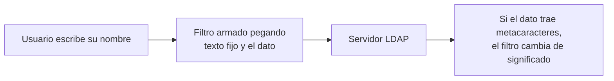

# Otras inyecciones (LDAP y XPath)

Parte de: [[12-Seguridad/02 Inyección SQL/_Índice Inyección SQL|Inyección SQL]]

> [!info] Cómo avanzar
> `progreso`: **pendiente** → **viendo** (estudiando) → **visto** (contestaste la autoevaluación sin abrir las respuestas) → **dominado** (hiciste el laboratorio o lo aplicaste de verdad).

## Contenido

### Qué es
**LDAP injection** y **XPath injection** son primas de SQL injection: el mismo problema en otros lenguajes de consulta.
- **LDAP** (*Lightweight Directory Access Protocol*) se usa para consultar directorios de usuarios como Active Directory. Sus filtros tienen una sintaxis con paréntesis, operadores lógicos y comodines.
- **XPath** es el lenguaje para seleccionar nodos de un documento XML.

**Lo que tienen en común con SQL injection**: la aplicación arma la consulta **concatenando** texto fijo con datos del usuario, y los caracteres especiales del lenguaje (paréntesis, asteriscos, comillas, operadores) permiten cambiar la **estructura** del filtro en lugar de solo su valor. El resultado típico es el mismo: saltarse una autenticación o leer entradas que no deberías.

### Cómo funciona


En LDAP, los caracteres con significado en un filtro (RFC 4515) son el asterisco (comodín), los paréntesis (agrupación), la diagonal invertida (escape) y el carácter nulo. Si alguno llega sin escapar, el usuario puede ampliar la búsqueda o cerrar un grupo y agregar condiciones. En XPath pasa lo mismo con comillas y operadores como `or`.

### Ejemplo
**Defensa contra LDAP injection**: escapar los valores del filtro según el RFC 4515 y validar con lista blanca. En .NET puedes usar `System.DirectoryServices.Protocols`:

```csharp
using System.DirectoryServices.Protocols;
using System.Text;

public static class Ldap
{
    // Escape de valores en filtros LDAP según RFC 4515
    public static string EscaparFiltro(string valor)
    {
        var sb = new StringBuilder(valor.Length);
        foreach (char c in valor)
        {
            sb.Append(c switch
            {
                '\\' => @"\5c",
                '*'  => @"\2a",
                '('  => @"\28",
                ')'  => @"\29",
                '\0' => @"\00",
                _    => c.ToString()
            });
        }
        return sb.ToString();
    }

    public static SearchRequest BuscarUsuario(string baseDn, string usuario)
    {
        if (!System.Text.RegularExpressions.Regex.IsMatch(usuario, @"^[a-zA-Z0-9._-]{1,64}$"))
            throw new ArgumentException("Usuario con formato no válido");

        string filtro = $"(&(objectClass=user)(sAMAccountName={EscaparFiltro(usuario)}))";
        return new SearchRequest(baseDn, filtro, SearchScope.Subtree, "displayName", "mail");
    }
}
```

Además: la cuenta con la que la app se conecta al directorio debe tener **solo lectura** sobre la unidad organizativa que necesita, y la autenticación de usuarios debe hacerse con un *bind* con sus credenciales o, mejor, delegarse a un proveedor de identidad (Entra ID, tu Xolotl.Hecate) en lugar de buscar y comparar a mano.

**Defensa contra XPath injection**: no armes expresiones XPath con texto del usuario. En .NET la alternativa más simple es **LINQ to XML**, donde el valor es siempre un valor de C#:

```csharp
using System.Xml.Linq;

XDocument doc = XDocument.Load("catalogo.xml");
string sku = entrada.Sku; // validado antes con lista blanca o patrón
var producto = doc.Descendants("producto")
                  .FirstOrDefault(p => (string?)p.Attribute("sku") == sku);
```

Si de verdad necesitas XPath, usa variables de XPath (con un `XsltContext` personalizado) o valida el dato con un patrón estricto antes de usarlo.

### Cuándo usarlo y cuándo no
Te encontrarás LDAP en integraciones con Active Directory local (login corporativo, búsqueda de empleados) y XPath en integraciones con XML heredado (facturas CFDI, servicios SOAP). En ambos casos, aplica la regla general: **API estructurada o parámetros primero, escape del contexto como segunda opción, lista blanca siempre**. Cuando proceses XML de terceros, revisa también [[XXE]].

### Errores comunes
- **Asumir que solo SQL tiene inyección.** Cualquier intérprete que mezcle código y datos la tiene.
- **Escapar con las reglas del contexto equivocado**: el escape de un filtro LDAP es distinto al de un DN (RFC 4514).
- **Cuenta de servicio con permisos de administrador** del directorio.
- **Aceptar comodines** en búsquedas de login.

### Para profundizar
- [OWASP LDAP Injection Prevention Cheat Sheet](https://cheatsheetseries.owasp.org/cheatsheets/LDAP_Injection_Prevention_Cheat_Sheet.html)
- [RFC 4515 - LDAP: String Representation of Search Filters](https://www.rfc-editor.org/rfc/rfc4515)
- [OWASP Injection Prevention Cheat Sheet](https://cheatsheetseries.owasp.org/cheatsheets/Injection_Prevention_Cheat_Sheet.html)

## Autoevaluación

Contesta primero en voz alta o en papel; luego despliega la respuesta.

> [!question]- ¿Qué tienen en común LDAP injection y XPath injection con SQL injection?
> Lo mismo: se arma una consulta (filtro LDAP o expresión XPath) concatenando datos del usuario y los caracteres especiales cambian su lógica.

> [!question]- ¿Cómo te defiendes de LDAP injection?
> Escapando los caracteres especiales del filtro LDAP con una función de la librería (según RFC 4515), validando con lista blanca y usando una cuenta de servicio con permisos de solo lectura limitados.

> [!question]- ¿Y de XPath injection?
> Usando variables en la expresión en lugar de concatenar (en Java existe `XPathVariableResolver`; en .NET requiere un `XsltContext` propio) o, si no es posible, validando el valor con lista blanca estricta. Nunca pegues texto del usuario en la expresión.

