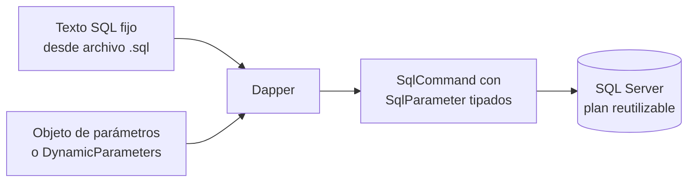

# SQL injection - Dapper y parámetros

Parte de: [[12-Seguridad/02 Inyección SQL/_Índice Inyección SQL|Inyección SQL]]

> [!info] Cómo avanzar
> `progreso`: **pendiente** → **viendo** (estudiando) → **visto** (contestaste la autoevaluación sin abrir las respuestas) → **dominado** (hiciste el laboratorio o lo aplicaste de verdad).

## Contenido

### Qué es
**Dapper** es un micro-ORM: ejecuta el SQL que tú escribes y mapea los resultados a objetos. No genera SQL por ti, así que la protección contra inyección depende de cómo le pases los datos. La regla es simple: **el texto SQL es fijo y los valores viajan en el objeto de parámetros**. Dapper convierte cada propiedad de ese objeto en un `DbParameter` y el motor la trata como dato, nunca como código.

### Cómo funciona
Hay dos formas de pasar parámetros:

1. **Objeto anónimo** (la más común): cada propiedad se empareja con un `@Nombre` en el SQL.
2. **`DynamicParameters`**: cuando necesitas **armar los parámetros según condiciones** (filtros opcionales), usar **parámetros de salida o de retorno** de un procedimiento, o **fijar tipo y tamaño** (`DbType`, `size`) para evitar conversiones implícitas.



Otros detalles útiles:
- **Listas en `IN`**: Dapper expande automáticamente `WHERE Id IN @Ids` cuando `Ids` es una colección, generando un parámetro por elemento. Para listas muy grandes, usa un *table-valued parameter*.
- **Cadenas**: por defecto se envían como `nvarchar`. Si la columna es `varchar`, usa `DbString { IsAnsi = true, Length = 50 }` para evitar conversiones que impidan usar índices.
- **Procedimientos**: `commandType: CommandType.StoredProcedure` y el nombre del procedimiento como texto.

### Ejemplo
Con tu convención de **SQL en archivos `.sql` y una interfaz por consulta** (vertical slice):

```sql
-- Features/Pedidos/Buscar/BuscarPedidos.sql
SELECT Id, Folio, Total, Estado, Fecha
FROM app.Pedidos
WHERE TenantId = @TenantId
  AND (@Estado IS NULL OR Estado = @Estado)
  AND (@Desde  IS NULL OR Fecha  >= @Desde)
ORDER BY Fecha DESC
OFFSET @Salto ROWS FETCH NEXT @Tamano ROWS ONLY;
```

```csharp
public interface IBuscarPedidos
{
    Task<IReadOnlyList<PedidoDto>> EjecutarAsync(BuscarPedidosQuery q, string tenant, CancellationToken ct);
}

internal sealed class BuscarPedidos(IDbConnectionFactory db, ISqlArchivos sql) : IBuscarPedidos
{
    public async Task<IReadOnlyList<PedidoDto>> EjecutarAsync(BuscarPedidosQuery q, string tenant, CancellationToken ct)
    {
        using var cn = await db.AbrirAsync(ct);
        var cmd = new CommandDefinition(
            sql.Leer("Pedidos/Buscar/BuscarPedidos.sql"),
            new
            {
                TenantId = tenant,
                q.Estado,                         // null si no se filtra
                q.Desde,
                Salto = (q.Pagina - 1) * q.Tamano,
                q.Tamano
            },
            cancellationToken: ct);
        return (await cn.QueryAsync<PedidoDto>(cmd)).AsList();
    }
}
```

El patrón `(@Estado IS NULL OR Estado = @Estado)` resuelve filtros opcionales **sin armar SQL dinámico**: el mismo texto sirve para todas las combinaciones de filtros, y cada valor viaja como parámetro. Si ese patrón da un mal plan de ejecución en tablas grandes (porque el optimizador genera un plan único para todas las combinaciones), la alternativa es construir el `WHERE` con fragmentos de texto fijos y `DynamicParameters`, concatenando solo el fragmento (`" AND Estado = @Estado"`) y nunca el valor:

```csharp
var sb = new StringBuilder("SELECT Id, Total FROM app.Pedidos WHERE TenantId = @TenantId");
var p = new DynamicParameters(new { TenantId = tenant });
if (q.Estado is not null) { sb.Append(" AND Estado = @Estado"); p.Add("Estado", q.Estado, DbType.AnsiString, size: 20); }
if (q.Desde  is not null) { sb.Append(" AND Fecha >= @Desde");  p.Add("Desde",  q.Desde,  DbType.DateTime2); }
```

Procedimiento almacenado con parámetro de salida:

```csharp
var p = new DynamicParameters(new { TenantId = tenant, ClienteId = id });
p.Add("Total", dbType: DbType.Int32, direction: ParameterDirection.Output);
var pedidos = await cn.QueryAsync<PedidoDto>("app.Pedidos_ListarPorCliente", p,
    commandType: CommandType.StoredProcedure);
int total = p.Get<int>("Total");
```

### Cuándo usarlo y cuándo no
Siempre que uses Dapper, todos los valores van como parámetros, incluidos los que "vienen de confianza" (otra tabla, un token, una cola). Lo que **no** se puede parametrizar (nombres de columnas, dirección de orden, nombres de tabla) se resuelve con listas blancas. Ver [[SQL injection - listas blancas para ORDER BY y nombres de columnas]].

### Errores comunes
- **Interpolar con `$"..."` dentro del SQL**: Dapper recibe una cadena ya armada y no puede proteger nada. Ver [[SQL injection - concatenación de cadenas, la causa raíz]].
- **Concatenar el valor al armar filtros opcionales** en lugar de concatenar solo el fragmento fijo con su `@Parametro`.
- **No validar tipos antes**: pasar `Request.Query["id"]` como string es seguro frente a inyección, pero conviene convertirlo y validarlo para responder 400 con ProblemDetails.
- **`nvarchar` contra columnas `varchar`**: no es un problema de seguridad, pero degrada el rendimiento.

### Para profundizar
- [Dapper (repositorio oficial)](https://github.com/DapperLib/Dapper)
- [OWASP Query Parameterization Cheat Sheet](https://cheatsheetseries.owasp.org/cheatsheets/Query_Parameterization_Cheat_Sheet.html)
- [Configurar parámetros en ADO.NET](https://learn.microsoft.com/en-us/dotnet/framework/data/adonet/configuring-parameters-and-parameter-data-types)

## Ejercicios

Resuélvelos en papel o en la herramienta; la solución está plegada.

> [!question]- Arma con Dapper una búsqueda con filtros opcionales `estado` y `desde` sin concatenar valores.
> ```csharp
> var sql = new StringBuilder("SELECT Id, Total FROM Pedidos WHERE TenantId = @TenantId");
> var p = new DynamicParameters(new { TenantId = tenant });
> if (estado is not null) { sql.Append(" AND Estado = @Estado"); p.Add("Estado", estado); }
> if (desde is not null)  { sql.Append(" AND Fecha >= @Desde");  p.Add("Desde", desde); }
> var r = await cn.QueryAsync<Pedido>(sql.ToString(), p);
> ```

> [!question]- ¿Es seguro esto? `cn.Query("SELECT * FROM T WHERE Id = @Id", new { Id = Request.Query["id"] })`
> Sí respecto a inyección: el valor va como parámetro. Aun así conviene convertir y validar a `int` antes, para devolver 400 con entradas inválidas.

## Autoevaluación

Contesta primero en voz alta o en papel; luego despliega la respuesta.

> [!question]- ¿Cómo se pasan parámetros en Dapper?
> Con un objeto anónimo o `DynamicParameters`:
> ```csharp
> var c = await cn.QuerySingleOrDefaultAsync<Cliente>(
>     "SELECT * FROM Clientes WHERE Id = @Id", new { Id = id });
> ```

> [!question]- ¿Cuándo usarías `DynamicParameters`?
> Cuando armas los parámetros según filtros opcionales, necesitas parámetros de salida o de retorno en un procedimiento, o quieres fijar tipo y tamaño (`DbType`, `size`).

> [!question]- ¿Cómo llamas un procedimiento almacenado con Dapper?
> ```csharp
> await cn.QueryAsync<Pedido>("dbo.Pedidos_Listar",
>     new { TenantId = tenant, ClienteId = id },
>     commandType: CommandType.StoredProcedure);
> ```

> [!question]- Error común con filtros opcionales en Dapper.
> Concatenar el valor al armar el `WHERE` dinámico. Lo correcto es concatenar solo fragmentos fijos (`" AND Estado = @Estado"`) y agregar el valor a `DynamicParameters`.

## Práctica

- [[Lab 3 - Consulta vulnerable y su corrección con Dapper]]

