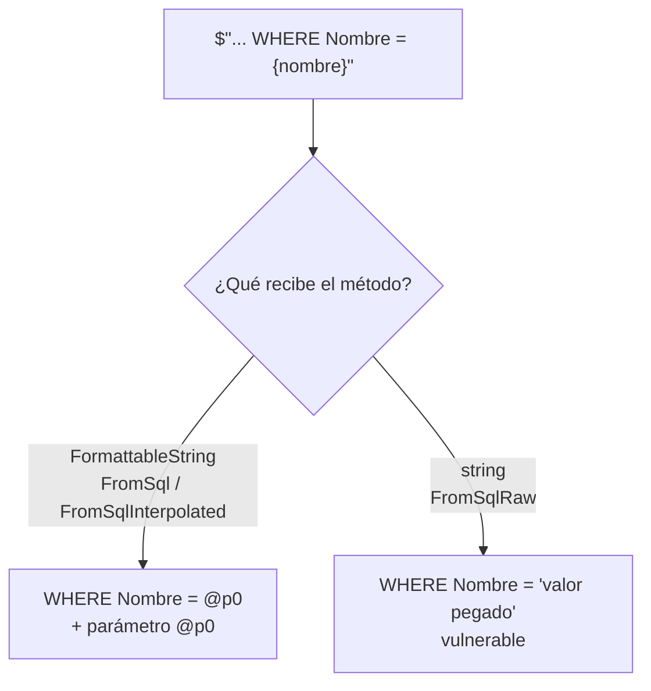

# SQL injection - EF Core (FromSqlRaw vs FromSqlInterpolated)

Parte de: [[12-Seguridad/02 Inyección SQL/_Índice Inyección SQL|Inyección SQL]]

> [!info] Cómo avanzar
> `progreso`: **pendiente** → **viendo** (estudiando) → **visto** (contestaste la autoevaluación sin abrir las respuestas) → **dominado** (hiciste el laboratorio o lo aplicaste de verdad).

## Contenido

### Qué es
**Entity Framework Core** genera SQL parametrizado cuando usas LINQ, así que la gran mayoría de las consultas son seguras sin que hagas nada. El riesgo aparece cuando escribes **SQL crudo** con los métodos que EF Core ofrece para eso. Ahí hay que distinguir dos familias:

- **`FromSqlRaw` / `ExecuteSqlRaw` / `SqlQueryRaw`**: reciben una **cadena ya armada** y una lista opcional de parámetros. Si concatenas o interpolas valores en esa cadena, son vulnerables.
- **`FromSqlInterpolated` / `ExecuteSqlInterpolated`** y, desde EF Core 7, **`FromSql` / `ExecuteSql` / `SqlQuery`**: reciben un `FormattableString`. EF Core separa el texto de los valores interpolados y convierte cada `{valor}` en un `DbParameter`.

### Cómo funciona
La diferencia está en el **tipo** que recibe el método. Una cadena interpolada `$"..."` se puede convertir en `string` (ya armada) o en `FormattableString` (texto con huecos más la lista de valores). Si el método recibe `FormattableString`, EF Core ve los huecos y los parametriza. Si recibe `string`, la interpolación ocurre antes y EF Core solo ve el resultado.



### Ejemplo
```csharp
// Vulnerable: la interpolación arma el string antes de llegar a FromSqlRaw
var vulnerable = await ctx.Clientes
    .FromSqlRaw($"SELECT * FROM app.Clientes WHERE Nombre = '{nombre}'")
    .ToListAsync(ct);

// Seguro: FromSql (EF Core 7+) recibe FormattableString y parametriza
var seguro = await ctx.Clientes
    .FromSql($"SELECT * FROM app.Clientes WHERE Nombre = {nombre} AND TenantId = {tenant}")
    .ToListAsync(ct);

// También seguro: FromSqlRaw con marcadores y parámetros explícitos
var conParametros = await ctx.Clientes
    .FromSqlRaw("SELECT * FROM app.Clientes WHERE Nombre = {0}", nombre)
    .ToListAsync(ct);

// O con SqlParameter tipado
var p = new SqlParameter("@nombre", SqlDbType.NVarChar, 120) { Value = nombre };
var conSqlParameter = await ctx.Clientes
    .FromSqlRaw("SELECT * FROM app.Clientes WHERE Nombre = @nombre", p)
    .ToListAsync(ct);
```

**Por qué el primer caso es vulnerable**: aunque se ve casi igual al segundo, `FromSqlRaw` recibe un `string`. El compilador resuelve la interpolación y pega el valor dentro de las comillas. Si `nombre` contiene una comilla, cierra la cadena literal y lo que sigue se interpreta como SQL. Las comillas alrededor de `{nombre}` son otra señal de alarma: con `FromSql` nunca se ponen comillas, porque el valor es un parámetro.

**¿Las consultas LINQ normales son seguras?** Sí, en lo que respecta a inyección: `ctx.Clientes.Where(c => c.Nombre == nombre)` genera `WHERE [c].[Nombre] = @__nombre_0`. Lo mismo `EF.Functions.Like(c.Nombre, $"%{texto}%")`, porque el patrón completo viaja como parámetro (aunque el usuario puede incluir comodines `%` y `_`; si importa, escápalos). LINQ no te protege de errores de **autorización**: si olvidas filtrar por tenant, la consulta es segura y aun así devuelve datos de otros.

### Cuándo usarlo y cuándo no
- **LINQ** por defecto.
- **`FromSql` / `SqlQuery`** cuando necesitas SQL que LINQ no expresa bien (funciones de ventana, hints, CTE complejas).
- **`FromSqlRaw`** solo cuando el texto SQL debe armarse dinámicamente (por ejemplo, una columna de orden), y en ese caso los identificadores salen de una **lista blanca** y los valores siguen como parámetros.
- En tus proyectos con Dapper el principio es idéntico. Ver [[SQL injection - Dapper y parámetros]].

### Errores comunes
- **Cambiar `FromSql` por `FromSqlRaw`** para "arreglar" un error de compilación y dejar la interpolación.
- **Extraer la cadena interpolada a una variable `string`** antes de pasarla: `var sql = $"..."; ctx.Clientes.FromSql(sql)` ya no compila con `FromSql`, y con `FromSqlRaw` compila pero es vulnerable.
- **Poner comillas alrededor de los huecos** con `FromSql`.
- **Asumir que el analizador lo detecta siempre**: EF Core incluye advertencias para algunos casos, pero no todos. Revísalo en el PR.

### Para profundizar
- [Consultas SQL en EF Core (Microsoft Learn)](https://learn.microsoft.com/en-us/ef/core/querying/sql-queries)
- [OWASP SQL Injection Prevention Cheat Sheet](https://cheatsheetseries.owasp.org/cheatsheets/SQL_Injection_Prevention_Cheat_Sheet.html)

## Autoevaluación

Contesta primero en voz alta o en papel; luego despliega la respuesta.

> [!question]- ¿Diferencia entre `FromSqlRaw` y `FromSqlInterpolated`?
> `FromSqlInterpolated` (y `FromSql` en versiones recientes) recibe un `FormattableString` y convierte cada `{valor}` en parámetro. `FromSqlRaw` recibe texto: es seguro solo si usas marcadores `{0}` o `SqlParameter` y no concatenas.

> [!question]- ¿Por qué esto es vulnerable?
```csharp
var sql = $"SELECT * FROM Clientes WHERE Nombre = '{n}'";
ctx.Clientes.FromSqlRaw(sql);
```
> La interpolación se resolvió en un `string` antes de llamar `FromSqlRaw`; EF ya no puede parametrizar. Usa `ctx.Clientes.FromSql($"SELECT * FROM Clientes WHERE Nombre = {n}")`.

> [!question]- ¿Las consultas LINQ normales de EF Core son seguras?
> Sí, EF genera SQL parametrizado. El riesgo aparece con SQL crudo (`FromSqlRaw`, `ExecuteSqlRaw`) y con nombres de columna dinámicos.

