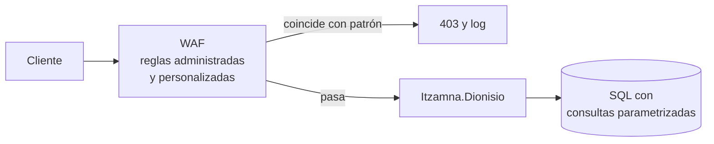

# SQL injection - WAF como capa adicional

Parte de: [[12-Seguridad/02 Inyección SQL/_Índice Inyección SQL|Inyección SQL]]

> [!info] Cómo avanzar
> `progreso`: **pendiente** → **viendo** (estudiando) → **visto** (contestaste la autoevaluación sin abrir las respuestas) → **dominado** (hiciste el laboratorio o lo aplicaste de verdad).

## Contenido

### Qué es
Un **WAF** (*Web Application Firewall*) es un filtro que inspecciona las peticiones HTTP **antes** de que lleguen a tu aplicación y bloquea las que coinciden con patrones de ataque conocidos. En Azure se ofrece en **Application Gateway** y en **Azure Front Door**, con conjuntos de reglas administrados basados en el OWASP Core Rule Set (CRS) o en el Default Rule Set de Microsoft.

Contra SQL injection, el WAF detecta fragmentos típicos de SQL en parámetros, cuerpo, encabezados y cookies, y puede **registrar** (modo detección) o **bloquear** (modo prevención) la petición.

### Cómo funciona


Las reglas de inyección SQL buscan palabras clave, operadores, comentarios y estructuras típicas, y asignan una **puntuación de anomalía**. Si la petición supera un umbral, se bloquea. Puedes ajustar exclusiones para campos legítimos que disparan falsos positivos (por ejemplo, un campo de comentarios donde la gente escribe sobre SQL).

**Por qué no sustituye a las consultas parametrizadas**:
- **Trabaja con firmas**: un atacante puede usar codificaciones, sintaxis alternativa o fragmentar la carga para evadir patrones. Las reglas se mejoran, y también las técnicas de evasión.
- **No entiende tu aplicación**: no sabe que cierto campo termina en una consulta y otro no, ni qué es normal en tu negocio.
- **No ve todo el tráfico**: datos que llegan por colas, archivos importados, otra app que escribe en la misma base o la inyección de segundo orden nunca pasan por el WAF.
- **Falsos positivos**: en la práctica, los equipos agregan exclusiones y la capa se debilita.
- Si la consulta está parametrizada, la inyección **no es posible** sin importar qué traiga la petición. El WAF reduce la probabilidad; la parametrización elimina la causa.

### Ejemplo
Política de WAF en Front Door definida con Bicep (fragmento simplificado):

```bicep
resource waf 'Microsoft.Network/FrontDoorWebApplicationFirewallPolicies@2022-05-01' = {
  name: 'wafDionisioProd'
  location: 'global'
  sku: { name: 'Premium_AzureFrontDoor' }
  properties: {
    policySettings: {
      enabledState: 'Enabled'
      mode: 'Detection'   // empieza en detección; pasa a 'Prevention' tras revisar falsos positivos
    }
    managedRules: {
      managedRuleSets: [
        { ruleSetType: 'Microsoft_DefaultRuleSet', ruleSetVersion: '2.1', ruleSetAction: 'Block' }
      ]
    }
  }
}
```

Las versiones de los conjuntos de reglas cambian; revisa en la documentación cuál es la vigente al crear la política (Pendiente de confirmar la versión más reciente). El flujo práctico es: activar en **detección**, revisar los logs en Log Analytics durante unas semanas, crear exclusiones específicas para falsos positivos y luego cambiar a **prevención**.

### Cuándo tiene sentido un WAF
- Como **capa adicional** en aplicaciones expuestas a internet, dentro de la [[Defensa en profundidad]].
- Para **ganar tiempo** con un *virtual patch* mientras corriges una vulnerabilidad conocida en el código.
- Para proteger **aplicaciones heredadas** que no puedes modificar pronto.
- Para frenar **escaneo automatizado** y bots, y reducir ruido en los logs.
- Por **requisitos de cumplimiento** (algunos estándares, como PCI DSS, lo consideran).

No tiene sentido como excusa para no corregir el código, ni dejarlo en modo detección indefinidamente sin que nadie revise los registros. Más detalle de la herramienta en [[WAF]].

### Errores comunes
- **"Tenemos WAF, no hace falta parametrizar."**
- **Dejar el WAF en detección para siempre** sin alertas ni revisión.
- **Exclusiones demasiado amplias** (desactivar toda una regla para toda la app por un campo).
- **Permitir que la app sea accesible sin pasar por el WAF**: restringe el origen para que solo acepte tráfico de Front Door.

### Para profundizar
- [Azure Web Application Firewall (Microsoft Learn)](https://learn.microsoft.com/en-us/azure/web-application-firewall/overview)
- [WAF en Azure Front Door](https://learn.microsoft.com/en-us/azure/web-application-firewall/afds/afds-overview)
- [OWASP Core Rule Set](https://coreruleset.org/)

## Autoevaluación

Contesta primero en voz alta o en papel; luego despliega la respuesta.

> [!question]- ¿Qué hace un WAF contra SQL injection?
> Inspecciona las peticiones y bloquea patrones conocidos de inyección (por ejemplo con el OWASP Core Rule Set).

> [!question]- ¿Por qué no sustituye a las consultas parametrizadas?
> Porque trabaja por firmas y heurísticas: hay evasiones con codificaciones y variantes, y también falsos positivos. La causa raíz sigue en el código.

> [!question]- ¿Cuándo tiene sentido un WAF?
> Como capa extra en apps expuestas a internet, para "parche virtual" mientras se corrige una vulnerabilidad y para frenar escaneos automatizados.

