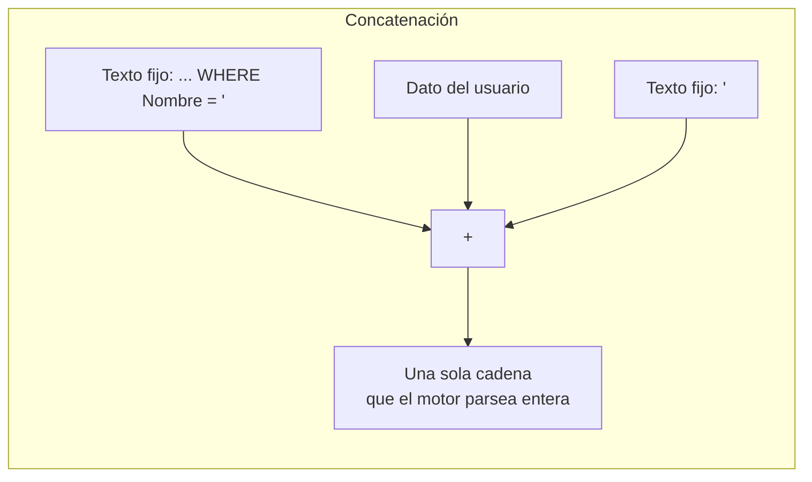

# SQL injection - concatenación de cadenas, la causa raíz

Parte de: [[12-Seguridad/02 Inyección SQL/_Índice Inyección SQL|Inyección SQL]]

> [!info] Cómo avanzar
> `progreso`: **pendiente** → **viendo** (estudiando) → **visto** (contestaste la autoevaluación sin abrir las respuestas) → **dominado** (hiciste el laboratorio o lo aplicaste de verdad).

## Contenido

### Qué es
La causa raíz de SQL injection es **construir el texto de una consulta pegando datos dentro de él**: con `+`, con `string.Format`, con `StringBuilder.Append(valor)` o con interpolación `$"..."`. En cuanto el dato forma parte del texto, el motor de base de datos ya no puede distinguir qué parte escribió el programador y qué parte escribió el usuario. Todo es SQL.

### Cómo funciona
El motor de base de datos recibe un texto y lo **analiza** (*parsea*) para saber qué hacer. Las comillas simples delimitan cadenas literales, los guiones dobles inician comentarios, el punto y coma separa instrucciones, y palabras como `OR`, `UNION` o `AND` tienen significado. Si un dato contiene esos símbolos y está pegado en el texto, el analizador los interpreta como parte de la instrucción.



Si el dato trae una comilla, **cierra antes de tiempo** la cadena literal que el programador abrió, y todo lo que viene después del dato se interpreta como más SQL. El atacante no necesita acceso a tu código: le basta con adivinar la forma aproximada de la consulta observando cómo responde la aplicación.

### Ejemplo
Cuatro formas de cometer el mismo error en C#:

```csharp
// 1. Concatenación
var sql1 = "SELECT * FROM app.Clientes WHERE Nombre = '" + nombre + "'";
// 2. string.Format
var sql2 = string.Format("SELECT * FROM app.Clientes WHERE Nombre = '{0}'", nombre);
// 3. Interpolación
var sql3 = $"SELECT * FROM app.Clientes WHERE Nombre = '{nombre}'";
// 4. Números "sin comillas": igual de vulnerable
var sql4 = $"SELECT * FROM app.Pedidos WHERE Id = {idTexto}";
```

La corrección es la misma en todos los casos: **texto fijo con marcadores y valores como parámetros**.

```csharp
const string sql = "SELECT Id, Nombre FROM app.Clientes WHERE Nombre = @Nombre AND TenantId = @TenantId";
var clientes = await cn.QueryAsync<ClienteDto>(sql, new { Nombre = nombre, TenantId = tenant });
```

**¿Escapar comillas a mano (reemplazar una comilla por dos) es suficiente?** No es confiable:
- No sirve para valores **numéricos** que van sin comillas (caso 4): el atacante no necesita comillas.
- No sirve para **identificadores** (nombres de columnas o tablas).
- Hay casos con codificaciones de caracteres, truncamiento por longitud o SQL dinámico anidado donde el escape se rompe.
- Basta **olvidarlo en un solo lugar**, y en una base de código grande alguien lo olvidará.

**¿La interpolación de C# es segura con Dapper?** No. `$"..."` produce un `string` antes de llamar a Dapper; Dapper recibe el texto ya contaminado y solo puede proteger los valores que vengan en el objeto de parámetros. EF Core es distinto porque `FromSql` recibe `FormattableString`. Ver [[SQL injection - EF Core (FromSqlRaw vs FromSqlInterpolated)]].

### Cuándo usarlo y cuándo no
Concatenar **fragmentos fijos de SQL** escritos por ti es aceptable (por ejemplo, agregar `" AND Estado = @Estado"` a un filtro opcional). Concatenar **valores** nunca lo es. Concatenar **identificadores** solo si provienen de una lista blanca en código, no del usuario. Ver [[SQL injection - listas blancas para ORDER BY y nombres de columnas]].

### Errores comunes
- **Creer que un dato es seguro porque no viene de un formulario**: encabezados, cookies, valores de otra tabla o de un archivo importado también pueden ser manipulados (inyección de segundo orden).
- **Validar con listas negras** buscando palabras como `DROP` o `OR`.
- **Mezclar**: la mayoría de la consulta parametrizada, y un valor "inocente" (un id, una fecha) concatenado.
- **Concatenar dentro de un procedimiento almacenado** con `EXEC(@sql)`: el problema se mueve a T-SQL. Ver [[SQL injection - stored procedures y SQL dinámico seguro (sp_executesql y QUOTENAME)]].

### Para profundizar
- [OWASP SQL Injection Prevention Cheat Sheet](https://cheatsheetseries.owasp.org/cheatsheets/SQL_Injection_Prevention_Cheat_Sheet.html)
- [PortSwigger: SQL injection](https://portswigger.net/web-security/sql-injection)
- [CA2100: Revisar consultas SQL para comprobar si tienen vulnerabilidades de seguridad](https://learn.microsoft.com/en-us/dotnet/fundamentals/code-analysis/quality-rules/ca2100)

> [!warning] Ética
> Las pruebas de esta nota se hacen solo en tu propio código, en tu máquina o en plataformas de entrenamiento (PortSwigger Web Security Academy, DVWA, OWASP Juice Shop). Ver [[Marco legal y autorización por escrito]].

## Autoevaluación

Contesta primero en voz alta o en papel; luego despliega la respuesta.

> [!question]- Identifica el problema:
```csharp
var sql = $"SELECT * FROM Clientes WHERE Nombre = '{nombre}'";
```
> La interpolación mete `nombre` directo en el texto SQL. Si el valor contiene una comilla, el usuario puede cerrar la cadena y agregar lógica propia. Debe ser un parámetro: `WHERE Nombre = @nombre`.

> [!question]- ¿Escapar comillas a mano (reemplazar `'` por `''`) es suficiente?
> No es confiable: falla con valores numéricos sin comillas, con codificaciones raras, con identificadores, y es fácil olvidarlo en un lugar. Usa parámetros.

> [!question]- ¿La interpolación de C# (`$"..."`) es segura con Dapper?
> No: `$"..."` arma un string antes de llegar a Dapper. Dapper solo protege los valores que pasas como objeto de parámetros. (EF Core es distinto: `FromSqlInterpolated` sí convierte la interpolación en parámetros.)

## Práctica

- [[Lab 3 - Consulta vulnerable y su corrección con Dapper]]

