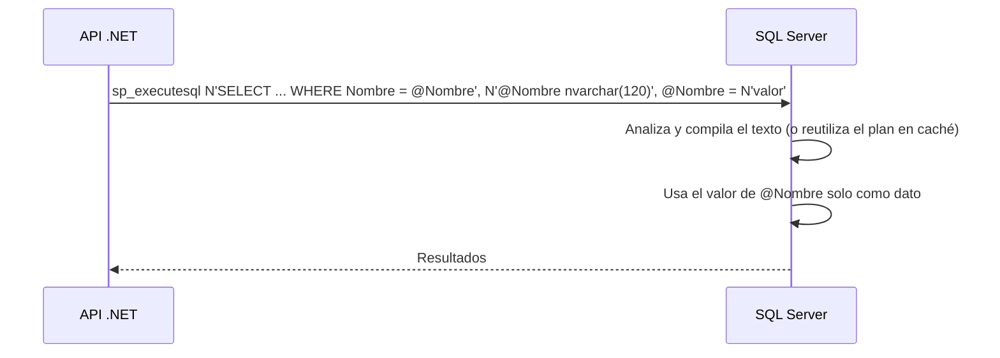

# SQL injection - consultas parametrizadas

Parte de: [[12-Seguridad/02 Inyección SQL/_Índice Inyección SQL|Inyección SQL]]

> [!info] Cómo avanzar
> `progreso`: **pendiente** → **viendo** (estudiando) → **visto** (contestaste la autoevaluación sin abrir las respuestas) → **dominado** (hiciste el laboratorio o lo aplicaste de verdad).

## Contenido

### Qué es
Una **consulta parametrizada** (o *prepared statement*) separa el **texto SQL**, que escribe el programador y no cambia, de los **valores**, que viajan aparte, cada uno con su tipo. El motor analiza y compila el texto con marcadores (`@Nombre`), y después usa los valores como datos al ejecutar. Como el texto ya se analizó, un valor nunca puede convertirse en instrucción, sin importar qué caracteres traiga. Es la **defensa principal** contra SQL injection.

### Cómo funciona


Con ADO.NET (y con Dapper encima), SQL Server recibe una llamada a `sp_executesql` con el texto, la declaración de los parámetros y sus valores por separado.

**Lo que no puedes parametrizar**: los parámetros representan **valores**, no partes de la gramática. No puedes parametrizar nombres de tablas o columnas, la dirección `ASC`/`DESC`, palabras clave ni operadores. Para eso se usan listas blancas. Ver [[SQL injection - listas blancas para ORDER BY y nombres de columnas]].

**Beneficio adicional en SQL Server**: el **reuso del plan de ejecución**. Como el texto es idéntico entre llamadas y solo cambian los valores, el motor compila una vez y reutiliza el plan desde la caché, en lugar de compilar un plan nuevo por cada valor distinto. Eso ahorra CPU y evita llenar la caché de planes de un solo uso.

### Ejemplo
**ADO.NET puro** con tipos y tamaños explícitos:

```csharp
// Antes (vulnerable): "SELECT * FROM Usuarios WHERE Correo = '" + correo + "'"
await using var cn = new SqlConnection(cadena);
await using var cmd = new SqlCommand(
    "SELECT Id, Nombre FROM app.Usuarios WHERE Correo = @Correo AND Activo = 1", cn);
cmd.Parameters.Add("@Correo", SqlDbType.NVarChar, 254).Value = correo;
await cn.OpenAsync(ct);
await using var rd = await cmd.ExecuteReaderAsync(ct);
```

**Búsqueda con `LIKE`**: el patrón completo se arma en C# y viaja como **un** parámetro; los comodines los pones tú.

```csharp
const string sql = "SELECT Id, Nombre FROM app.Clientes WHERE TenantId = @TenantId AND Nombre LIKE @Patron";
// Escapa los comodines que escriba el usuario para que busque literalmente
string texto = busqueda.Replace("[", "[[]").Replace("%", "[%]").Replace("_", "[_]");
var r = await cn.QueryAsync<ClienteDto>(sql, new { TenantId = tenant, Patron = $"%{texto}%" });
```

Ojo: aquí la interpolación arma el **valor** del parámetro, no el texto SQL; por eso es correcta.

**`IN` con una lista de ids**, tres opciones:

```csharp
// 1. Dapper expande la colección: @Ids -> (@Ids1, @Ids2, ...)
var a = await cn.QueryAsync<PedidoDto>("SELECT * FROM app.Pedidos WHERE Id IN @Ids", new { Ids = ids });

// 2. Un solo parámetro con la lista y STRING_SPLIT (SQL Server 2016+)
var b = await cn.QueryAsync<PedidoDto>(
    "SELECT p.* FROM app.Pedidos p JOIN STRING_SPLIT(@Ids, ',') s ON p.Id = CAST(s.value AS INT)",
    new { Ids = string.Join(',', ids) });

// 3. Table-valued parameter para listas grandes (requiere CREATE TYPE app.ListaIds AS TABLE (Id INT))
var tabla = new DataTable(); tabla.Columns.Add("Id", typeof(int));
foreach (var id in ids) tabla.Rows.Add(id);
var c = await cn.QueryAsync<PedidoDto>("app.Pedidos_PorIds",
    new { Ids = tabla.AsTableValuedParameter("app.ListaIds") }, commandType: CommandType.StoredProcedure);
```

**¿`AddWithValue` tiene algún problema?** No de seguridad (el valor sigue siendo un parámetro), pero **infiere el tipo** a partir del valor de .NET: un `string` se manda como `nvarchar` con la longitud exacta del valor. Eso causa dos problemas: si la columna es `varchar`, SQL Server hace una conversión implícita que puede impedir usar el índice; y como cada longitud distinta genera una declaración distinta, se llena la caché con planes casi iguales. Usa `Add` con `SqlDbType` y tamaño, o `DbString` en Dapper.

### Cuándo usarlo y cuándo no
Siempre, para todo valor, también en procedimientos y en SQL dinámico dentro de T-SQL (`sp_executesql` con parámetros). La única excepción son los identificadores y palabras clave, que se resuelven con listas blancas.

### Errores comunes
- **Parametrizar "casi todo"** y concatenar un valor que parecía inofensivo.
- **Interpolar en el texto SQL** creyendo que es un parámetro.
- **Usar `AddWithValue` en columnas `varchar` muy consultadas** y sufrir planes malos.
- **Armar `IN` concatenando ids** "porque son números": si vienen como texto, no lo son.

### Para profundizar
- [OWASP Query Parameterization Cheat Sheet](https://cheatsheetseries.owasp.org/cheatsheets/Query_Parameterization_Cheat_Sheet.html)
- [Configurar parámetros y tipos en ADO.NET](https://learn.microsoft.com/en-us/dotnet/framework/data/adonet/configuring-parameters-and-parameter-data-types)
- [STRING_SPLIT (Transact-SQL)](https://learn.microsoft.com/en-us/sql/t-sql/functions/string-split-transact-sql)

## Ejercicios

Resuélvelos en papel o en la herramienta; la solución está plegada.

> [!question]- Reescribe con parámetros (ADO.NET):
```csharp
var cmd = new SqlCommand("SELECT * FROM Pedidos WHERE ClienteId = " + id, cn);
```
> ```csharp
> var cmd = new SqlCommand("SELECT * FROM Pedidos WHERE ClienteId = @id", cn);
> cmd.Parameters.Add("@id", SqlDbType.Int).Value = id;
> ```

> [!question]- Reescribe una búsqueda con `LIKE` que hoy concatena `'%' + texto + '%'`.
> El comodín va en el valor, no en el SQL:
> ```csharp
> var sql = "SELECT Id, Nombre FROM Productos WHERE Nombre LIKE @patron";
> cmd.Parameters.Add("@patron", SqlDbType.NVarChar, 102).Value = "%" + texto + "%";
> ```
> Si no quieres que el usuario use `%` o `_` como comodines, escápalos y agrega `ESCAPE`.

> [!question]- ¿Cómo parametrizas un `IN` con una lista de ids en SQL Server?
> Opciones: con Dapper, pasar un `IEnumerable<int>` (`WHERE Id IN @ids`, Dapper expande parámetros); en T-SQL, un TVP o `STRING_SPLIT(@ids, ',')` con un parámetro de texto validado como números.

## Autoevaluación

Contesta primero en voz alta o en papel; luego despliega la respuesta.

> [!question]- ¿Por qué una consulta parametrizada evita la inyección?
> El texto del comando y los valores viajan por separado al motor. El motor compila el comando con marcadores (`@id`) y trata el valor siempre como dato, nunca como SQL.

> [!question]- ¿Qué NO puedes parametrizar?
> Identificadores: nombres de tablas, columnas, la dirección `ASC/DESC` o palabras clave. Para eso se usan listas blancas.

> [!question]- Además de seguridad, ¿qué beneficio dan los parámetros en SQL Server?
> Reutilización del plan de ejecución en caché (consultas iguales con distintos valores) y conversión de tipos correcta (fechas, decimales).

> [!question]- ¿`SqlParameter` con `AddWithValue` tiene algún problema?
> No de seguridad, pero infiere el tipo (por ejemplo `nvarchar` de longitud variable), lo que puede causar conversiones implícitas y planes malos. Es mejor declarar `SqlDbType` y tamaño.

## Práctica

- [[Lab 3 - Consulta vulnerable y su corrección con Dapper]]

