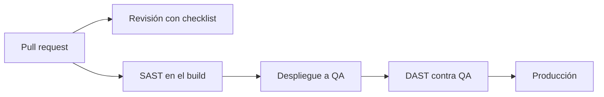

# SQL injection - cómo detectarla (revisión de código, SAST y DAST)

Parte de: [[12-Seguridad/02 Inyección SQL/_Índice Inyección SQL|Inyección SQL]]

> [!info] Cómo avanzar
> `progreso`: **pendiente** → **viendo** (estudiando) → **visto** (contestaste la autoevaluación sin abrir las respuestas) → **dominado** (hiciste el laboratorio o lo aplicaste de verdad).

## Contenido

### Qué es
Detectar SQL injection en **tu propio código** combina tres técnicas complementarias:
- **Revisión de código**: una persona lee los cambios buscando patrones peligrosos.
- **SAST** (*Static Application Security Testing*): análisis automático del código fuente **sin ejecutarlo**, que sigue el flujo de datos desde la entrada hasta la consulta.
- **DAST** (*Dynamic Application Security Testing*): pruebas automáticas contra la aplicación **en ejecución**, enviando peticiones y observando respuestas, sin ver el código.

### Cómo funciona
**Qué buscas en una revisión de código**:
- Cualquier **construcción de texto SQL con datos**: `+`, `string.Format`, `$"..."`, `StringBuilder.Append(variable)` cerca de `Query`, `Execute`, `SqlCommand`, `FromSqlRaw`, `ExecuteSqlRaw`.
- **`FromSqlRaw` con interpolación** o variables `string` que contienen SQL.
- **Procedimientos con `EXEC(@sql)`** o `sp_executesql` sin lista de parámetros.
- **`ORDER BY`, nombres de columnas o tablas** que vienen de la petición sin lista blanca.
- **Valores que vienen de "confianza"** (otra tabla, un archivo) concatenados: candidatos a segundo orden.
- **Cuentas de base con permisos excesivos** en las cadenas de conexión.

Un `grep` sirve como primer filtro en código heredado:

```bash
# Busca construcción de SQL con interpolación o concatenación cerca de llamadas de acceso a datos
git grep -nE '(Query|Execute|FromSqlRaw|ExecuteSqlRaw|SqlCommand)[A-Za-z]*\(\s*\$"' -- '*.cs'
git grep -nE '"\s*(SELECT|UPDATE|DELETE|INSERT)[^"]*"\s*\+' -- '*.cs'
git grep -nE 'EXEC\s*\(\s*@' -- '*.sql'
```

**SAST vs DAST para esto**:

| | SAST | DAST |
|---|---|---|
| Qué analiza | Código fuente | App en ejecución |
| Cuándo | En cada PR o build | En un ambiente de pruebas desplegado |
| Fortaleza | Ubica la línea exacta; cubre código que no se ejecuta en pruebas | Confirma que el problema es explotable; no depende del lenguaje |
| Debilidad | Falsos positivos; no conoce tu lógica | Solo ve lo que alcanza a recorrer; no indica la línea |

**Herramientas**: SAST como **CodeQL** (integrado en GitHub Advanced Security y en GitHub Advanced Security for Azure DevOps), **SonarQube / SonarQube Cloud**, **Semgrep**, y los analizadores de .NET como la regla **CA2100**. DAST como **OWASP ZAP** y **Burp Suite** (Community para pruebas manuales). Ver [[SAST, DAST y SCA]], [[OWASP ZAP]] y [[Burp Suite Community]].



### Ejemplo
Activar analizadores de seguridad en todos los proyectos .NET:

```xml
<!-- Directory.Build.props -->
<Project>
  <PropertyGroup>
    <AnalysisLevel>latest</AnalysisLevel>
    <AnalysisModeSecurity>All</AnalysisModeSecurity>
  </PropertyGroup>
</Project>
```

Prueba manual segura en tu propia API local (Itzamna.Dionisio en `localhost`): envía a cada parámetro de búsqueda valores con **caracteres especiales legítimos** (un apellido con apóstrofo como O'Brien, un texto con guiones dobles, un número con letras) y observa si la respuesta cambia de forma anómala: error 500, mensaje de SQL, resultados distintos a los esperados. Una API bien hecha devuelve resultados normales o un 400 de validación. Luego busca en el código la consulta de ese endpoint.

Para practicar la parte ofensiva, usa solo entornos de entrenamiento: [[Lab 4 - PortSwigger - laboratorios de SQL injection nivel Apprentice]]. Para la corrección: [[Lab 3 - Consulta vulnerable y su corrección con Dapper]].

### Cuándo usarlo y cuándo no
Las tres a la vez, en distintos momentos: revisión y SAST en cada cambio; DAST en cada despliegue a QA o al menos periódicamente. **Nunca** ejecutes DAST contra sistemas de terceros ni contra producción sin autorización por escrito y coordinación. Ver [[Marco legal y autorización por escrito]].

### Errores comunes
- **Confiar solo en una herramienta**: el SAST no ve SQL dinámico armado en procedimientos; el DAST no llega a endpoints que requieren flujos complejos.
- **Ignorar hallazgos por "falsos positivos"** sin revisarlos uno por uno.
- **Correr DAST sin autenticación**: solo prueba la superficie anónima.
- **No revisar los archivos `.sql`**: el riesgo también vive en T-SQL.

### Para profundizar
- [CodeQL](https://codeql.github.com/)
- [OWASP ZAP](https://www.zaproxy.org/)
- [CA2100 (Microsoft Learn)](https://learn.microsoft.com/en-us/dotnet/fundamentals/code-analysis/quality-rules/ca2100)
- [OWASP Code Review Guide](https://owasp.org/www-project-code-review-guide/)

> [!warning] Ética
> Las pruebas de esta nota se hacen solo en tu propio código, en tu máquina o en plataformas de entrenamiento (PortSwigger Web Security Academy, DVWA, OWASP Juice Shop). Ver [[Marco legal y autorización por escrito]].

## Autoevaluación

Contesta primero en voz alta o en papel; luego despliega la respuesta.

> [!question]- ¿Qué buscas en una revisión de código?
> Construcción de SQL con `+`, `$"..."`, `string.Format` o `StringBuilder` que meta variables; `FromSqlRaw`/`ExecuteSqlRaw` con strings armados; `EXEC(@sql)` dentro de SPs.

> [!question]- ¿Diferencia entre SAST y DAST para esto?
> SAST analiza el código fuente y sigue el flujo de datos de la entrada hasta la consulta (encuentra la línea exacta). DAST prueba la app corriendo enviando entradas y observando respuestas (confirma que es explotable, pero no dice dónde está en el código).

> [!question]- Menciona una herramienta de cada tipo.
> SAST: CodeQL, SonarQube/SonarQube Cloud, analizadores de Roslyn. DAST: [[OWASP ZAP]], [[Burp Suite Community]] (manual).

## Práctica

- [[Lab 4 - PortSwigger - laboratorios de SQL injection nivel Apprentice]]

