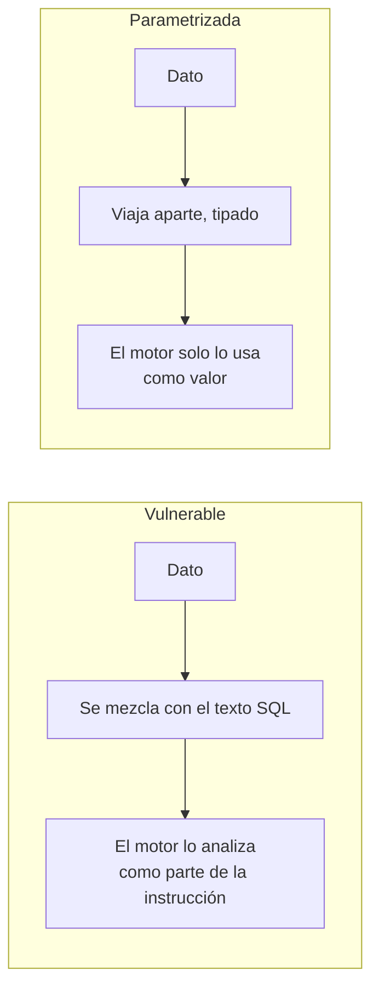

# SQL injection - cómo funciona un ataque (conceptual)

Parte de: [[12-Seguridad/02 Inyección SQL/_Índice Inyección SQL|Inyección SQL]]

> [!info] Cómo avanzar
> `progreso`: **pendiente** → **viendo** (estudiando) → **visto** (contestaste la autoevaluación sin abrir las respuestas) → **dominado** (hiciste el laboratorio o lo aplicaste de verdad).

## Contenido

### Qué es
Esta nota explica, **a grandes rasgos y desde el lado de quien defiende**, por qué una consulta vulnerable puede verse afectada por los datos del usuario. La idea es que reconozcas el código de riesgo y entiendas lo que aparece en tus logs, no que ejecutes nada. No trae valores maliciosos concretos: para practicar la parte ofensiva existen entornos hechos para eso (enlaces al final).

### Cómo funciona
El fondo del problema es que una consulta vulnerable **mezcla en un mismo texto** las instrucciones que escribió el programador y los datos que escribió el usuario (ver [[SQL injection - concatenación de cadenas, la causa raíz]]). Cuando el motor analiza ese texto, no tiene forma de saber dónde termina la instrucción y dónde empieza el dato: lo interpreta todo junto. Por eso, un dato que contiene símbolos con significado para SQL (comillas que delimitan cadenas, el separador de instrucciones, palabras reservadas) deja de comportarse como un simple valor y pasa a cambiar **qué consulta se ejecuta**.

En términos defensivos, lo que cambia respecto a una consulta parametrizada es la **frontera de confianza**:



**Qué observa alguien que prueba si un parámetro es vulnerable.** No necesita ver tu código; se guía por cómo **responde** la aplicación ante datos con caracteres especiales:
- **Mensajes de error de la base** que se filtran al usuario (una señal de que el dato llegó al motor y rompió la sintaxis). Por eso importa [[SQL injection - manejo de errores sin filtrar detalles|no mostrar los errores de SQL]].
- **Diferencias en la respuesta**: que cambie el conjunto de resultados, el tamaño de la página o aparezca un comportamiento distinto al enviar datos equivalentes pero escritos de otra forma.
- **Diferencias de tiempo**: que la respuesta tarde más o menos, lo que delata una inyección aunque no haya ni errores ni cambios visibles (la variante "ciega"; ver [[SQL injection - tipos (basada en errores, UNION, ciega y de segundo orden)]]).

Como defensor, esas mismas señales son tus **indicadores de detección**: un endpoint que empieza a arrojar errores 500 con contenido de SQL, o que recibe ráfagas de peticiones con tiempos de respuesta anómalos, merece una alerta.

**Por qué esta nota no trae ejemplos de valores maliciosos.** Porque para aprender a **defender** no hacen falta: lo que protege es parametrizar, validar y restringir permisos, y eso se entiende con el mecanismo, no con cargas listas para pegar. Practicar la explotación tiene su lugar, pero en entornos diseñados para ello (donde es legal y seguro), no en apuntes ni, mucho menos, contra sistemas reales. Reproducir cargas útiles fuera de esos entornos es ilegal y peligroso. Ver [[Qué nunca hacer]].

### Ejemplo
Cómo se traduce esto en tu trabajo diario con Itzamna.Dionisio:

```csharp
// Señal de riesgo en revisión: el dato se mezcla con el texto
// var sql = $"SELECT * FROM app.Clientes WHERE Nombre = '{nombre}'";

// Sin riesgo: el dato viaja aparte y el motor nunca lo analiza como instrucción
const string sql = "SELECT Id, Nombre FROM app.Clientes WHERE Nombre = @Nombre AND TenantId = @TenantId";
var r = await cn.QueryAsync<ClienteDto>(sql, new { Nombre = nombre, TenantId = tenant });
```

Y cómo se ve del lado de la **detección**: si tu API devuelve errores con texto de SQL, le estás dando a cualquiera justo la retroalimentación que necesita para afinar un intento. Un `ProblemDetails` genérico con un `codigo` propio y el detalle solo en el log del servidor corta esa realimentación.

### Cuándo usarlo y cuándo no
Usa este modelo mental al **revisar código** (¿el dato se mezcla con el texto?) y al **diseñar detección** (¿qué señales delatarían un intento y las estoy registrando?). Para comprobar de verdad que un endpoint resiste, hazlo en tu propia copia local o en plataformas de entrenamiento, nunca contra producción ni contra terceros.

### Errores comunes
- **Creer que "no se nota" equivale a "no es explotable"**: las variantes ciegas no muestran errores ni cambios obvios.
- **Mostrar errores de SQL al usuario** y regalar la señal de vulnerabilidad.
- **No registrar ni alertar** sobre errores 500 repetidos o patrones de tiempo anómalos.
- **Pensar que solo los formularios son entrada**: encabezados, cookies, parámetros de ruta, archivos y datos de otra tabla también llegan a SQL.

### Para profundizar
- [PortSwigger Web Security Academy: SQL injection](https://portswigger.net/web-security/sql-injection)
- [OWASP: SQL Injection](https://owasp.org/www-community/attacks/SQL_Injection)
- [OWASP SQL Injection Prevention Cheat Sheet](https://cheatsheetseries.owasp.org/cheatsheets/SQL_Injection_Prevention_Cheat_Sheet.html)

> [!warning] Ética
> Las pruebas de esta nota se hacen solo en tu propio código, en tu máquina o en plataformas de entrenamiento (PortSwigger Web Security Academy, DVWA, OWASP Juice Shop). Ver [[Marco legal y autorización por escrito]].

## Autoevaluación

Contesta primero en voz alta o en papel; luego despliega la respuesta.

> [!question]- Describe conceptualmente cómo un atacante altera una consulta vulnerable.
> Envía un valor que contiene caracteres de control del lenguaje SQL (una comilla para cerrar el literal, operadores lógicos, un separador o un comentario). Al concatenarse, la consulta deja de significar lo que quiso el programador: cambia el filtro, agrega otra consulta o ignora el resto de la condición.

> [!question]- ¿Qué observa un atacante para saber si un parámetro es vulnerable?
> Diferencias en la respuesta: errores de SQL, cambios en el número de resultados, cambios de contenido o tiempos de respuesta distintos según la condición que inyecta.

> [!question]- ¿Por qué esta nota no trae ejemplos de valores maliciosos?
> Porque el objetivo es reconocer y corregir la causa. Para practicar la explotación de forma legal usa entornos hechos para eso, como [[PortSwigger Web Security Academy]] u [[OWASP Juice Shop]] local.

## Práctica

- [[Lab 4 - PortSwigger - laboratorios de SQL injection nivel Apprentice]]

