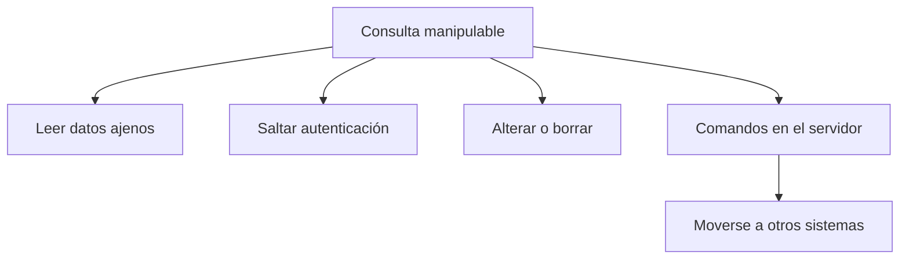

# SQL injection - impacto real

Parte de: [[12-Seguridad/02 Inyección SQL/_Índice Inyección SQL|Inyección SQL]]

> [!info] Cómo avanzar
> `progreso`: **pendiente** → **viendo** (estudiando) → **visto** (contestaste la autoevaluación sin abrir las respuestas) → **dominado** (hiciste el laboratorio o lo aplicaste de verdad).

## Contenido

### Qué es
El **impacto** de una inyección SQL es lo que un atacante puede llegar a hacer una vez que su dato altera una consulta. Entenderlo sirve para dimensionar el riesgo ante el negocio y para justificar las defensas: no es "un bug más", es una de las vías más directas a una fuga total de datos.

### Cómo funciona
Una vez que una consulta es manipulable, el daño depende de los **permisos de la cuenta** con la que la aplicación se conecta a la base y de la **información** accesible desde ahí. Cuatro impactos posibles, de menos a más grave:

1. **Lectura no autorizada (confidencialidad)**: extraer datos de otros usuarios o tenants, listas completas de clientes, credenciales (aunque estén con hash, quedan expuestas a ataques fuera de línea), datos personales y secretos. Es el caso más común y suele terminar en venta o publicación de la base.
2. **Saltarse la autenticación o la autorización**: alterar la condición de un login o de un filtro para entrar como otro usuario o como administrador.
3. **Alteración o borrado (integridad)**: modificar precios, saldos, permisos o registros, o borrar datos. Afecta la confianza en la información, no solo su secreto.
4. **Compromiso del servidor y movimiento lateral**: según el motor y la configuración, ejecutar comandos del sistema operativo, leer o escribir archivos y usar la base como punto de apoyo para alcanzar otros sistemas de la red. Es el peor escenario.

A estos se suma la **denegación de servicio**: consultas costosas que saturan la base.

**Qué determina el tamaño del daño**:
- **Permisos de la cuenta de la app**: una cuenta con solo `EXECUTE` sobre sus procedimientos limita mucho el alcance; una con `db_owner` o `sa` lo amplía a toda la base o al servidor. Ver [[SQL injection - mínimo privilegio en la cuenta de base de datos]].
- **Segmentación**: si la base está aislada en red y no alcanza otros sistemas, el movimiento lateral se complica.
- **Qué datos viven en esa base** y si están cifrados o enmascarados.
- **Detección y respuesta**: cuánto tarda la organización en notar y contener.

### Ejemplo
Dos versiones del mismo incidente en Itzamna.Dionisio, con la misma vulnerabilidad pero distinta preparación:

| | Cuenta `sa` sin monitoreo | Cuenta con mínimo privilegio y alertas |
|---|---|---|
| Alcance | Toda la base y, quizá, el servidor | Solo los procedimientos de la API |
| Datos en riesgo | Todas las tablas, otras bases | Las que esos procedimientos tocan |
| Detección | Se enteran por un tercero | Alerta por errores 500 y accesos anómalos |
| Resultado | Fuga total, posible RCE | Incidente acotado y contenido |

Esto muestra por qué la [[Defensa en profundidad]] importa aunque la causa raíz sea la misma.

**Obligaciones legales que puede disparar una fuga.** Si los datos expuestos son personales, se activan deberes bajo la [[Privacidad - ley mexicana de datos personales (LFPDPPP)|LFPDPPP]] (medidas de seguridad, informar a los titulares de vulneraciones que afecten sus derechos) y, si hay titulares en la UE, bajo el [[Privacidad - GDPR para desarrolladores|GDPR]] (notificar a la autoridad en un plazo corto y, si el riesgo es alto, a los afectados). Además de multas, hay costos de notificación, pérdida de confianza y, a veces, obligaciones contractuales con clientes.

### Cuándo usarlo y cuándo no
Usa esta nota para **comunicar riesgo** y priorizar correcciones, y para argumentar por qué el mínimo privilegio, el cifrado y el monitoreo valen la pena aunque "ya parametrizamos". No la uses para minimizar: incluso una cuenta acotada que solo lee una tabla puede provocar una fuga con consecuencias legales.

### Errores comunes
- **Medir el impacto solo por la tabla del endpoint**: con permisos amplios, una inyección en cualquier consulta alcanza toda la base.
- **Suponer que los hashes de contraseñas "no importan" si se filtran**: quedan expuestos a cracking fuera de línea; por eso deben usar algoritmos lentos con sal.
- **No tener plan de respuesta**: sin saber a quién avisar y en cuánto tiempo, se incumplen plazos legales.
- **Olvidar la integridad**: a veces alterar un dato es peor que leerlo.

### Para profundizar
- [OWASP: SQL Injection](https://owasp.org/www-community/attacks/SQL_Injection)
- [OWASP Top 10 2021 - A03 Injection](https://owasp.org/Top10/A03_2021-Injection/)
- [LFPDPPP vigente (Cámara de Diputados)](https://www.diputados.gob.mx/LeyesBiblio/pdf/LFPDPPP.pdf)

## Autoevaluación

Contesta primero en voz alta o en papel; luego despliega la respuesta.

> [!question]- Menciona cuatro impactos posibles.
> Lectura de datos de otros usuarios o tablas completas; saltarse el inicio de sesión; modificar o borrar datos; en configuraciones débiles, ejecutar comandos en el servidor (por ejemplo con `xp_cmdshell` habilitado).

> [!question]- ¿Qué determina el tamaño del daño?
> Los permisos de la cuenta con la que se conecta la app, la configuración del motor y qué datos hay en el mismo servidor. Por eso importa el mínimo privilegio.

> [!question]- ¿Qué obligaciones legales puede disparar una fuga por SQL injection?
> Notificación a los titulares y a la autoridad si hay datos personales (ver [[Privacidad y protección de datos (ley mexicana y GDPR)]]), además de daño reputacional y contractual.

## Práctica

- [[Lab 4 - PortSwigger - laboratorios de SQL injection nivel Apprentice]]

