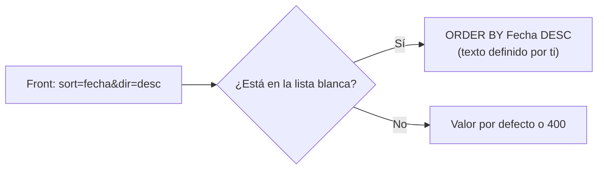

# SQL injection - listas blancas para ORDER BY y nombres de columnas

Parte de: [[12-Seguridad/02 Inyección SQL/_Índice Inyección SQL|Inyección SQL]]

> [!info] Cómo avanzar
> `progreso`: **pendiente** → **viendo** (estudiando) → **visto** (contestaste la autoevaluación sin abrir las respuestas) → **dominado** (hiciste el laboratorio o lo aplicaste de verdad).

## Contenido

### Qué es
Los parámetros protegen **valores**, pero no pueden representar partes de la gramática SQL: no puedes parametrizar un nombre de columna, un nombre de tabla ni la dirección de orden (`ASC`/`DESC`). Cuando el usuario elige "ordena por fecha descendente", ese dato termina formando parte del **texto** de la consulta, así que la defensa no son parámetros sino una **lista blanca**: un conjunto fijo, definido en código, de identificadores permitidos. Lo que no esté en la lista se rechaza.

### Cómo funciona
**Por qué no puedes parametrizar `ORDER BY @columna`**: un parámetro es un valor que el motor sustituye al ejecutar, después de haber analizado la estructura. Si escribes `ORDER BY @columna`, el motor interpreta `@columna` como un valor literal (ordenar por la constante "fecha", que es igual para todas las filas), no como el nombre de una columna. La estructura (qué columna, qué dirección) tiene que estar fija **antes** del análisis. Por eso se elige con código, no con un parámetro.

El **patrón recomendado en C#** es un **diccionario o conjunto** que mapea lo que manda el front a un fragmento de SQL de confianza, escrito por ti:



La clave es que el string que se concatena **no es el dato del usuario**, sino un valor constante que tú elegiste; el dato solo sirve de **llave** para buscarlo.

### Ejemplo
Construcción segura de `ORDER BY` a partir de `sort=fecha&dir=desc`:

```csharp
public sealed record Orden(string Sort, string Dir);

public static class OrdenPedidos
{
    // El front manda una llave; el valor es SQL de confianza escrito por mí
    private static readonly Dictionary<string, string> Columnas = new(StringComparer.OrdinalIgnoreCase)
    {
        ["fecha"]   = "Fecha",
        ["total"]   = "Total",
        ["folio"]   = "Folio",
    };

    public static string Clausula(Orden o)
    {
        // Si no está en la lista, uso un orden por defecto (también podría devolver 400)
        string columna = Columnas.TryGetValue(o.Sort, out var c) ? c : "Fecha";
        string dir = string.Equals(o.Dir, "desc", StringComparison.OrdinalIgnoreCase) ? "DESC" : "ASC";
        return $"ORDER BY {columna} {dir}";
    }
}

// Uso con Dapper: los valores siguen siendo parámetros; solo el ORDER BY sale de la lista blanca
string sql = $"SELECT Id, Folio, Total, Fecha FROM app.Pedidos WHERE TenantId = @TenantId {OrdenPedidos.Clausula(orden)}";
var r = await cn.QueryAsync<PedidoDto>(sql, new { TenantId = tenant });
```

**¿Es seguro filtrar con un `Regex` que solo acepta letras para el nombre de columna?** Es mejor que nada, pero no es la defensa correcta. Un patrón `^[A-Za-z]+$` reduce el riesgo de inyección de sintaxis, pero **no garantiza que la columna exista ni que el usuario deba poder ordenar por ella**: podría pedir ordenar por una columna sensible (`PasswordHash`, `Saldo`) y, en inyecciones ciegas basadas en orden, inferir datos observando cómo cambia el orden de los resultados. La lista blanca resuelve ambas cosas: solo expones columnas que decidiste exponer. Si combinas, usa la lista blanca como control principal y el patrón como validación extra.

**Qué haces si el valor recibido no está en la lista**: dos opciones válidas. Devolver un **400** con `ProblemDetails` y un `codigo` (`ORDEN_INVALIDO`) si quieres que el front sepa que mandó algo inválido, o aplicar un **orden por defecto** silencioso si prefieres tolerancia. Nunca la tercera opción: pasar el valor tal cual a la consulta.

### Cuándo usarlo y cuándo no
Siempre que una parte **estructural** de la consulta dependa del usuario: columna o dirección de orden, columna de filtro elegible, nombre de tabla en escenarios multi-tenant por tabla, campos de un `PIVOT` dinámico. Para **valores**, usa parámetros, no listas blancas. Si el SQL dinámico ocurre dentro de T-SQL, revisa `QUOTENAME`. Ver [[SQL injection - stored procedures y SQL dinámico seguro (sp_executesql y QUOTENAME)]].

### Errores comunes
- **Concatenar el nombre de columna tal cual** "porque es un identificador, no un valor".
- **Confiar solo en un `Regex`** y exponer columnas que no deberían ordenarse.
- **Listas blancas dispersas**: define el mapeo en un solo lugar por consulta (encaja con tu convención de una interfaz por consulta) y reúsalo.
- **Permitir varios campos de orden** concatenando una lista sin validar cada elemento.

### Para profundizar
- [OWASP SQL Injection Prevention Cheat Sheet (sección de allow-list)](https://cheatsheetseries.owasp.org/cheatsheets/SQL_Injection_Prevention_Cheat_Sheet.html)
- [QUOTENAME (Transact-SQL)](https://learn.microsoft.com/en-us/sql/t-sql/functions/quotename-transact-sql)

## Ejercicios

Resuélvelos en papel o en la herramienta; la solución está plegada.

> [!question]- Completa: el front manda `sort=fecha&dir=desc`. Construye la cláusula `ORDER BY` segura.
> ```csharp
> var col = Orden.GetValueOrDefault(sort ?? "", "Id");
> var dir = string.Equals(dirParam, "desc", StringComparison.OrdinalIgnoreCase) ? "DESC" : "ASC";
> var sql = $"SELECT Id, Nombre FROM Clientes ORDER BY {col} {dir}"; // solo valores de la lista
> ```
> Se interpola solo texto que salió de la lista blanca, nunca el valor del usuario.

> [!question]- ¿Es seguro filtrar con un `Regex` que solo acepta letras para el nombre de columna?
> Reduce el riesgo pero permite columnas que no quieres exponer (por ejemplo `PasswordHash`). La lista blanca explícita es mejor.

## Autoevaluación

Contesta primero en voz alta o en papel; luego despliega la respuesta.

> [!question]- ¿Por qué no puedes parametrizar `ORDER BY @columna`?
> Porque el parámetro es un valor, no un identificador: el motor ordenaría por una constante (no hace nada útil) o daría error. Los identificadores deben venir de una lista fija.

> [!question]- Patrón recomendado en C#.
> Un diccionario de valores permitidos a columnas reales:
> ```csharp
> static readonly Dictionary<string,string> Orden = new(StringComparer.OrdinalIgnoreCase)
> { ["nombre"] = "Nombre", ["fecha"] = "FechaAlta" };
> var col = Orden.GetValueOrDefault(sort ?? "", "Id");
> ```

> [!question]- ¿Qué haces si el valor recibido no está en la lista?
> Usar un valor por defecto o devolver 400. Nunca "pasarlo tal cual por si acaso".

## Práctica

- [[Lab 3 - Consulta vulnerable y su corrección con Dapper]]

